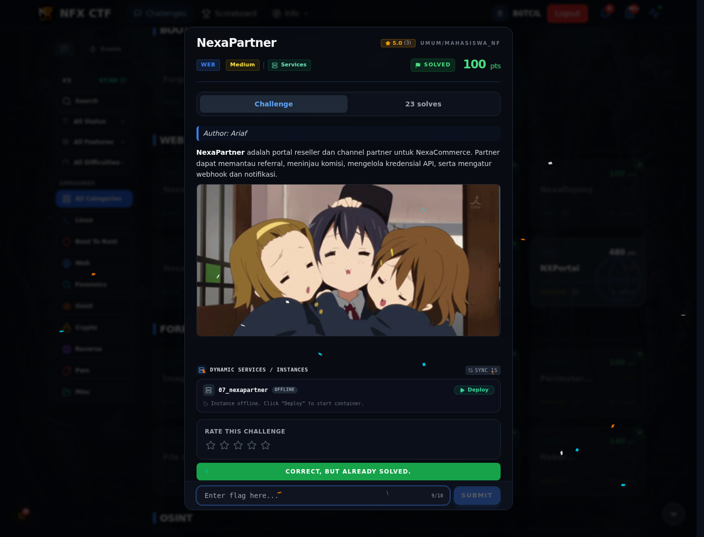

# NexaPartner — Flag & Verifikasi

[← Overview](12-nexapartner.md) · [Index](index.md)

> **Langkah 7/9 — Flag.** Flag yang sama tampil di /admin/audit setelah pollution.
>
> **Titik penting:** NFX{js0n_pr0t0_p0llut10n_4dm1n_byp4ss}
>
> **Berikutnya:** [Bukti / Evidence](12-nexapartner-08-bukti-evidence.md)

> **Flag:** `NFX{js0n_pr0t0_p0llut10n_4dm1n_byp4ss}`
> **Status:** `VERIFIED`

```text
NFX{js0n_pr0t0_p0llut10n_4dm1n_byp4ss}
```

Verifikasi:

```bash
cat flags/web/07_nexapartner.txt
# NFX{js0n_pr0t0_p0llut10n_4dm1n_byp4ss}
```

Flag yang sama tampil di `/admin/audit` setelah pollution. Tidak ada submit ke platform.

### Bukti submit di platform



*Submit flag di platform: `CORRECT, BUT ALREADY SOLVED.`*

> **Bukti submit:** screenshot form challenge di atas menampilkan `CORRECT, BUT ALREADY SOLVED.`
