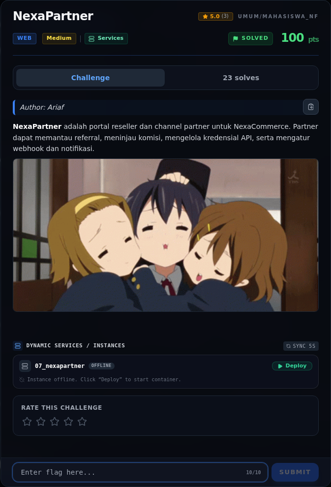
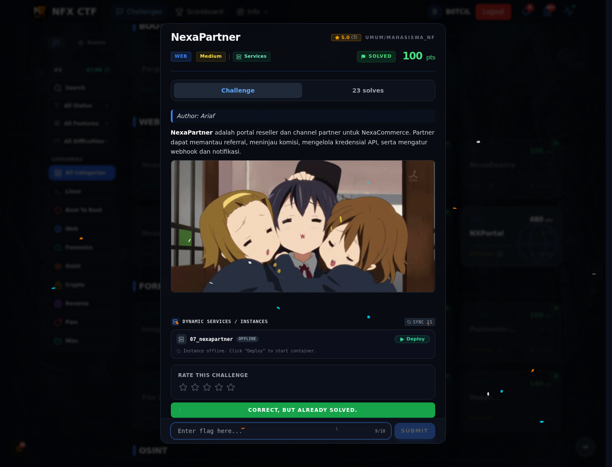
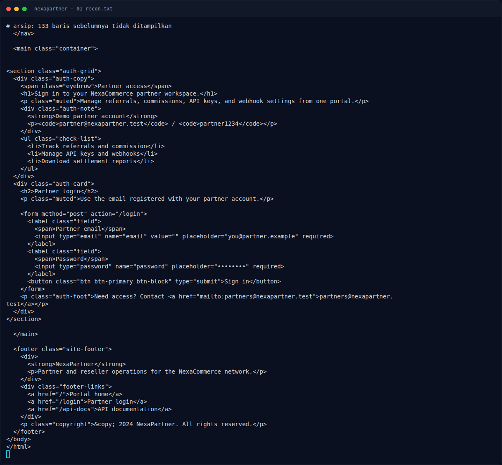
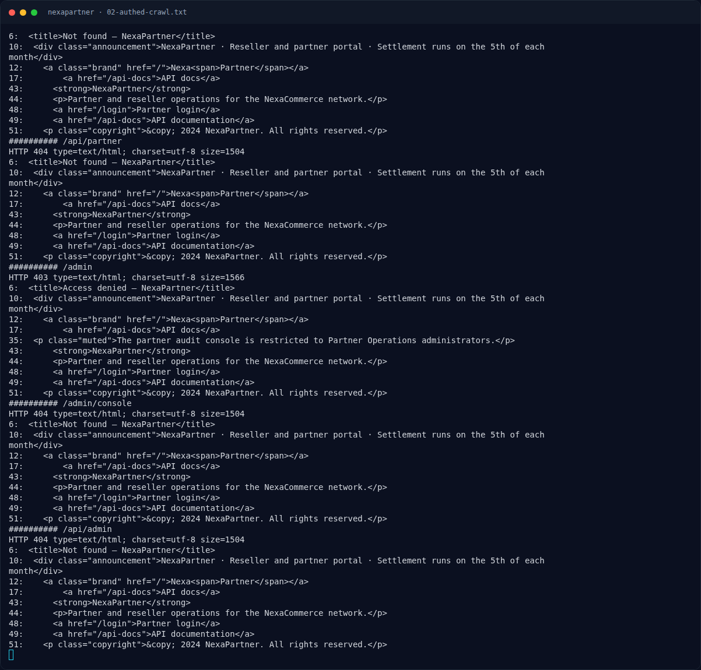
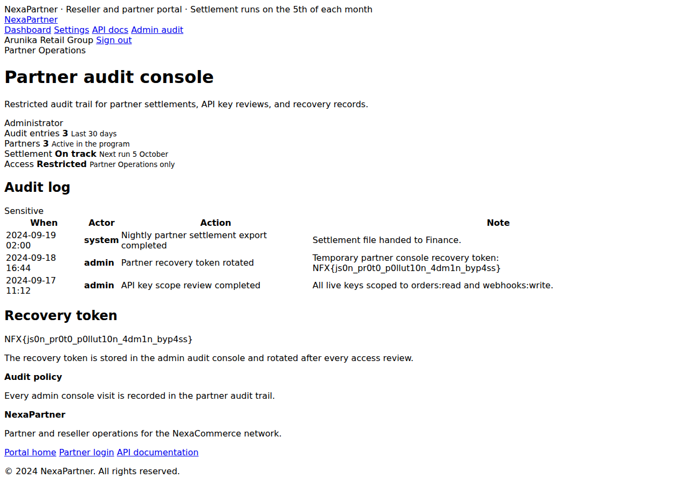

# NexaPartner — Evidence / Bukti

6 screenshot5 transkrip / script

[← Overview](12-nexapartner.md) · [Index](index.md)

## Arsip Evidence

> Semua file berasal dari `assets/nexapartner/`. Screenshot platform dan terminal adalah bukti asli dari sesi solve; transkrip mentah tetap ditautkan di bagian bawah.

### Platform

<figure><figcaption>00-challenge-platform.png</figcaption></figure>

*Challenge brief asli di platform NFX CTF 2026.*

<figure><figcaption>00b-submit-platform.png</figcaption></figure>

*Submit flag di platform: `CORRECT, BUT ALREADY SOLVED.`*

### Terminal (arsip sesi)

<figure><figcaption>term-01-recon.png</figcaption></figure>

*Terminal evidence — `01-recon.txt` (arsip transkrip sesi solve).*

<figure><figcaption>term-02-authed-crawl.png</figcaption></figure>

*Terminal evidence — `02-authed-crawl.txt` (arsip transkrip sesi solve).*

<figure><figcaption>term-03-exploit-evidence.png</figcaption></figure>

*Terminal evidence — `03-exploit-evidence.txt` (arsip transkrip sesi solve).*

### Screenshot langkah

<figure><figcaption>01-admin-audit-flag.png</figcaption></figure>

*Evidence — `01-admin-audit-flag.png`.*

### Transkrip mentah & script

- [`01-recon.txt`](assets/nexapartner/01-recon.txt)
- [`02-authed-crawl.txt`](assets/nexapartner/02-authed-crawl.txt)
- [`03-exploit-evidence.txt`](assets/nexapartner/03-exploit-evidence.txt)
- [`admin-audit.html`](assets/nexapartner/admin-audit.html)
- [`exploit_nexapartner.py`](assets/nexapartner/exploit_nexapartner.py)

## Tabel Evidence

| Bukti | File | Keterangan |
|---|---|---|
| Recon | `assets/nexapartner/01-recon.txt` | Landing, login, demo account |
| Crawl auth | `assets/nexapartner/02-authed-crawl.txt` | Dashboard, settings, api-docs, `/admin` 403 |
| Exploit evidence | `assets/nexapartner/03-exploit-evidence.txt` | `/admin` 302, audit + flag, payload |
| Admin audit HTML | `assets/nexapartner/admin-audit.html` | Flag di tabel dan recovery token |
| Screenshot | `assets/nexapartner/01-admin-audit-flag.png` | `/admin/audit` menampilkan recovery token |
| Exploit | `assets/nexapartner/exploit_nexapartner.py` | Script reproduksi |
| Hash/flag | `flags/web/07_nexapartner.txt` | Sumber flag |