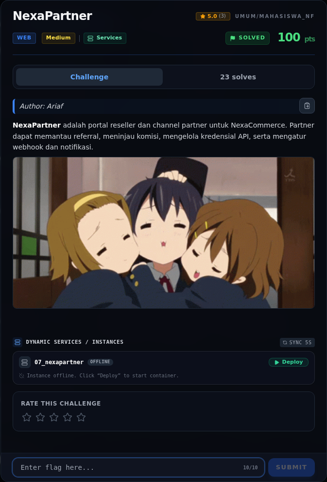

# NexaPartner — Referensi

[← Overview](12-nexapartner.md) · [Index](index.md)

> **Langkah 9/9 — Referensi.** Referensi
>
> **Titik penting:** —
>
> **Selesai.** Kembali ke [Overview](12-nexapartner.md).

- OWASP: Prototype Pollution.
- PortSwigger: Prototype pollution → privilege escalation.
- `Object.hasOwn`, `Object.create(null)`, `Map`.
- CWE-1321 (Improperly Controlled Modification of Object Prototype Attributes), CWE-915, CWE-863.

### Evidence langkah ini

*Challenge brief asli di platform NFX CTF 2026.*
