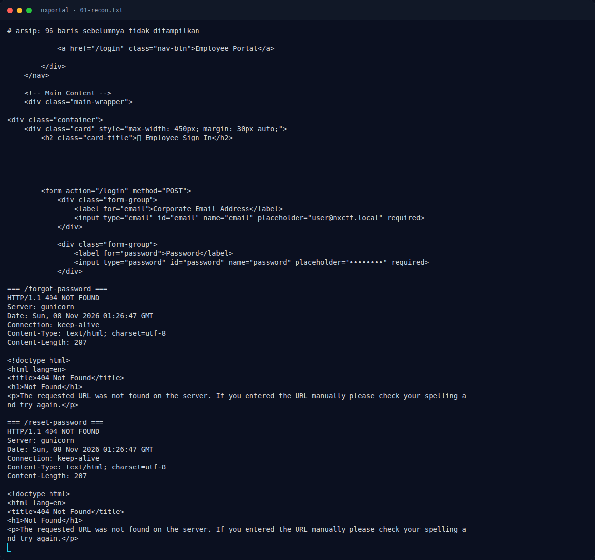

# NXPortal — Triage awal

[← Overview](13-nxportal.md) · [Index](index.md)

## 1.4 Triage awal

```bash
BASE=http://s1.nfx.my.id:40001
curl -sS -i "$BASE/"
curl -sS -i "$BASE/login"
curl -sS -i "$BASE/forgot"
curl -sS -i "$BASE/reset"
```

Temuan:
- `/` → `200`, landing NXPortal.
- `/login` → `200`, form `email` + `password`, `POST /login`.
- `/forgot` → `200`, form “Corporate Account Recovery”, `POST /forgot`.
- `/reset` → `200`, form `token` + `password`, `POST /reset`.
- `/register` → `404` (tidak ada registrasi).
- `/dashboard` tanpa session → `302 /login`.
- `/blog/5` → artikel “Hardening Header Parsing & Mail Notification Engines”.

### Evidence langkah ini



*Terminal evidence — `01-recon.txt` (arsip transkrip sesi solve).*

**Berkas mentah langkah ini:**

- [`01-recon.txt`](assets/nxportal/01-recon.txt)
