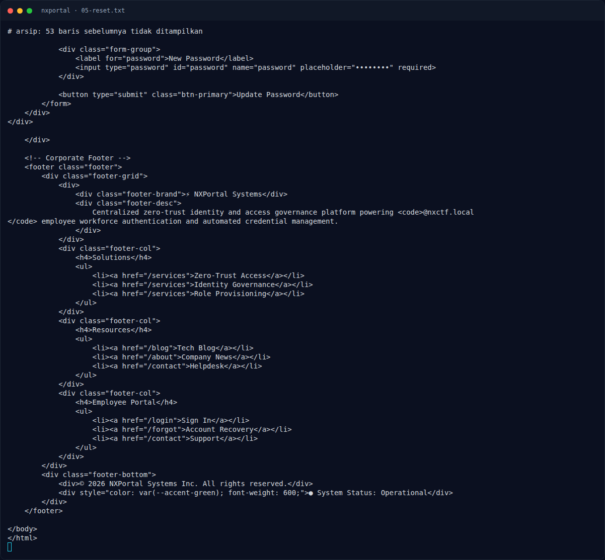

# NXPortal — Analisis

[← Overview](13-nxportal.md) · [Index](index.md)

## 2.1 Alur recovery

1. `POST /forgot` dengan `email`.
2. Server memvalidasi domain (`@nxctf.local`).
3. Server membuat token reset dan mengirim email berisi link/token.
4. User membuka `/reset`, mengisi token + password baru.
5. `POST /reset` memvalidasi token dan mengganti password.

Form `/forgot`:

```html
<form action="/forgot" method="POST">
  <input type="text" id="email" name="email" placeholder="user@nxctf.local" required>
  <button type="submit">Request Recovery Link</button>
</form>
```

Form `/reset`:

```html
<form action="/reset" method="POST">
  <input type="text" id="token" name="token" value="" placeholder="Paste reset token here" required>
  <input type="password" id="password" name="password" placeholder="••••••••" required>
  <button type="submit">Update Password</button>
</form>
```

Respons `/forgot` selalu uniform untuk email yang lolos filter:

```text
If a matching corporate account exists in our records, recovery instructions have been dispatched.
```

Email yang tidak lolos filter:

```text
Access Denied: Only corporate @nxctf.local email addresses are permitted.
```

## 2.2 Filter domain berbasis substring

Uji:

| Email | Respons | Arti |
|---|---|---|
| `employee@nxctf.local` | success | valid |
| `admin@nxctf.local` | success | valid |
| `test@example.com` | error | domain ditolak |
| `bad` | error | bukan email |
| `name@nxctf.local.yopmail.com` | success | **substring check**, bukan suffix |
| `"@nxctf.local" <attacker@external>` | success | display-name lolos |
| `attacker@nxctf.local@external` | success | double-`@` lolos |
| `attacker@external` + `\r\nBcc: attacker@external` | success | CRLF lolos |
| `attacker@external (nxctf.local)` | error | komentar tidak lolos |

Kesimpulan: pengecekan bukan `endswith('@nxctf.local')` dan bukan parser email
yang benar; ia hanya mencari substring `@nxctf.local` di string mentah.

### Evidence langkah ini



*Terminal evidence — `05-reset.txt` (arsip transkrip sesi solve).*

**Berkas mentah langkah ini:**

- [`05-reset.txt`](assets/nxportal/05-reset.txt)
