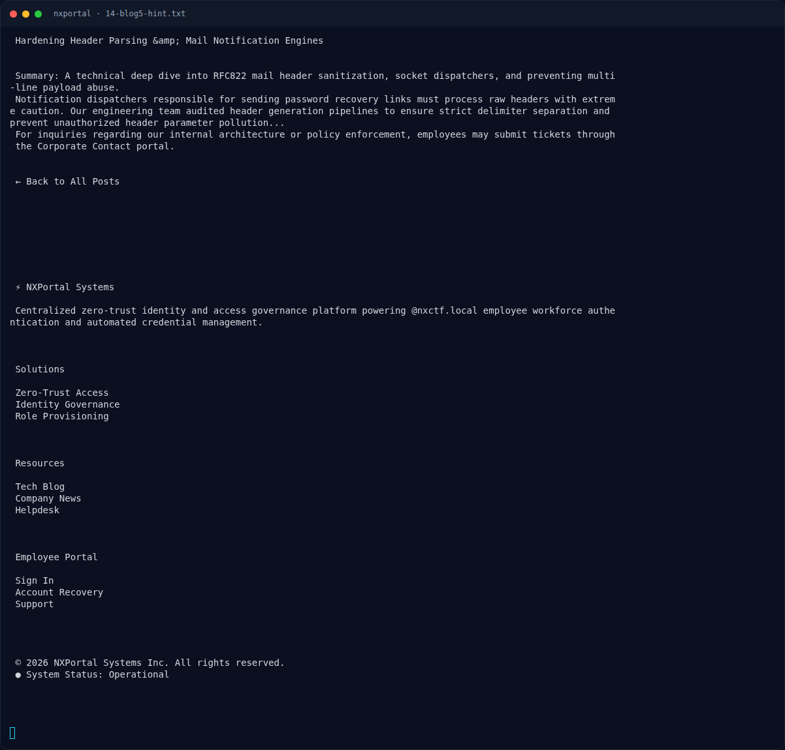

# NXPortal — Hint blog: header parsing / multi-line payload

[← Overview](13-nxportal.md) · [Index](index.md)

## 2.3 Hint blog: header parsing / multi-line payload

`/blog/5`:

```text
Hardening Header Parsing & Mail Notification Engines
Summary: A technical deep dive into RFC822 mail header sanitization, socket
dispatchers, and preventing multi-line payload abuse.

Notification dispatchers responsible for sending password recovery links must
process raw headers with extreme caution. Our engineering team audited header
generation pipelines to ensure strict delimiter separation and prevent
unauthorized header parameter pollution...
```

Ini adalah deskripsi langsung dari kelas bug:
- **RFC822 header injection**
- **multi-line payload** (`\r\n` / `\n`)
- **header parameter pollution** (`Bcc:`, `Cc:`, `To:`)
- **socket dispatcher** → kemungkinan SMTP mentah

Jika field `email` dipakai untuk menyusun header `To:` atau envelope `RCPT TO:`
tanpa sanitasi newline, penyerang dapat menambahkan recipient lain. Itulah
“permintaan pemulihan terkirim ke tujuan yang seharusnya tidak menerimanya”.

### Evidence langkah ini



*Terminal evidence — `14-blog5-hint.txt` (arsip transkrip sesi solve).*

**Berkas mentah langkah ini:**

- [`14-blog5-hint.txt`](assets/nxportal/14-blog5-hint.txt)
