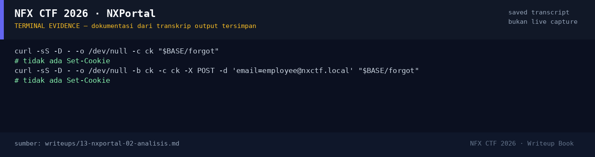

# NXPortal — Evidence / Bukti

1 screenshot14 transkrip / script

[← Overview](13-nxportal.md) · [Index](index.md)

## Arsip Evidence

> Semua file di bawah berasal dari folder `assets/nxportal/`. Screenshot ditempel langsung; file teks/script ditautkan.

### Screenshot

<figure><figcaption>98-terminal-evidence.png</figcaption></figure>

### Transkrip / file pendukung

- [`01-recon.txt`](assets/nxportal/01-recon.txt)
- [`02-forgot.txt`](assets/nxportal/02-forgot.txt)
- [`03-forgot-normal.txt`](assets/nxportal/03-forgot-normal.txt)
- [`04-route-fuzz.txt`](assets/nxportal/04-route-fuzz.txt)
- [`05-reset.txt`](assets/nxportal/05-reset.txt)
- [`06-reset-tests.txt`](assets/nxportal/06-reset-tests.txt)
- [`07-mailtm-injection.txt`](assets/nxportal/07-mailtm-injection.txt)
- [`08-login-tests.txt`](assets/nxportal/08-login-tests.txt)
- [`09-source-fuzz.txt`](assets/nxportal/09-source-fuzz.txt)
- [`10-token-guess.txt`](assets/nxportal/10-token-guess.txt)
- [`11-injection-traversal.txt`](assets/nxportal/11-injection-traversal.txt)
- [`12-misc-fuzz.txt`](assets/nxportal/12-misc-fuzz.txt)
- [`14-blog5-hint.txt`](assets/nxportal/14-blog5-hint.txt)
- [`forgot-response.html`](assets/nxportal/forgot-response.html)

## Tabel Evidence

| Bukti | File | Keterangan |
|---|---|---|
| Recon | `assets/nxportal/01-recon.txt` | Landing, login, forgot |
| Form forgot | `assets/nxportal/02-forgot.txt` | Form + validasi |
| Uji email normal | `assets/nxportal/03-forgot-normal.txt` | Success/error response |
| Route fuzz | `assets/nxportal/04-route-fuzz.txt` | `/reset` ditemukan |
| Form reset | `assets/nxportal/05-reset.txt` | Token + password |
| Uji token | `assets/nxportal/06-reset-tests.txt` | Invalid/expired |
| Uji mail.tm | `assets/nxportal/07-mailtm-injection.txt` | 6 payload, 0 messages |
| Uji login/SQLi | `assets/nxportal/08-login-tests.txt` | Semua gagal |
| Source/static fuzz | `assets/nxportal/09-source-fuzz.txt` | Tidak ada source bocor |
| Token prediction | `assets/nxportal/10-token-guess.txt` | Semua gagal |
| SQLi/traversal | `assets/nxportal/11-injection-traversal.txt` | Negatif |
| Misc fuzz | `assets/nxportal/12-misc-fuzz.txt` | Tidak ada mailbox |
| Blog hint | `assets/nxportal/14-blog5-hint.txt` | “Header Parsing & Mail Notification” |
| Catatan lama | `flags/web/NXPortal.txt` | Riwayat investigasi |