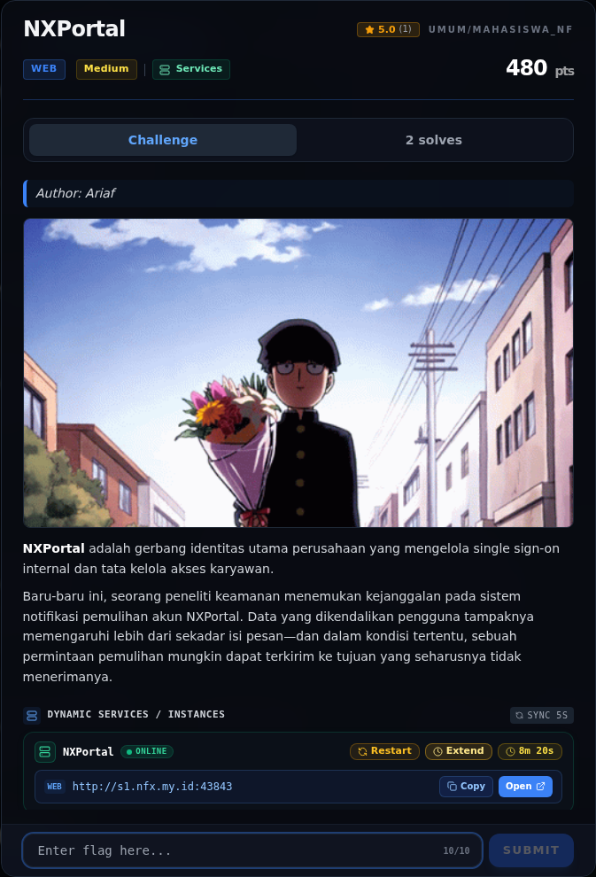

# NXPortal — Flag & Verifikasi

[← Overview](13-nxportal.md) · [Index](index.md)

> **Langkah 7/10 — Flag.** flags/web/NXPortal.txt berisi catatan investigasi, bukan flag challenge:
>
> **Titik penting:** flag belum ditemukan
>
> **Berikutnya:** [Bukti / Evidence](13-nxportal-08-bukti-evidence.md)

> **Asal flag.** Flag **belum ditemukan**; halaman ini berisi blocker, bukan flag.  
> **Tingkat bukti metode.** OPEN. [Buka Evidence](13-nxportal-08-bukti-evidence.md)

> **Flag:** **OPEN — belum ditemukan**
> **Status:** `OPEN`

**Belum ditemukan.** Status OPEN.

`flags/web/NXPortal.txt` berisi catatan investigasi, bukan flag challenge:

```text
UNSOLVED — NXPortal (web) — recheck 2026-11-08
...
- No flag placeholder (`flag_placeholder=false`), `total_solves=2`.
...
=> App still does not deliver to external sinks. Likely it only sends to the
   stored user email (local mailbox / internal MailHog) or the relay is down.
```

Tidak ada flag yang dicantumkan.

> Belum ada flag yang bisa dicantumkan. Lihat halaman Analisis dan Evidence untuk detail kendala.

## Validasi platform

**Belum ada screenshot `CORRECT, BUT ALREADY SOLVED.`** untuk NXPortal karena
flag challenge belum ditemukan. Challenge ini tetap **OPEN** dan tidak
diklaim `VERIFIED`. Screenshot yang ada hanya brief/analisis, bukan bukti
submit sukses.

### Evidence langkah ini



*Challenge brief asli di platform — `00-challenge-platform.png`.*

**Berkas mentah terkait:**

- [`02-forgot.txt`](assets/nxportal/02-forgot.txt)
- [`09-source-fuzz.txt`](assets/nxportal/09-source-fuzz.txt)
- [`06-reset-tests.txt`](assets/nxportal/06-reset-tests.txt)
