# NXPortal — Evidence / Bukti

14 screenshot14 transkrip / script

[← Overview](13-nxportal.md) · [Index](index.md)

## Arsip Evidence

> Semua file berasal dari `assets/nxportal/`. Screenshot platform dan terminal adalah bukti asli dari sesi solve; transkrip mentah tetap ditautkan di bagian bawah.

### Platform

<figure><a href="assets/nxportal/00-challenge-platform.png" target="_blank" rel="noopener">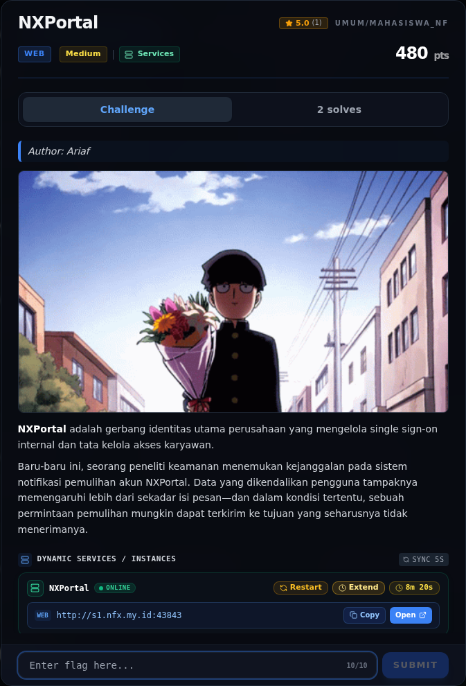</a><figcaption>00-challenge-platform.png</figcaption></figure>

*Challenge brief asli di platform NFX CTF 2026.*

### Terminal (arsip sesi)

<figure><a href="assets/nxportal/term-01-recon.png" target="_blank" rel="noopener">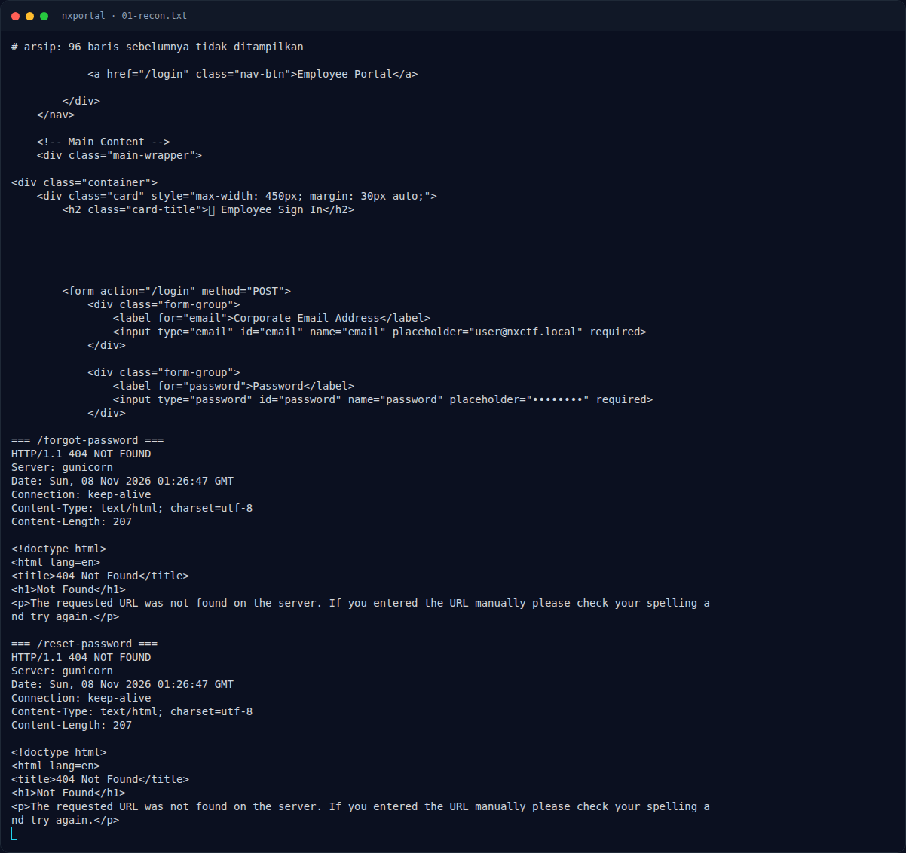</a><figcaption>term-01-recon.png</figcaption></figure>

*Terminal evidence — `01-recon.txt` (arsip transkrip sesi solve).*

<figure><a href="assets/nxportal/term-02-forgot.png" target="_blank" rel="noopener">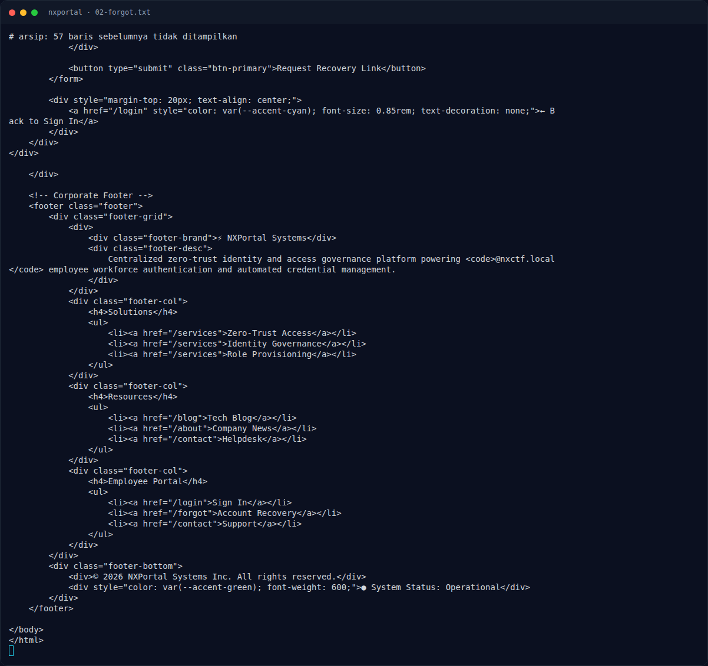</a><figcaption>term-02-forgot.png</figcaption></figure>

*Terminal evidence — `02-forgot.txt` (arsip transkrip sesi solve).*

<figure><a href="assets/nxportal/term-03-forgot-normal.png" target="_blank" rel="noopener">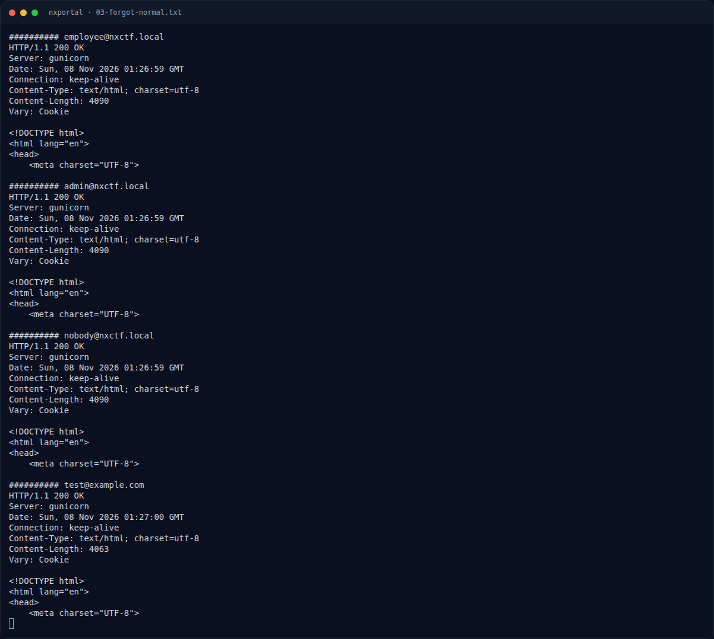</a><figcaption>term-03-forgot-normal.png</figcaption></figure>

*Terminal evidence — `03-forgot-normal.txt` (arsip transkrip sesi solve).*

<figure><a href="assets/nxportal/term-04-route-fuzz.png" target="_blank" rel="noopener">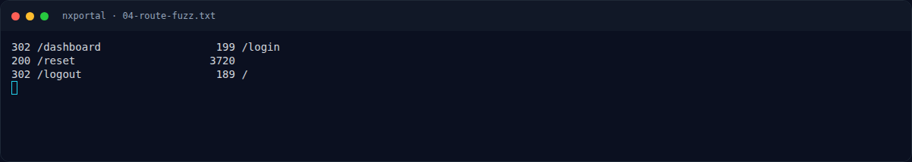</a><figcaption>term-04-route-fuzz.png</figcaption></figure>

*Terminal evidence — `04-route-fuzz.txt` (arsip transkrip sesi solve).*

<figure><a href="assets/nxportal/term-05-reset.png" target="_blank" rel="noopener">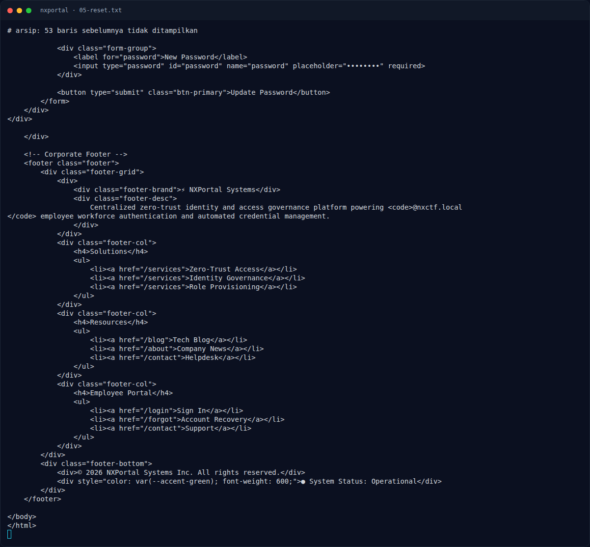</a><figcaption>term-05-reset.png</figcaption></figure>

*Terminal evidence — `05-reset.txt` (arsip transkrip sesi solve).*

<figure><a href="assets/nxportal/term-06-reset-tests.png" target="_blank" rel="noopener">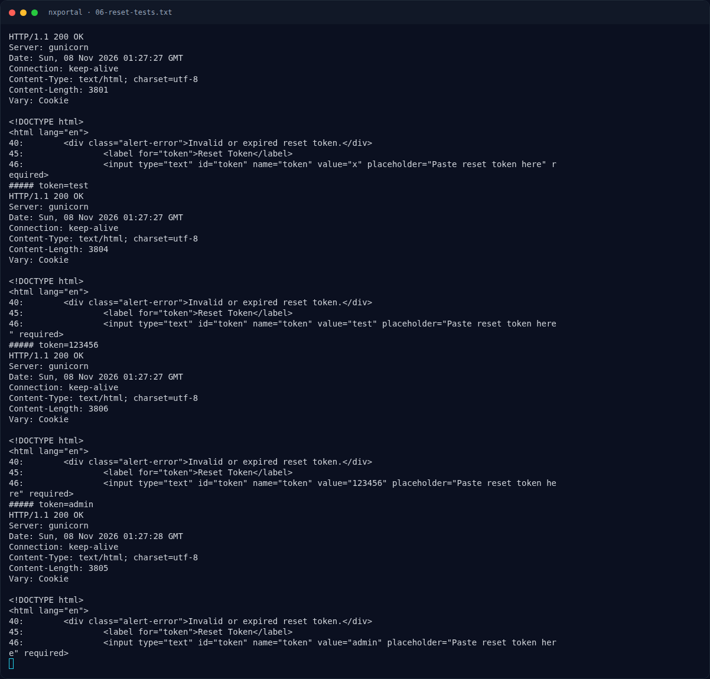</a><figcaption>term-06-reset-tests.png</figcaption></figure>

*Terminal evidence — `06-reset-tests.txt` (arsip transkrip sesi solve).*

<figure><a href="assets/nxportal/term-07-mailtm-injection.png" target="_blank" rel="noopener">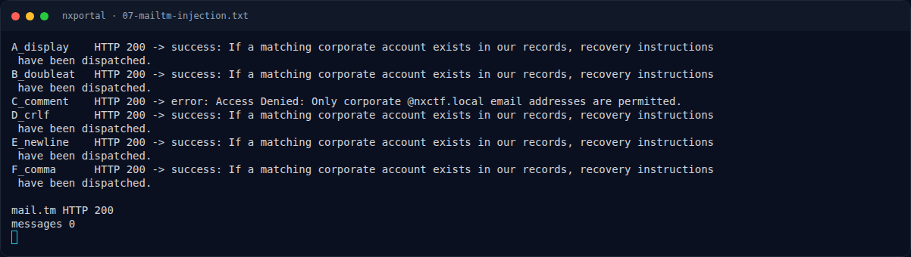</a><figcaption>term-07-mailtm-injection.png</figcaption></figure>

*Terminal evidence — `07-mailtm-injection.txt` (arsip transkrip sesi solve).*

<figure><a href="assets/nxportal/term-08-login-tests.png" target="_blank" rel="noopener">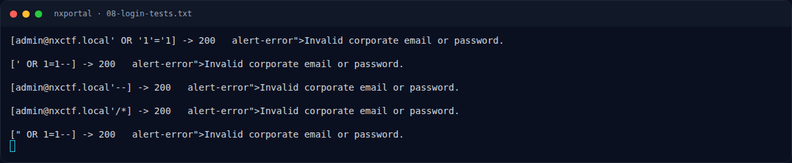</a><figcaption>term-08-login-tests.png</figcaption></figure>

*Terminal evidence — `08-login-tests.txt` (arsip transkrip sesi solve).*

<figure><a href="assets/nxportal/term-09-source-fuzz.png" target="_blank" rel="noopener">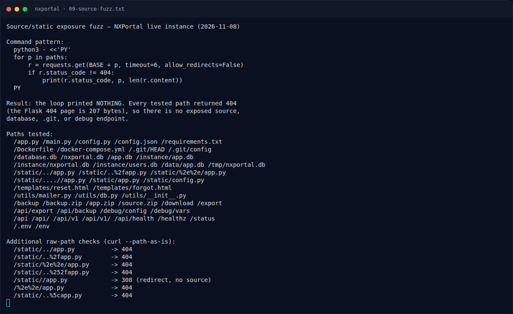</a><figcaption>term-09-source-fuzz.png</figcaption></figure>

*Terminal evidence — `09-source-fuzz.txt` (arsip transkrip sesi solve).*

<figure><a href="assets/nxportal/term-10-token-guess.png" target="_blank" rel="noopener">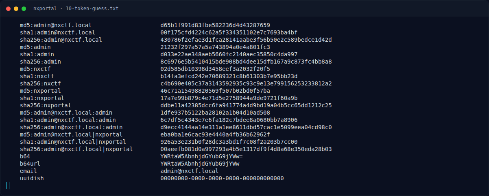</a><figcaption>term-10-token-guess.png</figcaption></figure>

*Terminal evidence — `10-token-guess.txt` (arsip transkrip sesi solve).*

<figure><a href="assets/nxportal/term-11-injection-traversal.png" target="_blank" rel="noopener">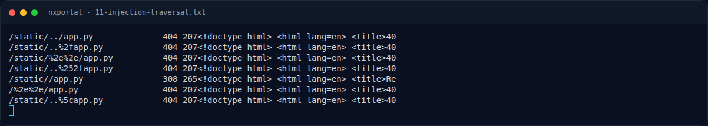</a><figcaption>term-11-injection-traversal.png</figcaption></figure>

*Terminal evidence — `11-injection-traversal.txt` (arsip transkrip sesi solve).*

<figure><a href="assets/nxportal/term-12-misc-fuzz.png" target="_blank" rel="noopener">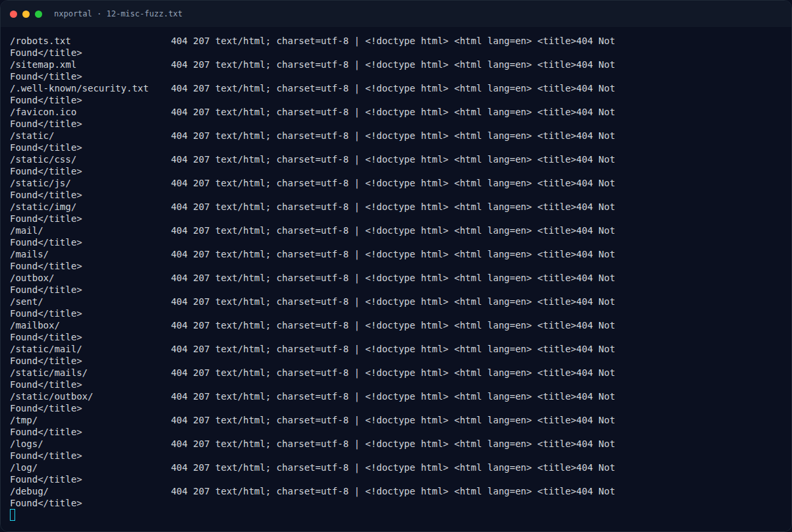</a><figcaption>term-12-misc-fuzz.png</figcaption></figure>

*Terminal evidence — `12-misc-fuzz.txt` (arsip transkrip sesi solve).*

<figure><a href="assets/nxportal/term-14-blog5-hint.png" target="_blank" rel="noopener">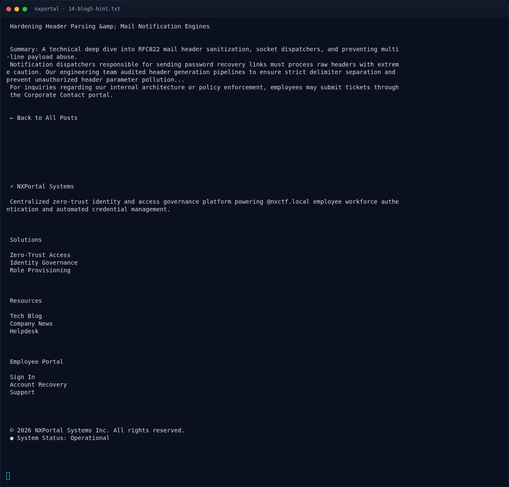</a><figcaption>term-14-blog5-hint.png</figcaption></figure>

*Terminal evidence — `14-blog5-hint.txt` (arsip transkrip sesi solve).*

### Transkrip mentah & script

- [`01-recon.txt`](assets/nxportal/01-recon.txt)
- [`02-forgot.txt`](assets/nxportal/02-forgot.txt)
- [`03-forgot-normal.txt`](assets/nxportal/03-forgot-normal.txt)
- [`04-route-fuzz.txt`](assets/nxportal/04-route-fuzz.txt)
- [`05-reset.txt`](assets/nxportal/05-reset.txt)
- [`06-reset-tests.txt`](assets/nxportal/06-reset-tests.txt)
- [`07-mailtm-injection.txt`](assets/nxportal/07-mailtm-injection.txt)
- [`08-login-tests.txt`](assets/nxportal/08-login-tests.txt)
- [`09-source-fuzz.txt`](assets/nxportal/09-source-fuzz.txt)
- [`10-token-guess.txt`](assets/nxportal/10-token-guess.txt)
- [`11-injection-traversal.txt`](assets/nxportal/11-injection-traversal.txt)
- [`12-misc-fuzz.txt`](assets/nxportal/12-misc-fuzz.txt)
- [`14-blog5-hint.txt`](assets/nxportal/14-blog5-hint.txt)
- [`forgot-response.html`](assets/nxportal/forgot-response.html)

## Tabel Evidence

| Bukti | File | Keterangan |
|---|---|---|
| Recon | `assets/nxportal/01-recon.txt` | Landing, login, forgot |
| Form forgot | `assets/nxportal/02-forgot.txt` | Form + validasi |
| Uji email normal | `assets/nxportal/03-forgot-normal.txt` | Success/error response |
| Route fuzz | `assets/nxportal/04-route-fuzz.txt` | `/reset` ditemukan |
| Form reset | `assets/nxportal/05-reset.txt` | Token + password |
| Uji token | `assets/nxportal/06-reset-tests.txt` | Invalid/expired |
| Uji mail.tm | `assets/nxportal/07-mailtm-injection.txt` | 6 payload, 0 messages |
| Uji login/SQLi | `assets/nxportal/08-login-tests.txt` | Semua gagal |
| Source/static fuzz | `assets/nxportal/09-source-fuzz.txt` | Tidak ada source bocor |
| Token prediction | `assets/nxportal/10-token-guess.txt` | Semua gagal |
| SQLi/traversal | `assets/nxportal/11-injection-traversal.txt` | Negatif |
| Misc fuzz | `assets/nxportal/12-misc-fuzz.txt` | Tidak ada mailbox |
| Blog hint | `assets/nxportal/14-blog5-hint.txt` | “Header Parsing & Mail Notification” |
| Catatan lama | `flags/web/NXPortal.txt` | Riwayat investigasi |