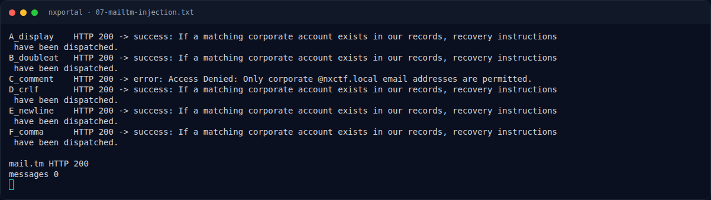

# NXPortal — Rencana Penyelesaian (OPEN)

[← Overview](13-nxportal.md) · [Index](index.md)

Prioritas:

1. **Akses mailbox internal.** Cari MailHog/Mailpit API (`/api/v2/messages`)
   pada port internal container, atau minta admin platform mengeksposnya.
   Jika email recovery disimpan di MailHog, token bisa langsung dibaca.
2. **Uji relay external.** Jika relay mengizinkan recipient eksternal, ulangi
   payload `Bcc:`/`To:` dengan inbox mail.tm/yopmail yang benar. Pastikan
   menggunakan alamat yang benar-benar valid (domain mail.tm, bukan subdomain
   `nxctf.local.yopmail.com`).
3. **Cari token leak.** Periksa log worker, file `/tmp`, database SQLite, atau
   endpoint debug. Token mungkin ditulis ke file/log yang bisa dibaca via LFI
   atau static path.
4. **Token prediction/forging.** Jika token memakai `itsdangerous` dengan secret
   lemah, brute secret umum; jika token = HMAC(email, secret), coba secret dari
   source/config challenge lain.
5. **Alternatif:** minta platform menambahkan flag placeholder atau
   mengonfirmasi seeded corporate user, seperti yang disarankan di
   `flags/web/NXPortal.txt`. Dua solver (`akudanil`, `Broel`) mungkin memiliki
   akses/leak internal; koordinasi dengan mereka.

Kriteria selesai: mendapatkan token `/reset` yang valid, mengganti password
`admin@nxctf.local`, login, dan membaca flag `NFX{...}` dari dashboard/console.

### Evidence langkah ini

*Terminal evidence — `07-mailtm-injection.txt` (arsip transkrip sesi solve).*
