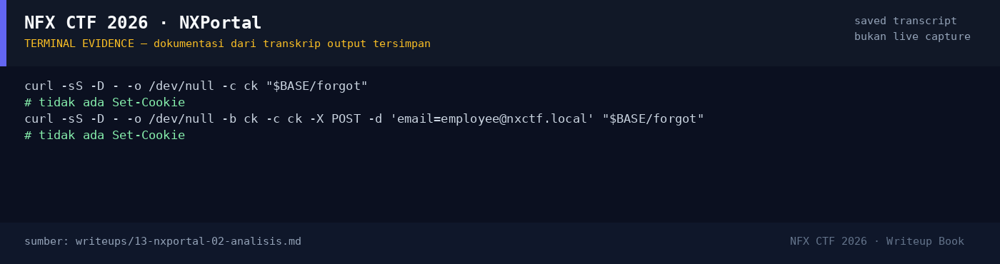

# NXPortal

Track Mahasiswa NF · WebMedium480 poinOPEN

| Field | Nilai |
|---|---|
| Event | `umum/mahasiswa_nf` |
| Kategori | `Web` |
| Difficulty | `Medium` |
| Poin | `480` |
| Author | `Ariaf` |
| Tools | curl, python3, sage, git, docker |
| Flag | **OPEN — belum ditemukan** |
| Status | `OPEN` |

[← Kembali ke Index](index.md)

> **Status: OPEN.** Halaman ini memuat analisis dan kendala yang ditemui; flag belum ditemukan.

## Ringkasan

> Catatan: `flags/web/NXPortal.txt` **bukan flag**, melainkan catatan investigasi
> (`UNSOLVED — NXPortal ...`). Tidak ada flag placeholder di platform
> (`flag_placeholder=false`). Writeup ini mendokumentasikan seluruh temuan,
> payload yang sudah dicoba, dan rencana penyelesaian. **Tidak ada flag yang
> dikarang dan tidak ada submit ke platform.**
## TL;DR

- **NXPortal** adalah gerbang identitas Flask/gunicorn dengan alur login dan
  **account recovery** (`/forgot` → email berisi token → `/reset`).
- Deskripsi challenge: data yang dikendalikan user memengaruhi lebih dari isi
  pesan, dan dalam kondisi tertentu permintaan recovery bisa terkirim ke tujuan
  yang seharusnya tidak menerimanya.
- Blog internal `/blog/5` memberi hint eksplisit: **“Hardening Header Parsing &
  Mail Notification Engines”**, “RFC822 mail header sanitization”, “preventing
  multi-line payload abuse”, dan “unauthorized header parameter pollution”.
  Ini mengarah ke **email header injection / recipient confusion** pada
  notification dispatcher.
- Filter domain `/forgot` hanya mengecek substring `@nxctf.local`. Payload
  display-name, double-`@`, dan CRLF `Bcc:`/`To:` berhasil melewati filter
  (respons `alert-success`).
- **Blocker:** instance live tidak mengirim email ke inbox eksternal (diuji
  dengan mail.tm), dan tidak ada route mailbox/MailHog/Mailpit yang terekspos.
  Port 1025/8025 dan port mail umum di host tertutup. Tanpa email/token, reset
  admin tidak dapat diselesaikan.
- Rencana penyelesaian ada di §7. Status tetap **OPEN**.

Pratinjau evidence. Buka halaman <a href="13-nxportal-05-bukti-evidence.html">Evidence / Bukti</a> untuk semua screenshot dan transkrip.

## Navigasi Halaman

<a class="nx-page-card" href="13-nxportal-01-recon.html"><b>Recon</b>Enumerasi target dan bukti awal</a>
<a class="nx-page-card" href="13-nxportal-02-analisis.html"><b>Analisis</b>Membaca alur dan akar masalah</a>
<a class="nx-page-card" href="13-nxportal-03-eksploitasi-solver-sebagian-belum-selesa.html"><b>Eksploitasi / Solver (sebagian, belum selesai)</b>Langkah exploit dan solver</a>
<a class="nx-page-card" href="13-nxportal-04-flag.html"><b>Flag</b>Flag dan verifikasi platform</a>
<a class="nx-page-card" href="13-nxportal-05-bukti-evidence.html"><b>Bukti / Evidence</b>Screenshot, transkrip, dan artefak</a>
<a class="nx-page-card" href="13-nxportal-06-rencana-penyelesaian-open.html"><b>Rencana Penyelesaian (OPEN)</b>Rencana penyelesaian (OPEN)</a>
<a class="nx-page-card" href="13-nxportal-07-referensi.html"><b>Referensi</b>Sumber dan bacaan lanjutan</a>

