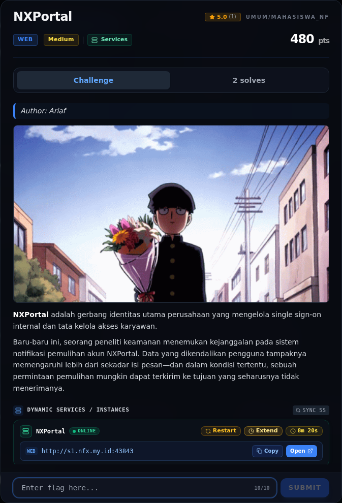

# NXPortal

Track Mahasiswa NF · WebMedium480 poinOPEN

| Field | Nilai |
|---|---|
| Event | `umum/mahasiswa_nf` |
| Kategori | `Web` |
| Difficulty | `Medium` |
| Poin | `480` |
| Author | `Ariaf` |
| Tools | curl, python3, sage, git, docker |
| Flag | **OPEN — belum ditemukan** |
| Status | `OPEN` |
[← Kembali ke Index](index.md)

> **Status: OPEN.** Halaman ini memuat analisis dan kendala yang ditemui; flag belum ditemukan.

## Challenge Brief (platform)

*Challenge brief asli di platform NFX CTF 2026.*

## Cerita singkat

Jadi ceritanya gini. **NXPortal** adalah gerbang identitas Flask/gunicorn dengan alur login dan **account recovery** (`/forgot` → email berisi token → `/reset`). Terus, deskripsi challenge: data yang dikendalikan user memengaruhi lebih dari isi pesan, dan dalam kondisi tertentu permintaan recovery bisa terkirim ke tujuan yang seharusnya tidak menerimanya. Lalu, blog internal `/blog/5` memberi hint eksplisit: **“Hardening Header Parsing & Mail Notification Engines”**, “RFC822 mail header sanitization”, “preventing multi-line payload abuse”, dan “unauthorized header parameter pollution”. Ini mengarah ke **email header injection / recipient confusion** pada notification dispatcher. Nah, dari situ kita bisa lihat sejauh mana progres dan di mana kendalanya.

## Alur & Titik Penting

| # | Langkah | Titik penting | Buka |
|---:|---|---|---|
| 1 | Recon | python3 nxapi.py nx-up "NFX/NXPortal" "NFXCTF-NFCC-NXCTF-2026" | [Buka](13-nxportal-01-recon.md) |
| 2 | Triage awal | curl -sS -i "$BASE/" | [Buka](13-nxportal-02-triage-awal.md) |
| 3 | Analisis | Respons /forgot selalu uniform untuk email yang lolos filter: | [Buka](13-nxportal-03-analisis.md) |
| 4 | Hint blog: header parsing / multi-line payload | Ini adalah deskripsi langsung dari kelas bug: | [Buka](13-nxportal-04-hint-blog-header-parsing-multi-line-payl.md) |
| 5 | Yang sudah dicoba (live, 2026-11-08) | curl -sS -D - -o /dev/null -c ck "$BASE/forgot" | [Buka](13-nxportal-05-yang-sudah-dicoba-live-2026-11-08.md) |
| 6 | Eksploitasi / Solver (sebagian, belum selesai) | Semua payload di atas diterima dengan pesan sukses, tetapi tidak ada email yang sampai ke inbox eksternal. | [Buka](13-nxportal-06-eksploitasi-solver-sebagian-belum-selesa.md) |
| 7 | Flag | flag belum ditemukan | [Buka](13-nxportal-07-flag.md) |
| 8 | Bukti / Evidence | arsip screenshot dan transkrip | [Buka](13-nxportal-08-bukti-evidence.md) |
| 9 | Rencana Penyelesaian (OPEN) | NFX{...} | [Buka](13-nxportal-09-rencana-penyelesaian-open.md) |
| 10 | Referensi | Password Recovery Mechanism). | [Buka](13-nxportal-10-referensi.md) |

## Ringkasan

> Catatan: `flags/web/NXPortal.txt` **bukan flag challenge**, melainkan catatan investigasi
> (`UNSOLVED — NXPortal ...`). Tidak ada flag placeholder di platform
> (`flag_placeholder=false`). Writeup ini mendokumentasikan seluruh temuan,
> payload yang sudah dicoba, dan rencana penyelesaian. **Tidak ada flag yang
> dicantumkan, dan tidak ada submit ke platform.**
## TL;DR

- **NXPortal** adalah gerbang identitas Flask/gunicorn dengan alur login dan
  **account recovery** (`/forgot` → email berisi token → `/reset`).
- Deskripsi challenge: data yang dikendalikan user memengaruhi lebih dari isi
  pesan, dan dalam kondisi tertentu permintaan recovery bisa terkirim ke tujuan
  yang seharusnya tidak menerimanya.
- Blog internal `/blog/5` memberi hint eksplisit: **“Hardening Header Parsing &
  Mail Notification Engines”**, “RFC822 mail header sanitization”, “preventing
  multi-line payload abuse”, dan “unauthorized header parameter pollution”.
  Ini mengarah ke **email header injection / recipient confusion** pada
  notification dispatcher.
- Filter domain `/forgot` hanya mengecek substring `@nxctf.local`. Payload
  display-name, double-`@`, dan CRLF `Bcc:`/`To:` berhasil melewati filter
  (respons `alert-success`).
- **Blocker:** instance live tidak mengirim email ke inbox eksternal (diuji
  dengan mail.tm), dan tidak ada route mailbox/MailHog/Mailpit yang terekspos.
  Port 1025/8025 dan port mail umum di host tertutup. Tanpa email/token, reset
  admin tidak dapat diselesaikan.
- Rencana penyelesaian ada di §7. Status tetap **OPEN**.

## Navigasi Halaman

<a class="nx-page-card" href="13-nxportal-01-recon.html"><b>Recon</b>Enumerasi target dan bukti awal</a>
<a class="nx-page-card" href="13-nxportal-02-triage-awal.html"><b>Triage awal</b>Baca bagian ini</a>
<a class="nx-page-card" href="13-nxportal-03-analisis.html"><b>Analisis</b>Membaca alur dan akar masalah</a>
<a class="nx-page-card" href="13-nxportal-04-hint-blog-header-parsing-multi-line-payl.html"><b>Hint blog: header parsing / multi-line payload</b>Baca bagian ini</a>
<a class="nx-page-card" href="13-nxportal-05-yang-sudah-dicoba-live-2026-11-08.html"><b>Yang sudah dicoba (live, 2026-11-08)</b>Baca bagian ini</a>
<a class="nx-page-card" href="13-nxportal-06-eksploitasi-solver-sebagian-belum-selesa.html"><b>Eksploitasi / Solver (sebagian, belum selesai)</b>Langkah exploit dan solver</a>
<a class="nx-page-card" href="13-nxportal-07-flag.html"><b>Flag</b>Flag dan verifikasi platform</a>
<a class="nx-page-card" href="13-nxportal-08-bukti-evidence.html"><b>Bukti / Evidence</b>Screenshot, transkrip, dan artefak</a>
<a class="nx-page-card" href="13-nxportal-09-rencana-penyelesaian-open.html"><b>Rencana Penyelesaian (OPEN)</b>Rencana penyelesaian (OPEN)</a>
<a class="nx-page-card" href="13-nxportal-10-referensi.html"><b>Referensi</b>Sumber dan bacaan lanjutan</a>

