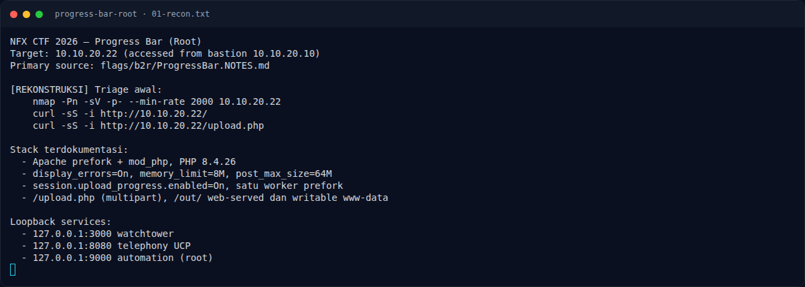

# Progress Bar (Root) — Recon

[← Overview](14-progress-bar-root.md) · [Index](index.md)

### 1.1 Deskripsi challenge

> Author: Ariaf
>
> Setelah mendapatkan akses user, lanjutkan enumerasi pada mesin target.
> Temukan jalur eskalasi yang tersisa, dapatkan akses root, lalu baca root.txt.
>
> Target: `10.10.20.22`

Challenge Root dimulai dari asumsi sudah punya akses user. Di lab ini akses
user didapat dari foothold `www-data` (challenge User), lalu enumerasi lokal
menemukan jalur ke root.

### 1.2 File / service yang diberikan

| File/Service | Ukuran/Endpoint | Keterangan |
|---|---|---|
| `NFX/b2r/labs/bastion` | TCP, dari platform | Pintu masuk peserta |
| `NFX/b2r/labs/22` | `10.10.20.22` | Target |
| `http://10.10.20.22/upload.php` | HTTP | Form upload multipart |
| `http://10.10.20.22/out/` | HTTP | Output web-served, writable www-data |
| `flags/b2r/ProgressBar.NOTES.md` | notes solve | Sumber langkah |

Tidak ada attachment; target berupa live container.

### 1.3 Environment

- Bastion `10.10.20.10`; target `10.10.20.22`.
- Tools: `nmap`, `curl`, `python3`, `php2shell`.
- Service loopback target:
  - `127.0.0.1:3000` — watchtower
  - `127.0.0.1:8080` — telephony UCP
  - `127.0.0.1:9000` — automation root

### 1.4 Triage awal

`[REKONSTRUKSI]`:

```bash
nmap -Pn -sV -p- --min-rate 2000 10.10.20.22
curl -sS -i http://10.10.20.22/
curl -sS -i http://10.10.20.22/upload.php
```

Hasil yang terdokumentasi:

```text
Apache prefork + mod_php
PHP 8.4.26
display_errors=On
memory_limit=8M
post_max_size=64M
session.upload_progress.enabled=On
satu worker prefork
/upload.php = form upload multipart
/out/ = web-served, writable www-data
```

### Evidence langkah ini



*Terminal evidence — `01-recon.txt` (arsip transkrip sesi solve).*
