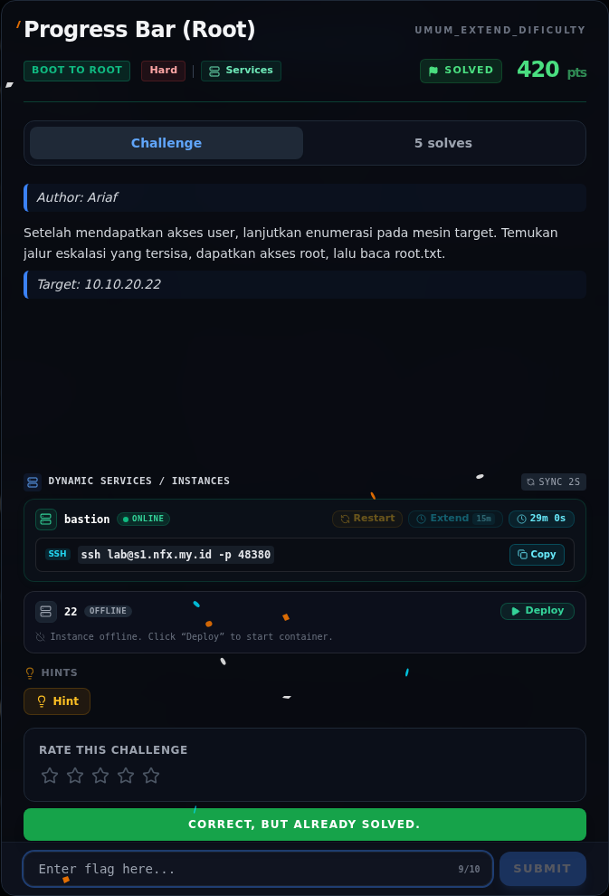

# Progress Bar (Root) — Flag & Verifikasi

[← Overview](14-progress-bar-root.md) · [Index](index.md)

> **Langkah 7/9 — Flag.** Verifikasi platform (submit log read-only, bukan submit baru):
>
> **Titik penting:** NFX{fr0m_w4tcht0w3r_c0nf1g_t0_r00t_3xp0rt_j0b}
>
> **Berikutnya:** [Bukti / Evidence](14-progress-bar-root-08-bukti-evidence.md)

> **Flag:** `NFX{fr0m_w4tcht0w3r_c0nf1g_t0_r00t_3xp0rt_j0b}`
> **Status:** `VERIFIED`

```text
NFX{fr0m_w4tcht0w3r_c0nf1g_t0_r00t_3xp0rt_j0b}
```

Verifikasi lokal:

```bash
sha256sum flags/b2r/ProgressBar_Root.txt
# dd3919ce557d7472fa51bcaaebefa18d4e5a493ea4578c2b3dfd0154a3a047af

wc -c flags/b2r/ProgressBar_Root.txt
# 47
```

Verifikasi platform (submit log read-only, bukan submit baru):

```json
{
  "id": "83e2d36a-3362-4bef-8748-0ecc03b41b4a",
  "title": "Progress Bar (Root)",
  "flag": "NFX{fr0m_w4tcht0w3r_c0nf1g_t0_r00t_3xp0rt_j0b}",
  "http": 200,
  "result": {"success": true, "message": "Correct! +500 points."}
}
```

Status: **verified platform**.

Sebagai konteks, user flag yang ikut terbaca adalah
`NFX{pr0gr3ss_b4r_qu3u3_st4g1ng_pwn3d_4s_www_d4t4}` (lihat writeup
`progress-bar-user.md` untuk catatan penolakan platform).

### Bukti submit di platform



*Submit flag di platform: `CORRECT, BUT ALREADY SOLVED.`*

> **Bukti submit:** screenshot form challenge di atas menampilkan `CORRECT, BUT ALREADY SOLVED.`
