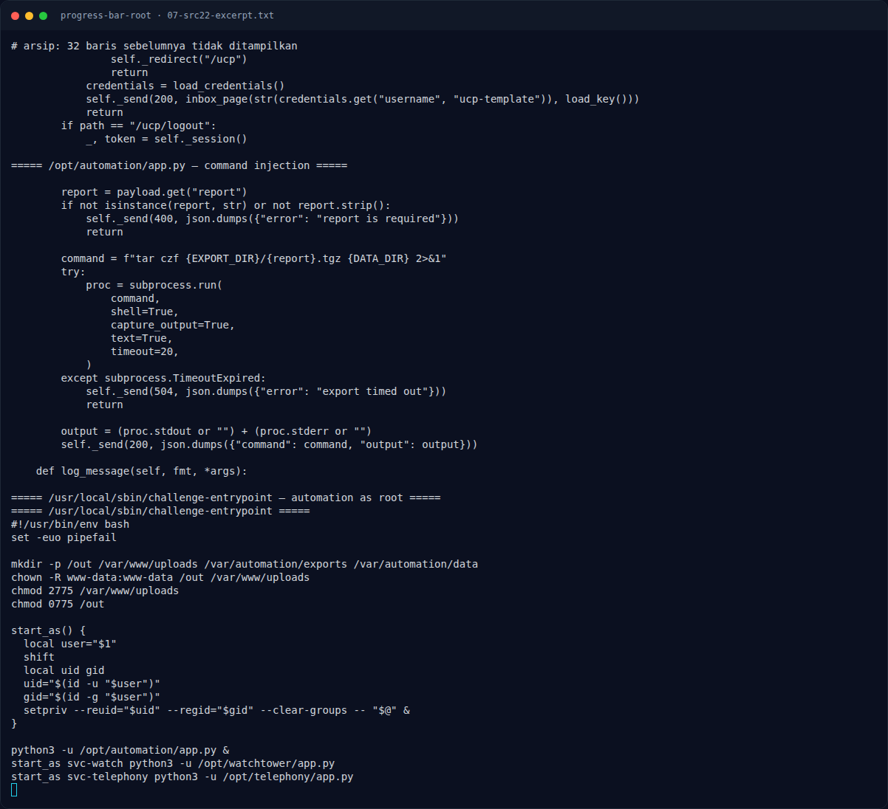

# Progress Bar (Root) — Referensi

[← Overview](14-progress-bar-root.md) · [Index](index.md)

- PHP advisory CVE-2026-109618 / CVE-2026-109619 (PHP2Shell), fixed
  8.4.27 / 8.5.12 / 8.3.36 / 8.2.35.
- 9bie / 3em0, `php2shell` — PoC dan penjelasan chain.
- Python `subprocess` documentation — risiko `shell=True`.
- OWASP: OS Command Injection; Credential Exposure; Least Privilege.

### Evidence langkah ini

*Terminal evidence — `07-src22-excerpt.txt` (arsip transkrip sesi solve).*

**Berkas mentah langkah ini:**

- [`07-src22-excerpt.txt`](assets/progress-bar-root/07-src22-excerpt.txt)
