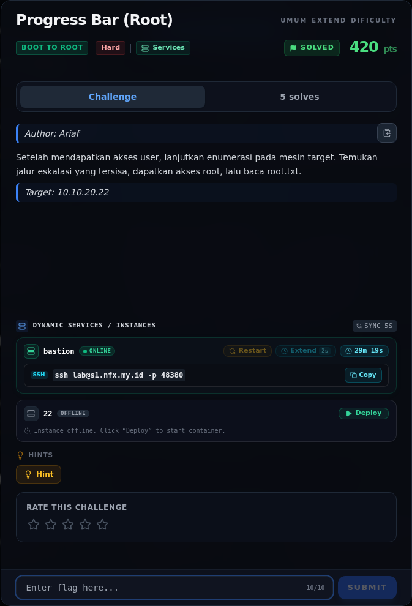
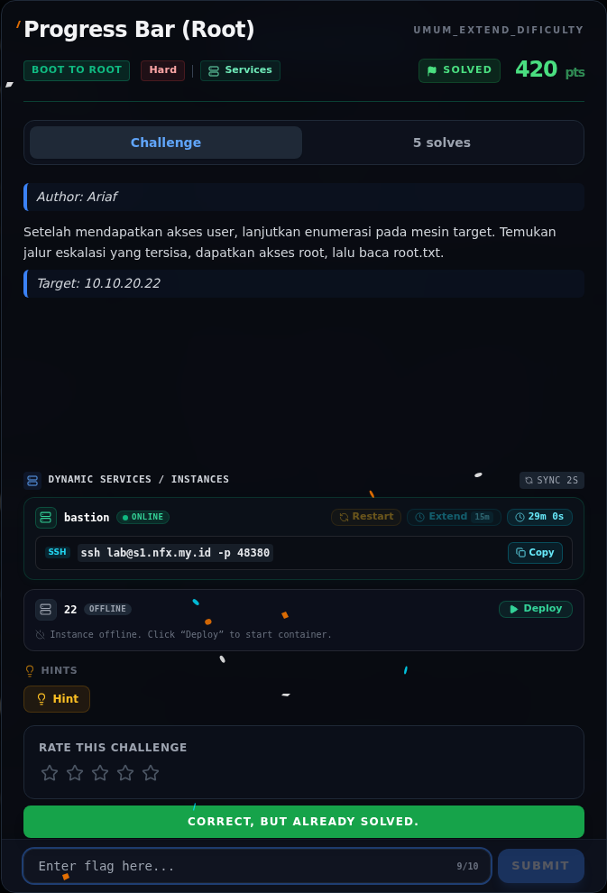

# Progress Bar (Root)

Track Umum / Extend · Boot To RootHard460 poinVERIFIED

| Field | Nilai |
|---|---|
| Event | `umum_Extend` |
| Kategori | `Boot To Root` |
| Difficulty | `Hard` |
| Poin | `460` |
| Author | `Ariaf` |
| Solves | `3` |
| Tools | nmap, curl, python3, sage |
| Flag | `NFX{fr0m_w4tcht0w3r_c0nf1g_t0_r00t_3xp0rt_j0b}` |
| Status | `VERIFIED` |

[← Kembali ke Index](index.md)

## Challenge Brief (platform)

*Challenge brief asli di platform NFX CTF 2026.*

## Cerita singkat

Jadi ceritanya gini. Target `10.10.20.22` adalah Apache prefork + mod_php **PHP 8.4.26** dengan `session.upload_progress` aktif, `memory_limit=8M`, `display_errors=On`, dan satu worker. Terus, PHP 8.4.26 rentan **CVE-2026-109618 (PHP2Shell)**. Chain 9bie/3em0 memakai OOM + dangling session pointer untuk membocorkan Zend MM chunk base dan libphp base via `Set-Cookie`, lalu memalsukan `HashTable` dengan `pDestructor = zif_system` → RCE sebagai `www-data`. Lalu, command RCE dibatasi 14 byte, jadi script enumerasi di-upload ke `/out/c` lewat `/upload.php` dan dijalankan dengan `sh</out/c`; hasilnya ditulis ke `/out/*.txt` yang web-served. Nah, dari situ kita bisa sampai ke flag dan bukti submit-nya.

## Alur & Titik Penting

| # | Langkah | Titik penting | Buka |
|---:|---|---|---|
| 1 | Recon | nmap -Pn -sV -p- --min-rate 2000 10.10.20.22 | [Buka](14-progress-bar-root-01-recon.md) |
| 2 | Foothold: PHP2Shell CVE-2026-109618 | session.uploadprogress membuat PHP memproses multipart session sebelum kode aplikasi. | [Buka](14-progress-bar-root-02-foothold-php2shell-cve-2026-109618.md) |
| 3 | Analisis | python3 -u /opt/automation/app.py & | [Buka](14-progress-bar-root-03-analisis.md) |
| 4 | Strategi | — | [Buka](14-progress-bar-root-04-strategi.md) |
| 5 | Langkah exploit | curl -sS -F 'PHP_SESSION_UPLOAD_PROGRESS=x' \ | [Buka](14-progress-bar-root-05-langkah-exploit.md) |
| 6 | Output | NFX{fr0m_w4tcht0w3r_c0nf1g_t0_r00t_3xp0rt_j0b} | [Buka](14-progress-bar-root-06-output.md) |
| 7 | Flag | NFX{fr0m_w4tcht0w3r_c0nf1g_t0_r00t_3xp0rt_j0b} | [Buka](14-progress-bar-root-07-flag.md) |
| 8 | Bukti / Evidence | arsip screenshot dan transkrip | [Buka](14-progress-bar-root-08-bukti-evidence.md) |
| 9 | Referensi | 8.4.27 / 8.5.12 / 8.3.36 / 8.2.35. | [Buka](14-progress-bar-root-09-referensi.md) |

## Ringkasan

> **Catatan bukti.** Sumber utama adalah
> `flags/b2r/ProgressBar.NOTES.md` dan source service yang tersimpan di
> `/tmp/opencode/src22.txt` (hasil enumerasi `/opt/*/app.py` dari target).
> Raw `nmap` dan stdout exploit tidak diarsipkan; langkah `[REKONSTRUKSI]`
> adalah rekonstruksi perintah dari temuan yang terdokumentasi, bukan output
> palsu. Flag dan hash dicek ulang terhadap `flags/b2r/`.
## TL;DR

- Target `10.10.20.22` adalah Apache prefork + mod_php **PHP 8.4.26** dengan
  `session.upload_progress` aktif, `memory_limit=8M`, `display_errors=On`, dan
  satu worker.
- PHP 8.4.26 rentan **CVE-2026-109618 (PHP2Shell)**. Chain 9bie/3em0 memakai
  OOM + dangling session pointer untuk membocorkan Zend MM chunk base dan
  libphp base via `Set-Cookie`, lalu memalsukan `HashTable` dengan
  `pDestructor = zif_system` → RCE sebagai `www-data`.
- Command RCE dibatasi 14 byte, jadi script enumerasi di-upload ke `/out/c`
  lewat `/upload.php` dan dijalankan dengan `sh</out/c`; hasilnya ditulis ke
  `/out/*.txt` yang web-served.
- Enumerasi `/opt` menemukan tiga service loopback: watchtower (config leak
  kredensial UCP), telephony (inbox berisi automation key), dan automation
  (berjalan sebagai **root**, memakai `shell=True`).
- Automation key `PB_AUTO_7b3f9a1c4e0d2f6a` + payload
  `x; id; echo ---CAT---; cat /root/root.txt ... #` memberi eksekusi root.
- Root flag: `NFX{fr0m_w4tcht0w3r_c0nf1g_t0_r00t_3xp0rt_j0b}`.

Pratinjau evidence. Buka halaman <a href="14-progress-bar-root-08-bukti-evidence.html">Evidence / Bukti</a> untuk semua screenshot dan transkrip.

## Navigasi Halaman

<a class="nx-page-card" href="14-progress-bar-root-01-recon.html"><b>Recon</b>Enumerasi target dan bukti awal</a>
<a class="nx-page-card" href="14-progress-bar-root-02-foothold-php2shell-cve-2026-109618.html"><b>Foothold: PHP2Shell CVE-2026-109618</b>Baca bagian ini</a>
<a class="nx-page-card" href="14-progress-bar-root-03-analisis.html"><b>Analisis</b>Membaca alur dan akar masalah</a>
<a class="nx-page-card" href="14-progress-bar-root-04-strategi.html"><b>Strategi</b>Baca bagian ini</a>
<a class="nx-page-card" href="14-progress-bar-root-05-langkah-exploit.html"><b>Langkah exploit</b>Baca bagian ini</a>
<a class="nx-page-card" href="14-progress-bar-root-06-output.html"><b>Output</b>Baca bagian ini</a>
<a class="nx-page-card" href="14-progress-bar-root-07-flag.html"><b>Flag</b>Flag dan verifikasi platform</a>
<a class="nx-page-card" href="14-progress-bar-root-08-bukti-evidence.html"><b>Bukti / Evidence</b>Screenshot, transkrip, dan artefak</a>
<a class="nx-page-card" href="14-progress-bar-root-09-referensi.html"><b>Referensi</b>Sumber dan bacaan lanjutan</a>

