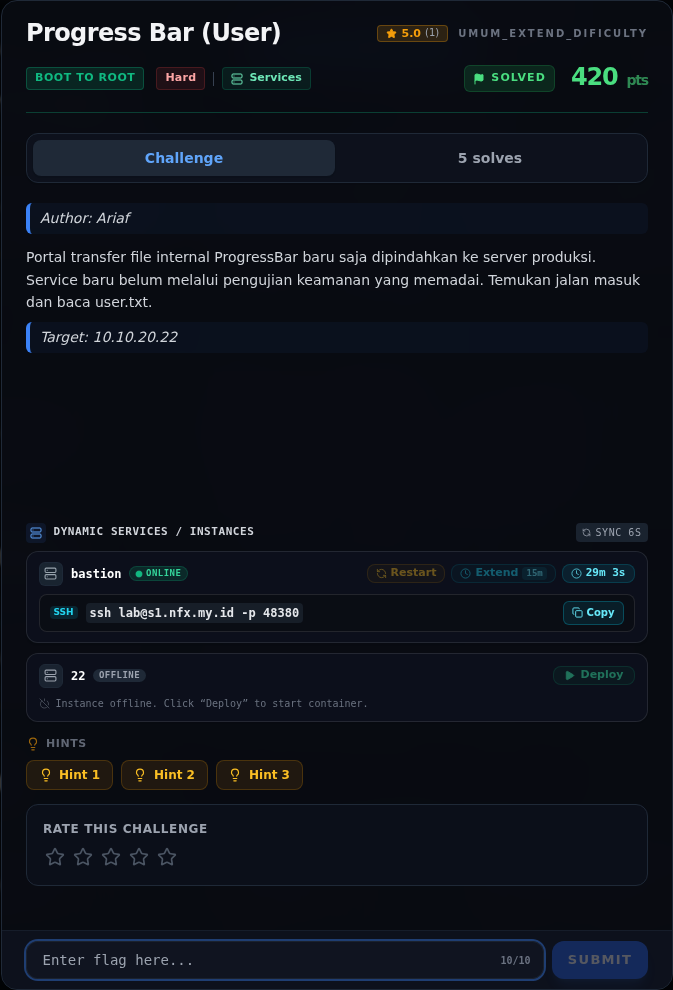
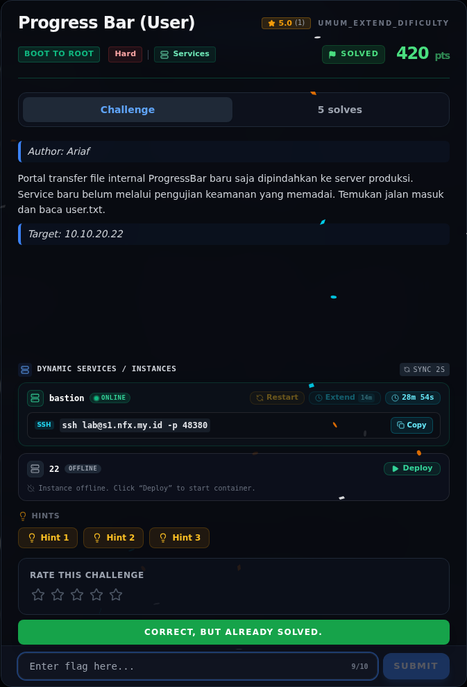

# Progress Bar (User)

Track Umum / Extend · Boot To RootHard460 poinVERIFIED

| Field | Nilai |
|---|---|
| Event | `umum_Extend` |
| Kategori | `Boot To Root` |
| Difficulty | `Hard` |
| Poin | `460` |
| Author | `Ariaf` |
| Solves | `3` |
| Tools | nmap, curl, python3 |
| Flag | `NFX{pr0gr3ss_b4r_qu3u3_st4g1ng_pwn3d_4s_www_d4t4}` |
| Status | `VERIFIED` |

[← Kembali ke Index](index.md)

## Challenge Brief (platform)

*Challenge brief asli di platform NFX CTF 2026.*

## Cerita singkat

Jadi ceritanya gini. Target `10.10.20.22` menjalankan Apache prefork + **mod_php PHP 8.4.26** dengan `display_errors=On`, `memory_limit=8M`, `post_max_size=64M`, dan `session.upload_progress.enabled=On`. Versi ini rentan **CVE-2026-109618** (PHP2Shell), fixed di 8.4.27. Terus, aplikasi mengekspos `/upload.php` (multipart upload) dan direktori `/out/` yang web-served serta writable oleh `www-data`. Lalu, chain PHP2Shell (9bie/3em0) memakai `PHP_SESSION_UPLOAD_PROGRESS` untuk memicu OOM, meninggalkan pointer session dangling, membocorkan Zend MM chunk base + libphp base lewat `Set-Cookie`, lalu memalsukan `HashTable` dengan `pDestructor = zif_system` → RCE sebagai `www-data`. Nah, dari situ kita bisa sampai ke flag dan bukti submit-nya.

## Alur & Titik Penting

| # | Langkah | Titik penting | Buka |
|---:|---|---|---|
| 1 | Recon | nmap -Pn -sV -p- --min-rate 2000 10.10.20.22 | [Buka](15-progress-bar-user-01-recon.md) |
| 2 | Permukaan upload dan `session.upload_progress` | PHP memiliki fitur session.uploadprogress: ketika sebuah multipart POST mengandung field PHPSESSIONUPLOADPROGRESS, PHP memproses progres upload dan session sebelum kode aplikasi (RINIT) dij… | [Buka](15-progress-bar-user-02-permukaan-upload-dan-session-upload-prog.md) |
| 3 | Analisis | CVE-2026-109618 adalah RCE via OOM corruption di PHP; fixed di 8.4.27 (8.5.12 / 8.3.36 / 8.2.35 untuk branch lain). | [Buka](15-progress-bar-user-03-analisis.md) |
| 4 | Analisis | Dari shell www-data, source service di /opt dibaca. | [Buka](15-progress-bar-user-04-analisis-2.md) |
| 5 | Strategi | — | [Buka](15-progress-bar-user-05-strategi.md) |
| 6 | Langkah exploit | curl -sS -F 'PHP_SESSION_UPLOAD_PROGRESS=x' \ | [Buka](15-progress-bar-user-06-langkah-exploit.md) |
| 7 | Output | NFX{fr0m_w4tcht0w3r_c0nf1g_t0_r00t_3xp0rt_j0b} | [Buka](15-progress-bar-user-07-output.md) |
| 8 | Flag | NFX{pr0gr3ss_b4r_qu3u3_st4g1ng_pwn3d_4s_www_d4t4} | [Buka](15-progress-bar-user-08-flag.md) |
| 9 | Bukti / Evidence | arsip screenshot dan transkrip | [Buka](15-progress-bar-user-09-bukti-evidence.md) |
| 10 | Referensi | 8.4.27 / 8.5.12 / 8.3.36 / 8.2.35. | [Buka](15-progress-bar-user-10-referensi.md) |

## Ringkasan

> **Catatan bukti.** Sumber utama adalah
> `flags/b2r/ProgressBar.NOTES.md`, source service yang tersimpan di
> `/tmp/opencode/src22.txt`, dan submit log read-only di `work/`. Raw output
> `nmap` dan stdout exploit tidak diarsipkan; langkah yang ditandai
> `[REKONSTRUKSI]` disusun dari temuan yang terdokumentasi, jadi bukan
> salinan transkrip mentah.
## TL;DR

- Target `10.10.20.22` menjalankan Apache prefork + **mod_php PHP 8.4.26**
  dengan `display_errors=On`, `memory_limit=8M`, `post_max_size=64M`, dan
  `session.upload_progress.enabled=On`. Versi ini rentan **CVE-2026-109618**
  (PHP2Shell), fixed di 8.4.27.
- Aplikasi mengekspos `/upload.php` (multipart upload) dan direktori `/out/`
  yang web-served serta writable oleh `www-data`.
- Chain PHP2Shell (9bie/3em0) memakai `PHP_SESSION_UPLOAD_PROGRESS` untuk
  memicu OOM, meninggalkan pointer session dangling, membocorkan Zend MM chunk
  base + libphp base lewat `Set-Cookie`, lalu memalsukan `HashTable` dengan
  `pDestructor = zif_system` → RCE sebagai `www-data`.
- Karena command dibatasi 14 byte, payload panjang di-upload sebagai script
  `/out/c` lewat form upload, lalu dijalankan dengan `sh</out/c`.
- `www-data` tidak bisa membaca `/home/deploy/user.txt` (mode 400,
  `deploy:deploy`, home 0711). Dari shell itu, enumerasi loopback menemukan
  kredensial UCP di watchtower, automation key di inbox voicemail, dan
  command injection `shell=True` di automation yang berjalan sebagai root.
- User flag dibaca sebagai root:
  `NFX{pr0gr3ss_b4r_qu3u3_st4g1ng_pwn3d_4s_www_d4t4}`.
- Nilai tersebut **byte-identik** dengan `user.txt` di target, tetapi platform
  menolaknya. Instance sudah di-redeploy dan dibaca ulang; hasilnya sama.

Pratinjau evidence. Buka halaman <a href="15-progress-bar-user-09-bukti-evidence.html">Evidence / Bukti</a> untuk semua screenshot dan transkrip.

## Navigasi Halaman

<a class="nx-page-card" href="15-progress-bar-user-01-recon.html"><b>Recon</b>Enumerasi target dan bukti awal</a>
<a class="nx-page-card" href="15-progress-bar-user-02-permukaan-upload-dan-session-upload-prog.html"><b>Permukaan upload dan `session.upload_progress`</b>Baca bagian ini</a>
<a class="nx-page-card" href="15-progress-bar-user-03-analisis.html"><b>Analisis</b>Membaca alur dan akar masalah</a>
<a class="nx-page-card" href="15-progress-bar-user-04-analisis-2.html"><b>Analisis</b>Membaca alur dan akar masalah</a>
<a class="nx-page-card" href="15-progress-bar-user-05-strategi.html"><b>Strategi</b>Baca bagian ini</a>
<a class="nx-page-card" href="15-progress-bar-user-06-langkah-exploit.html"><b>Langkah exploit</b>Baca bagian ini</a>
<a class="nx-page-card" href="15-progress-bar-user-07-output.html"><b>Output</b>Baca bagian ini</a>
<a class="nx-page-card" href="15-progress-bar-user-08-flag.html"><b>Flag</b>Flag dan verifikasi platform</a>
<a class="nx-page-card" href="15-progress-bar-user-09-bukti-evidence.html"><b>Bukti / Evidence</b>Screenshot, transkrip, dan artefak</a>
<a class="nx-page-card" href="15-progress-bar-user-10-referensi.html"><b>Referensi</b>Sumber dan bacaan lanjutan</a>

