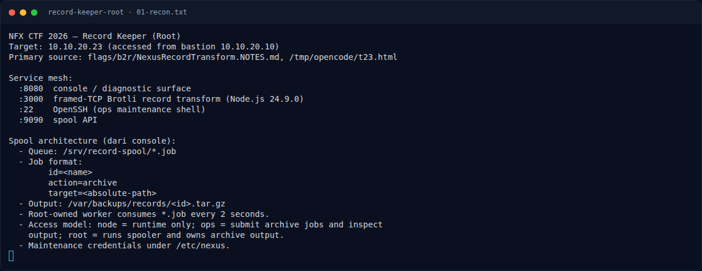

# Record Keeper (Root) — Recon

[← Overview](16-record-keeper-root.md) · [Index](index.md)

> **Langkah 1/10 — Recon.** Challenge Root melanjutkan akses node dari challenge User.
>
> **Titik penting:** 10.10.20.23 · 10.10.20.10
>
> **Berikutnya:** [Triage awal](16-record-keeper-root-02-triage-awal.md)

## 1.1 Deskripsi challenge

> Author: Ariaf
>
> Setelah mendapatkan akses user, lanjutkan enumerasi pada mesin target.
> Temukan jalur eskalasi yang tersisa, dapatkan akses root, lalu baca root.txt.
>
> Target: `10.10.20.23`

Challenge Root melanjutkan akses `node` dari challenge User. Fokusnya adalah
enumerasi lokal: sudo, wrapper archive, permission `/etc/nexus`, dan spooler
root.

## 1.2 File / service yang diberikan

| File/Service | Ukuran/Endpoint | Keterangan |
|---|---|---|
| `NFX/b2r/labs/bastion` | TCP, dari platform | Pintu masuk peserta |
| `NFX/b2r/labs/23` | `10.10.20.23` | Target |
| `:8080` | HTTP | Console / diagnostic surface |
| `:3000` | TCP | Framed Brotli record transform |
| `:22` | SSH | Ops maintenance shell |
| `:9090` | HTTP | Spool API |
| `/srv/record-spool` | Direktori | Queue job, writable oleh group ops |
| `/var/backups/records` | Direktori | Output arsip milik root |
| `flags/b2r/NexusRecordTransform.NOTES.md` | notes solve | Sumber langkah |

## 1.3 Environment

- Bastion `10.10.20.10`; target `10.10.20.23`.
- Shell awal: `node` dari exploit Node2Shell.
- Tools: `sudo`, `tar`, `cat`, `ls`, `nc`, `python3`.
- Group/permission penting: `node` bukan `ops`, tetapi punya sudo ke wrapper
  yang berjalan sebagai `ops`.

### Evidence langkah ini

*Terminal evidence — `01-recon.txt` (arsip transkrip sesi solve).*

**Berkas mentah langkah ini:**

- [`01-recon.txt`](assets/record-keeper-root/01-recon.txt)
