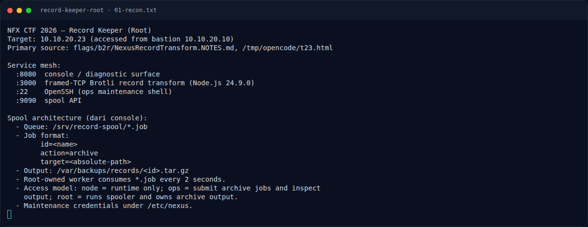
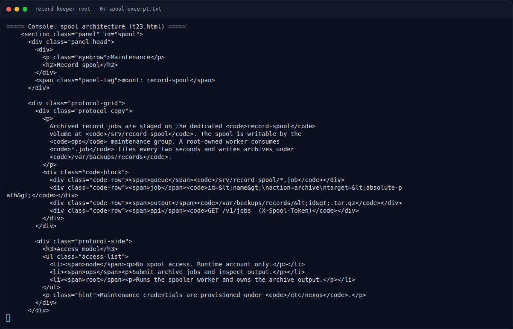

# Record Keeper (Root) — Triage awal

[← Overview](16-record-keeper-root.md) · [Index](index.md)

> **Langkah 2/10 — Triage awal.** [REKONSTRUKSI] Dari bastion:
>
> **Titik penting:** nmap -Pn -sV -p- --min-rate 2000 10.10.20.23 · curl -sS http://10.10.20.23:8080/ · http://10.10.20.23:8080/
>
> **Berikutnya:** [Analisis](16-record-keeper-root-03-analisis.md)

## 1.4 Triage awal

`[REKONSTRUKSI]` Dari bastion:

```bash
nmap -Pn -sV -p- --min-rate 2000 10.10.20.23
curl -sS http://10.10.20.23:8080/
printf '\x00\x00\x00\x00' | nc -w 3 10.10.20.23 3000
```

Service mesh yang terdokumentasi:

```text
:8080  console
:3000  framed-TCP Brotli record transform (Node.js 24.9.0)
:22    OpenSSH
:9090  spool API
```

Halaman console juga mendokumentasikan arsitektur spool:

```text
Queue   : /srv/record-spool/*.job
Job     : id=<name>
          action=archive
          target=<absolute-path>
Output  : /var/backups/records/<id>.tar.gz
Worker  : root-owned, consumes *.job every 2 seconds
Access  : node = runtime only
          ops  = submit archive jobs and inspect output
          root = runs spooler and owns archive output
```

### Evidence langkah ini



*Terminal evidence — `01-recon.txt` (arsip transkrip sesi solve).*



*Terminal evidence — `07-spool-excerpt.txt` (arsip transkrip sesi solve).*

**Berkas mentah langkah ini:**

- [`01-recon.txt`](assets/record-keeper-root/01-recon.txt)
- [`07-spool-excerpt.txt`](assets/record-keeper-root/07-spool-excerpt.txt)
