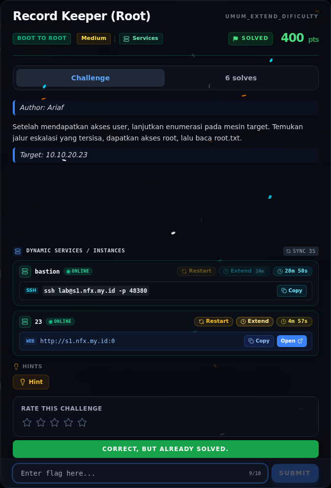
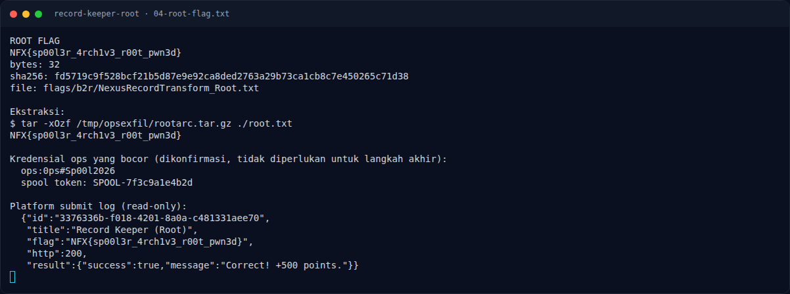

# Record Keeper (Root) — Flag & Verifikasi

[← Overview](16-record-keeper-root.md) · [Index](index.md)

> **Flag:** `NFX{sp00l3r_4rch1v3_r00t_pwn3d}`
> **Status:** `VERIFIED`

```text
NFX{sp00l3r_4rch1v3_r00t_pwn3d}
```

Verifikasi lokal:

```bash
sha256sum flags/b2r/NexusRecordTransform_Root.txt
# fd5719c9f528bcf21b5d87e9e92ca8ded2763a29b73ca1cb8c7e450265c71d38

wc -c flags/b2r/NexusRecordTransform_Root.txt
# 32
```

Verifikasi platform (submit log read-only, bukan submit baru):

```json
{
  "id": "3376336b-f018-4201-8a0a-c481331aee70",
  "title": "Record Keeper (Root)",
  "flag": "NFX{sp00l3r_4rch1v3_r00t_pwn3d}",
  "http": 200,
  "result": {"success": true, "message": "Correct! +500 points."}
}
```

Status: **verified platform**.

### Bukti submit di platform



*Submit flag di platform: `CORRECT, BUT ALREADY SOLVED.`*

### Evidence langkah ini



*Terminal evidence — `04-root-flag.txt` (arsip transkrip sesi solve).*

> **Verifikasi platform:** flag sudah diterima. Recheck 2026-11-09 mengembalikan `Correct, but already solved.`
