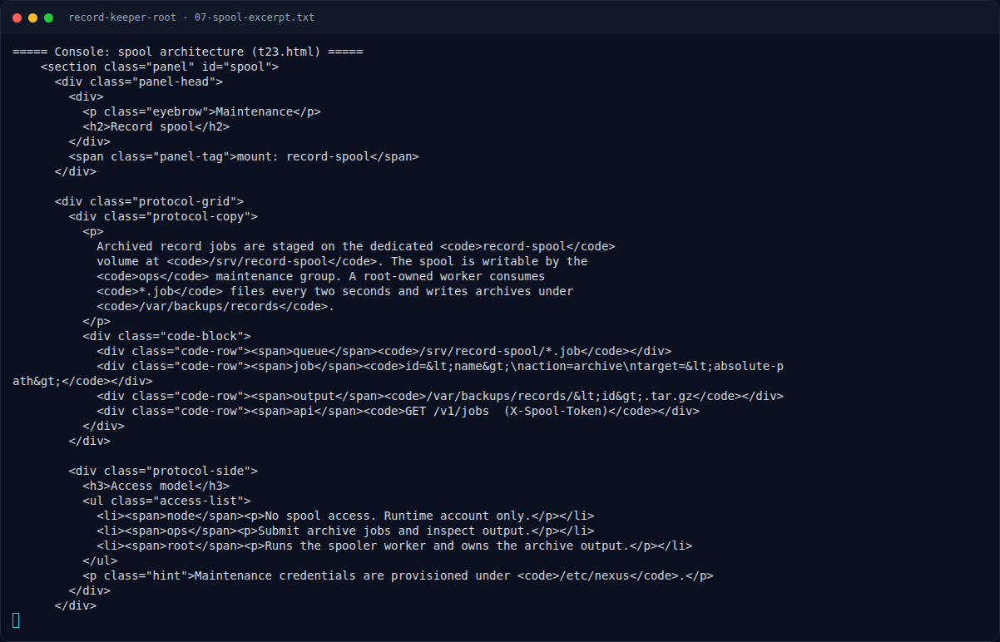

# Record Keeper (Root) — Referensi

[← Overview](16-record-keeper-root.md) · [Index](index.md)

- GNU tar manual — `--checkpoint`, `--checkpoint-action=exec=...`, dan
  pemisahan opsi dengan `--`.
- GTFOBins — `tar` sebagai jalur privilege escalation.
- Node.js 24.22.1 security release — CVE-2026-111497 (Brotli decoder).
- `Arkango/CVE-2026-111497` — exploit worker record transform.
- Prinsip least privilege untuk sudoers dan service spooler.

### Evidence langkah ini

*Terminal evidence — `07-spool-excerpt.txt` (arsip transkrip sesi solve).*

**Berkas mentah langkah ini:**

- [`07-spool-excerpt.txt`](assets/record-keeper-root/07-spool-excerpt.txt)
