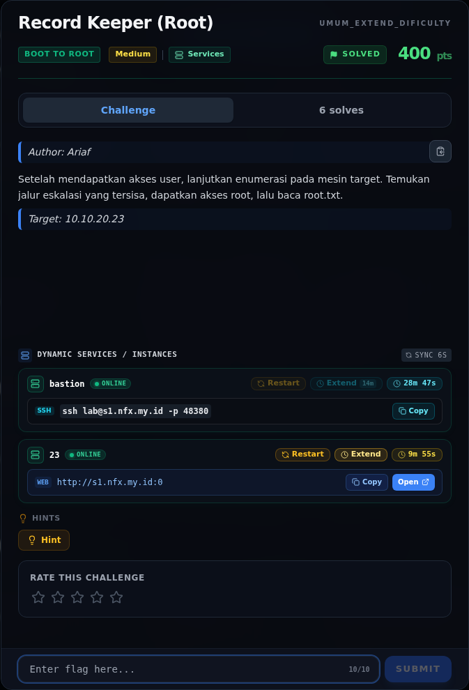
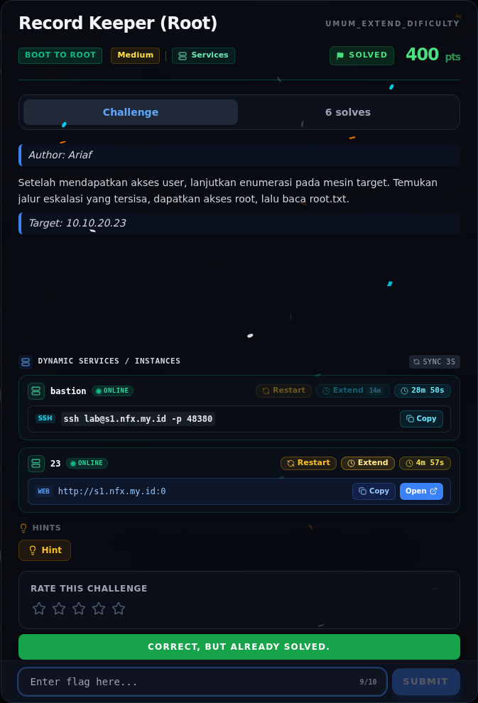

# Record Keeper (Root)

<div class="nx-challenge-head"><span class="nx-chip">Track Umum / Extend · Boot To Root</span><span class="nx-chip">Medium</span><span class="nx-chip">460 poin</span><span class="nx-badge nx-badge-verified">VERIFIED</span></div>


| Field | Nilai |
|---|---|
| Event | `umum_Extend` |
| Kategori | `Boot To Root` |
| Difficulty | `Medium` |
| Poin | `460` |
| Author | `Ariaf` |
| Solves | `3` |
| Tools | nmap, curl, python3, sage |
| Flag | `NFX{sp00l3r_4rch1v3_r00t_pwn3d}` |
| Status | `VERIFIED` |

[← Kembali ke Index](index.md)

## Challenge Brief (platform)



*Challenge brief asli di platform NFX CTF 2026.*

## Cerita singkat

Jadi ceritanya gini. foothold dimulai dari RCE **CVE-2026-111497 (Node2Shell)** di service `:3000`, memberi shell sebagai `uid=1000(node)`. Terus, `sudo -n -l` mengizinkan `(ops) NOPASSWD: /usr/local/bin/record-archive`. Lalu, `record-archive` menjalankan `cd "$target"; tar -czf "$out" *` sebagai `ops`. Karena `tar` membaca nama file yang diawali `--` sebagai opsi, isi direktori target bisa menyuntikkan opsi `tar`. Nah, dari situ kita bisa sampai ke flag dan bukti submit-nya.

## Alur & Titik Penting

| # | Langkah | Titik penting | Buka |
|---:|---|---|---|
| 1 | Recon | 10.10.20.23 | [Buka](16-record-keeper-root-01-recon.md) |
| 2 | Triage awal | nmap -Pn -sV -p- --min-rate 2000 10.10.20.23 | [Buka](16-record-keeper-root-02-triage-awal.md) |
| 3 | Analisis | python3 exploit/rce_worker.py --target 10.10.20.23 --port 3000 \ | [Buka](16-record-keeper-root-03-analisis.md) |
| 4 | Analisis | node tidak bisa membacanya, tetapi ops bisa. | [Buka](16-record-keeper-root-04-analisis-2.md) |
| 5 | Strategi | — | [Buka](16-record-keeper-root-05-strategi.md) |
| 6 | Langkah exploit | sudo -n -l | [Buka](16-record-keeper-root-06-langkah-exploit.md) |
| 7 | Output | tar -xOzf /tmp/opsexfil/rootarc.tar.gz ./root.txt | [Buka](16-record-keeper-root-07-output.md) |
| 8 | Flag | NFX{sp00l3r_4rch1v3_r00t_pwn3d} | [Buka](16-record-keeper-root-08-flag.md) |
| 9 | Bukti / Evidence | arsip screenshot dan transkrip | [Buka](16-record-keeper-root-09-bukti-evidence.md) |
| 10 | Referensi | pemisahan opsi dengan --. | [Buka](16-record-keeper-root-10-referensi.md) |

## Ringkasan

> **Catatan bukti.** Sumber utama adalah
> `flags/b2r/NexusRecordTransform.NOTES.md` dan halaman console target
> `/tmp/opencode/t23.html`. Script eksploitasi tar di §3.2 ditandai
> `[REKONSTRUKSI]`: notes mencatat aksi dan command intinya, tetapi isi script
> lengkap tidak tersimpan. Output yang dikutip (root flag, hash, submit log)
> berasal dari notes dan file flag lokal.
## TL;DR

- Foothold dimulai dari RCE **CVE-2026-111497 (Node2Shell)** di service
  `:3000`, memberi shell sebagai `uid=1000(node)`.
- `sudo -n -l` mengizinkan `(ops) NOPASSWD: /usr/local/bin/record-archive`.
- `record-archive` menjalankan `cd "$target"; tar -czf "$out" *` sebagai
  `ops`. Karena `tar` membaca nama file yang diawali `--` sebagai opsi, isi
  direktori target bisa menyuntikkan opsi `tar`.
- Payload `--checkpoint=1` + `--checkpoint-action=exec=sh x` membuat GNU tar
  mengeksekusi `sh x` sebagai `ops`.
- Script `x` (sebagai `ops`) membaca `/etc/nexus/ops.creds` +
  `/etc/nexus/spool.token`, lalu menulis job
  `id=rootarc / action=archive / target=/root` ke `/srv/record-spool/`.
- Root-owned spooler memproses job setiap 2 detik dan mengarsipkan `/root`
  ke `/var/backups/records/rootarc.tar.gz`. Arsip disalin keluar dan
  diekstrak:

  ```bash
  tar -xOzf /tmp/opsexfil/rootarc.tar.gz ./root.txt
  # NFX{sp00l3r_4rch1v3_r00t_pwn3d}
  ```

<div class="nx-evidence-preview"><a href="16-record-keeper-root-09-bukti-evidence.html"></a><span>Pratinjau evidence. Buka halaman <a href="16-record-keeper-root-09-bukti-evidence.html">Evidence / Bukti</a> untuk semua screenshot dan transkrip.</span></div>

## Navigasi Halaman

<div class="nx-page-grid">
<a class="nx-page-card" href="16-record-keeper-root-01-recon.html"><b>Recon</b><span>Enumerasi target dan bukti awal</span></a>
<a class="nx-page-card" href="16-record-keeper-root-02-triage-awal.html"><b>Triage awal</b><span>Baca bagian ini</span></a>
<a class="nx-page-card" href="16-record-keeper-root-03-analisis.html"><b>Analisis</b><span>Membaca alur dan akar masalah</span></a>
<a class="nx-page-card" href="16-record-keeper-root-04-analisis-2.html"><b>Analisis</b><span>Membaca alur dan akar masalah</span></a>
<a class="nx-page-card" href="16-record-keeper-root-05-strategi.html"><b>Strategi</b><span>Baca bagian ini</span></a>
<a class="nx-page-card" href="16-record-keeper-root-06-langkah-exploit.html"><b>Langkah exploit</b><span>Baca bagian ini</span></a>
<a class="nx-page-card" href="16-record-keeper-root-07-output.html"><b>Output</b><span>Baca bagian ini</span></a>
<a class="nx-page-card" href="16-record-keeper-root-08-flag.html"><b>Flag</b><span>Flag dan verifikasi platform</span></a>
<a class="nx-page-card" href="16-record-keeper-root-09-bukti-evidence.html"><b>Bukti / Evidence</b><span>Screenshot, transkrip, dan artefak</span></a>
<a class="nx-page-card" href="16-record-keeper-root-10-referensi.html"><b>Referensi</b><span>Sumber dan bacaan lanjutan</span></a>
</div>
