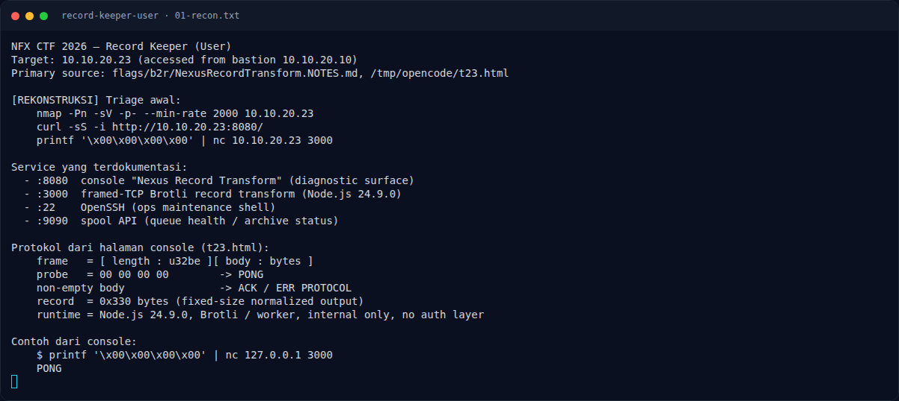

# Record Keeper (User) — Recon

[← Overview](17-record-keeper-user.md) · [Index](index.md)

### 1.1 Deskripsi challenge

> Author: Ariaf
>
> Tim platform merilis service internal `record-transform` berbasis Node.js.
> Service baru ini belum melalui pengujian keamanan yang memadai. Temukan jalan
> masuk dan baca `user.txt`.
>
> Target: `10.10.20.23`

Fokus challenge User adalah mendapatkan code execution pada service
`record-transform` dan membaca `/home/node/user.txt`.

### 1.2 File / service yang diberikan

| File/Service | Ukuran/Endpoint | Keterangan |
|---|---|---|
| `NFX/b2r/labs/bastion` | TCP, dari platform | Pintu masuk peserta |
| `NFX/b2r/labs/23` | `10.10.20.23` | Target |
| `:8080` | HTTP | Console / diagnostic surface |
| `:3000` | TCP | Framed Brotli record transform |
| `:22` | SSH | Ops maintenance shell |
| `:9090` | HTTP | Spool API / queue health |
| `flags/b2r/NexusRecordTransform.NOTES.md` | notes solve | Sumber langkah |

Tidak ada attachment binary. Target berupa live container.

### 1.3 Environment

- Bastion `10.10.20.10`; target `10.10.20.23`.
- Tools: `nmap`, `curl`, `nc`, `python3`, `brotli` (Python module),
  `git`, dan exploit `Arkango/CVE-2026-111497`.
- Shell balik memakai `/dev/tcp` bash ke `10.10.20.10:4445`.
- Callback listener exploit memakai port `4444` (bukan port shell).

### 1.4 Triage awal

`[REKONSTRUKSI]` Perintah awal:

```bash
nmap -Pn -sV -p- --min-rate 2000 10.10.20.23
curl -sS -i http://10.10.20.23:8080/
printf '\x00\x00\x00\x00' | nc -w 3 10.10.20.23 3000
```

Service yang terdokumentasi:

```text
:8080  console "Nexus Record Transform"
:3000  framed-TCP Brotli record transform (Node.js 24.9.0)
:22    OpenSSH
:9090  spool API
```

Halaman console menyatakan:

```text
Runtime    : Node.js 24.9.0
Transport  : Framed TCP
Endpoint   : 10.10.20.23:3000
Decoder    : Brotli / worker
Record size: 0x330 bytes
Mode       : Internal only, no public authentication layer
```

Contoh health probe dari console:

```text
$ printf '\x00\x00\x00\x00' | nc 127.0.0.1 3000
PONG
```

### Evidence langkah ini



*Terminal evidence — `01-recon.txt` (arsip transkrip sesi solve).*
